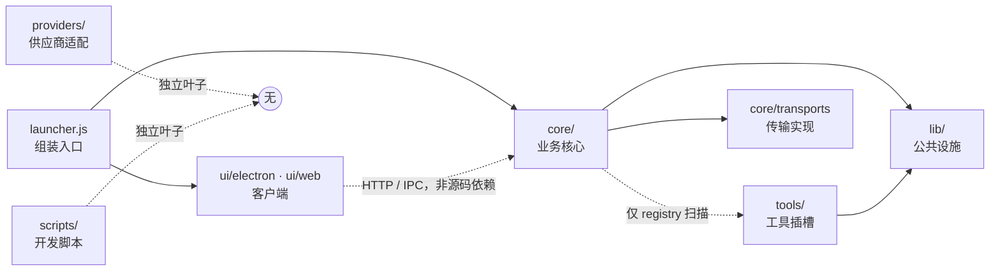

# arch

项目架构约定与公共层说明。

规则的可执行形态在 `scripts/graph/arch-rules.json`，由 `node scripts/graph/scan.js`（或 `pnpm graph`）求值；本文档是该规则集的设计依据。改动分层边界时，两处同步。

## 1 分层约定

### 1.1 层次与依赖方向

依赖方向严格单向，箭头表示「可以依赖」：



| 层 | 职责 | 可以依赖 | 禁止依赖 |
|---|---|---|---|
| `lib/` | 与宿主无关的公共设施：纯函数、无状态工具、进程内共享访问器 | 仅 Node 内置与第三方包 | `core/`、`tools/`、`ui/`、`providers/`、`scripts/` |
| `core/` | 业务核心：会话、agent 实例与输入队列、循环、上下文、模型通信、存储、RPC、节点图执行 | `lib/`、Node 内置与第三方包；经 registry 扫描加载 `tools/` | `ui/`、`providers/`；除 `core/tools/registry.js` 外不直接依赖 `tools/` |
| `tools/` | 可替换的工具插槽实现，通过 `registry.json` + `run.js` 被扫描加载 | `lib/`、Node 内置与第三方包；运行期经 `exec.capabilities` 拿到 core 声明的能力实现 | `core/`（源码级）、`ui/`、`providers/`、`scripts/` |
| `launcher.js` | 组装入口：选 UI、起 transport | `core/`、`ui/electron`（经 `UIS` 注册表） | `tools/`、`providers/` |
| `ui/electron` · `ui/web` | 客户端外壳与渲染；只呈现，不承载业务 | 客户端内部、浏览器 API、`ui/web/vendor` | `core/`、`tools/`；与 core 的通信只走 transport |
| `providers/` | 供应商适配叶子 | Node 内置与第三方包 | 其余全部应用层 |
| `scripts/` | 开发脚本（图谱扫描、架构检查） | Node 内置与第三方包 | `core/`、`tools/`、`ui/`、`providers/` |

### 1.2 层内边界

- **core 子域不互相窥探实现。** 跨子域只调用对方 `index.js` 的导出；不直接 `require` 对方内部文件（如不从 `core/loops` 直连 `core/context/messages.js`）。子域之间的既有耦合以 `arch-rules.json` 的 `no-static-cycles` 报告为依据，逐条收敛。
- **唯一允许 core → tools 的位置是 `core/tools/registry.js`。** 它扫描 `tools/*/registry.json` 并按声明加载入口，是插槽契约的实现处；其他任何 core 文件依赖 `tools/` 视为违规。
- **tools → core 的唯一通道是能力面。** 服务自报 `<domain>.<verb>` 能力标签，`core/capabilities.js` 合并成只读表；装配节点按工具 `registry.json` 的 `requires` 取出子集放进 `exec.capabilities`。工具代码只出现标签，不出现 core 服务类型名，也不 `require` core。新工具因此只需一个目录。
- **transport 是可替换实现，不是第三层。** HTTP / IPC 位于 `core/transports/`，经 `core/transport.js` 注册表选取。客户端不得假设某个 transport 存在。
- **ACP / A2A 是边缘适配器，不是新的运行时。** 两者都通过 `AgentRuntime.chat` 驱动同一套 session/turn，只把外部协议映射到内部概念；A2A 的 Task/Context 不反向侵入 `turns` / `messages` 语义（见 `docs/runtime/a2a.md`）。
- **浏览器是工具能力，不是新的循环。** `core/browser` 只拥有 Chromium 进程与按 `sessionId` 隔离的 `BrowserContext`；`browser_*` 工具通过 `exec.browser` 调用它，不把页面状态写入 `turns` / `messages`（见 `docs/runtime/browser.md`）。
- **client 与 core 的边界是消息，不是模块。** UI 通过 RPC 命令（`<domain>.<verb>`）与事件通道交互；渲染层不得 `require` core 模块，core 也不得引用 UI 文件或类型。

### 1.3 公共层的判据

一个模块进 `lib/` 需同时满足：

1. **无宿主依赖**：不 import `core/`、`tools/`、`ui/` 中任何模块。
2. **被两个以上层次使用**，或虽单层使用但语义上属于对外契约（如工具结果整形）。
3. **状态归属清晰**：有状态模块必须说明其生命周期由谁驱动、键是什么、何时释放。

不满足第 1 条的一律留在原层；不满足第 2 条的不提前下沉（避免为将来预留空层）。

### 1.4 状态归属

- 进程内共享状态（读前写观察表、todo 投影、技能注册表引用）以 `sessionId` 为键，`null` / `""` 统一映射到 `__bare__`。
- 有状态模块必须导出重置入口，且重置时机由 core 的 turn 生命周期驱动，不由写入方自行决定。
- 状态不落库；持久化走 `core/storage` 的事件溯源。

### 1.5 规则执行方式

- `scripts/graph/arch-rules.json` 是规则唯一可执行来源，severity 为 `error` 的违规使 `scan.js` 以非零码退出。
- 新增或调整边界时先改本文档，再改 `arch-rules.json`；两者不一致时以本文档为准并立即修正规则文件。
- 检查只读：不自动修复、不自动改写源码。

### 1.6 模块扩展名

- `launcher.js`、`lib/`、`core/`、`tools/`、`providers/`、`scripts/` 与 `ui/` 的源码一律使用 `.js`。根 `package.json` 声明 `"type": "module"`，`.js` 即 ESM，不再需要 `.mjs` 这种"单文件强制 ESM"的历史写法。
- 唯一例外：`ui/electron/preload.cjs`。preload 脚本运行在渲染进程的受限上下文，必须能按 CommonJS 加载；在 `"type": "module"` 下把它叫 `.js` 会被当作 ESM 解析并启动失败。这是平台约束，不是风格选择，不要"统一"掉它。
- 相对引用必须写全扩展名（`"./store.js"`，不能 `"./store"`）：ESM 不做扩展名补全。因此改扩展名是一次全图手术，引用点必须同批修改。
- 新增文件不得使用 `.mjs`；若确有需要按非本节默认方式解析的模块，先在本文档增补理由再落地。

## 2 公共层

### 2.1 组成

```
lib/
├── paths/             项目根定位（PROJECT_ROOT）
├── tool-result/       结果整形、截尾、spill（SPILL_ROOT 由 paths 派生）
├── fs-observe/        读前写观察与版本 CAS
├── shell-env/         托管 DSH_* 环境
├── skill-content/     技能内容渲染与转义
├── skill-policy/      名称校验（names.js）与可调用性判定（policy.js）
├── skill-instance/    活跃技能注册表访问器
├── workflow-runtime/  workflow 脚本机制：meta 校验、钩子、并发槽、返回值物化（子代理以 childPort 注入）
└── todo-state/        turn 内 todo 投影的存取原语
```

每个子目录以 `index.js` 为入口。`lib/README.md` 记载各目录职责与准入判据。

### 2.2 归属划分

**整体位于 lib（无宿主语义）**：`tool-result`、`fs-observe`、`shell-env`。

**公共部分位于 lib，子系统主体留在 core**：

- `skill-content` 与 `skill-policy` 是从技能子系统抽出的纯函数。core 的技能子系统（`core/skills/registry.js`、`filesystem.js`）负责 provider 合并、发现与缓存失效，留在 core；渲染与判定两侧共用 lib 的同一份实现，保证模型看到的 `<skill_content>` 只有一种形状。
- `skill-instance` 是进程内活跃注册表的访问器：`core/index.js` 在启动时 `setSkillsRegistry`，`skill` 工具经 `getSkillsRegistry` 读取。装配时序由 core 负责，不可颠倒。

**机制在 lib、策略在 core**：

- `todo-state` 只提供按 `sessionId` 的存取与重置原语。重置时机由 core 的 turn-start 节点调用 `reset()` 决定，`todo_write` 工具调用 `set()`。lib 不承载「何时重置」的语义。
- `workflow-runtime` 只提供脚本机制：`meta` 校验、脚本编译与执行、六个钩子、并发槽、返回值物化。子代理经注入的 `childPort` 交给它；`core/workflow` 负责把子代理委派适配成 `childPort`、管理 run 与取消、发领域事件，`tools/workflow` 负责模型侧参数与渲染。

### 2.3 绝对路径

需要绝对路径的公共设施统一经 `lib/paths` 的 `PROJECT_ROOT` 派生，不依赖模块自身 `__dirname` 的深度。`tool-result` 的 spill 目录由此定位到项目根下的 `tmp/tool-output`。

### 2.4 边界检查

`arch-rules.json` 中的规则保证上述划分不被侵蚀：

- `lib-is-a-leaf`：`lib/` 不得依赖任何应用层。
- `tools-no-core-internals`：`tools/` 不得依赖 `core/`，无文件级豁免。
- `core-tools-only-via-registry`：`core/` 只经 `core/tools/registry.js` 加载 `tools/`。
- `tools-only-via-capabilities`：`tools/` 只经 `exec.capabilities` 访问业务能力，不出现 core 服务类型名。

当前求值结果为零违规；任何一条规则出现违规都会使 `pnpm graph` 以非零码退出。

## 3 插槽：账号接入

账号接入 = **一个已认证的外部账号绑定**。它由平台签发的钥匙类型分成两个插槽，判据只有一条：**谁的身份在执行**。

| 钥匙 | 换取方式 | 代表 | 插槽 | 触发 |
|---|---|---|---|---|
| `tenant_access_token` | `app_id` + `app_secret` | 机器人 | channel | 平台推事件 |
| `user_access_token` | OAuth 同意授权 / 本地已登录 CLI | 自然人 | proxy | 模型在 turn 内调用 |

同一个自建应用可同时签发两套 token，但契约不可混用：channel 不以人的身份写文档，proxy 不订阅群事件。

### 3.1 与 host / presenter 的分界

| 角色 | 职责 | 拥有 core 生命周期 | 现状 |
|---|---|---|---|
| host | 启动、监督、退出时收拾 | 是 | `launcher.js` |
| presenter | 渲染事件流与本地交互 | 否，依附 host | Electron renderer、`ui/web` |
| channel | 外部事件入站、外部消息出站 | 否，独立生灭、可远程 | `channels/` |
| proxy | 以某人身份执行一次动作 | 否，按需 | `proxies/` |

前三者与 proxy 不得互相冒充实现同一个契约。channel 的契约以外部平台约束为蓝本（ack 时限、事件重投、多用户、发送配额），host 与 presenter 没有这些约束，proxy 也没有入站事件——强行合并会把约束稀释成可选。

### 3.2 形态

插槽的单位是驱动（`<slot>/<type>/index.js`），配置的单位是实例（`user/<slot>.json` 的一条）。同一驱动可接多个账号。

两类账号共用一层基础 `accounts/`，只做四件事：凭据生命周期（`auth/`）、错误分类（`errors.js`）、出站节奏与分段（`outbound/`）、驱动发现与实例配置（`registry-kit.js`）。两个插槽各自只保留特有部分：

- `channels/`：入站幂等（`event_id`）、每会话串行、事件投影、能力画像（含 `ackDeadlineMs`）。会话按 `ch:<type>:<instanceId>:<conversationKey>` 三段隔离，两个实例不串话。
- `proxies/`：`whoami` + `scopes` + `call`。无入站、无常驻；`scopes` 是授权范围与模型侧能力边界的唯一真源。

不提供通用消息抽象——表达哪条消息、发成卡片还是文本，留在驱动。`channels/fake/` 与 `proxies/fake/` 是无凭据可跑的受约束假驱动，兼作测试基座；`channels/feishu/` 是第一个接真实平台的驱动，`proxies/lark/` 是 proxy 侧的第一个真实驱动。

### 3.3 约束

- `accounts-is-shared`：`accounts/` 是叶子，不得依赖 core / tools / providers / 客户端，也不得依赖它所服务的两个插槽。
- `channels-no-core-internals` / `proxies-no-core-internals`：两个插槽都只经 transport 的 `POST /api/call` 访问 core，且互不依赖。
- 插槽只从入口层进入 core：`launcher.js` 装配实例 → `createCore({ proxies })` → `core/capabilities.js` 包成 `exec.capabilities`。tools 只拿到 capability，不 import `proxies/`、`channels/`；core 也不 import 这两个目录。
- 凭据只存在于 `user/`，出了该目录视为泄漏；不得进日志与 `data/store.db`。
- 事件模式决定部署前提：`ws` 只需出网，`webhook` 必须有公网 HTTPS 入口。云沙箱只能承载前者。

设计与断言清单见 `docs/accounts/`（`accounts.md`、`channel.md`、`proxy.md`）。
