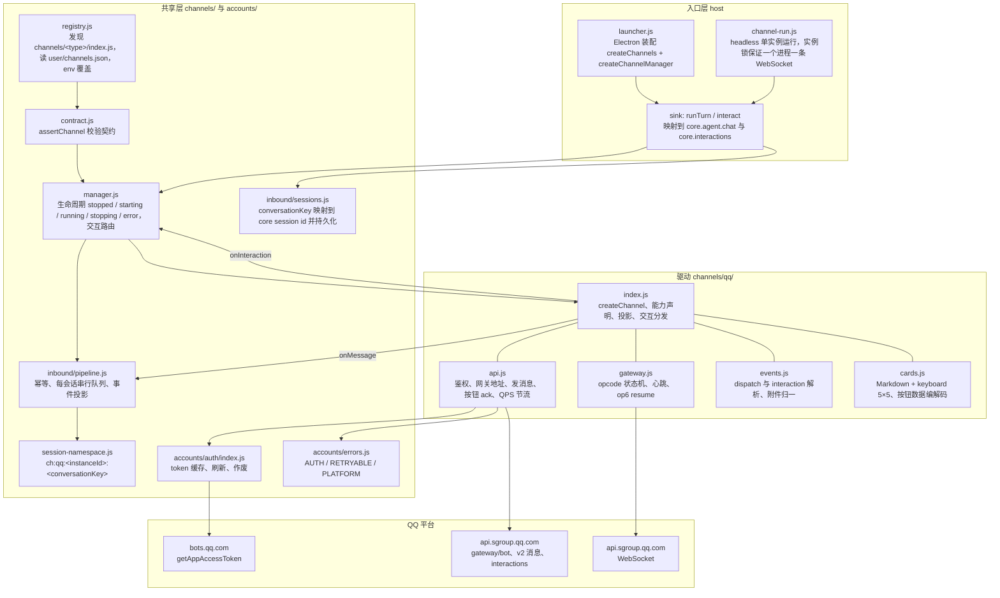
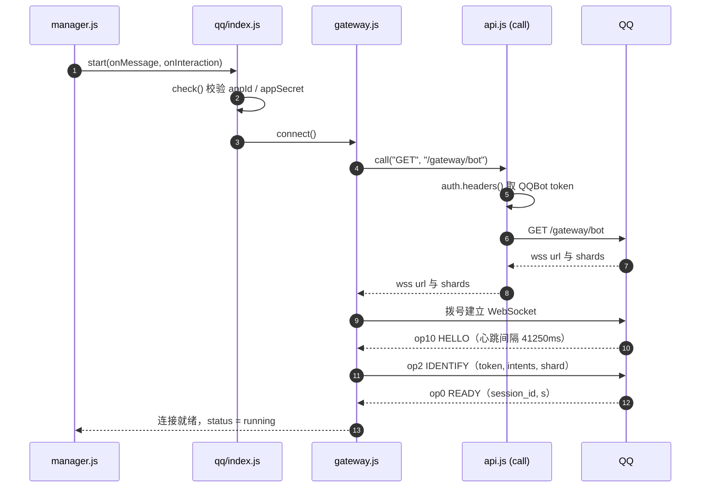
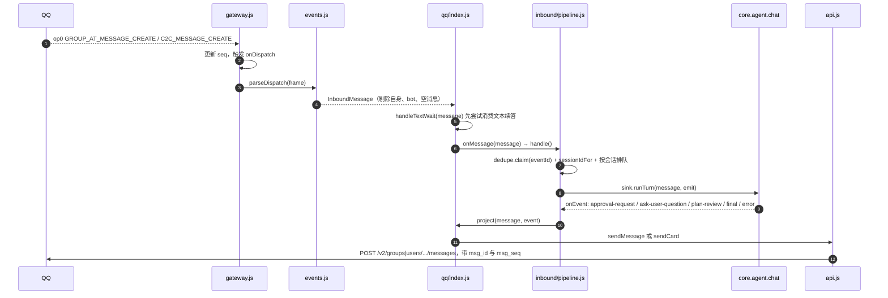
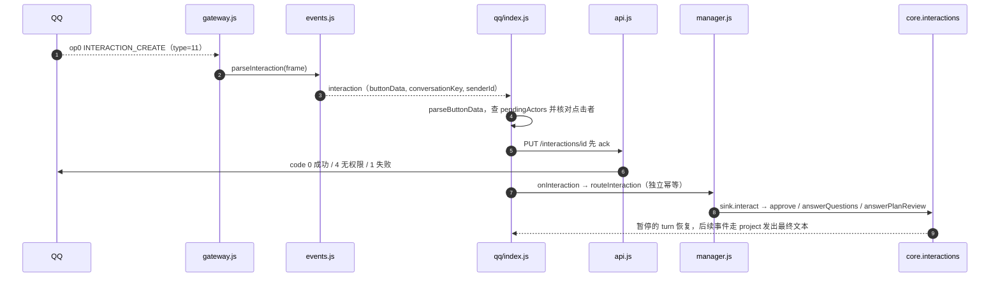

# QQ 机器人 channel 架构

QQ 官方机器人驱动（`channels/qq/`）。机器人身份由 `appId` + `appSecret` 换取有有效期的 `access_token`，事件经平台 WebSocket 下发，不需要公网入口。凭据轮换走共享层的 `createAppSecretTokenAuth`，`invalidate()` 在收到鉴权失败时真正生效。

## 分层位置

## 装配入口

`channels/registry.js:28` 按配置中的 `type: "qq"` 找到驱动目录，调用 `factory({ instance, deps })` 得到实例，再用 `assertChannel` 校验。凭据来自 `user/channels.json`，由 `CHANNEL_<ID>_<FIELD>` 环境变量覆盖；驱动只读注入的对象，不自行读盘。

`launcher.js:53` 在应用启动时构建全部通道但不自动连接——建立连接会让外部平台认为本机在线，这必须是显式请求。`launcher.js:65` 注入 sink：`runTurn` 把一条入站消息映射成一次 `core.agent.chat`，`interact` 把按钮回调交给 `core.interactions`。

`channel-run.js:97` 是无界面运行器：`data/channels/run-<id>.lock` 防止同一实例开第二条连接，这把锁与 UI 本地 `channel.start` 共用，是跨进程的原子锁（`lib/channel-lock.js`），不是内存标志；`--echo` 模式直接回显文本，不调用模型。

`manager.js:172` 的 `start()` 先拿实例锁，再执行 `channel.check()` 做启动前检查，缺凭据时抛出 `ChannelPreflightError` 并释放锁，不发起连接。消息经 `ensurePipeline()` 进入共享入站管道；按钮经 `routeInteraction()` 独立去重后直送 `sink.interact`，不进消息管道。独立 channel 服务没有本地 sink，按钮改发 `/interactions/subscribe`，core 侧用 `applyInteraction()` 回灌 `core.interactions`；审批卡、提问卡、计划审批卡由 `channel-listen` 在 turn 挂起时通过 `/proactive` 的 `event` 字段回传，callback 直接 `channel.project`，不发送文本、不 ACK。

## 驱动构成

| 文件 | 职责 |
|---|---|
| `channels/qq/index.js:42` | 装配 `auth` 与 `api`，声明能力，管理连接与四张状态表，实现 `check/start/project/stop/stats` |
| `channels/qq/gateway.js:36` | 网关地址获取、WebSocket opcode 协议、心跳、identify/resume、重连退避与统计 |
| `channels/qq/api.js:41` | appsecret 换 token，REST 调用与速率限制，HTTP 状态与 `err_code` 分类 |
| `channels/qq/events.js:22` | `GROUP_AT_MESSAGE_CREATE`、`GROUP_MESSAGE_CREATE`、`C2C_MESSAGE_CREATE` 转中性消息；附件归一 |
| `channels/qq/events.js:127` | `INTERACTION_CREATE` 转交互对象，只接受 `type=11` 的按钮回调 |
| `channels/qq/cards.js:51` | 审批卡、提问卡、计划审批卡的构造；`parseButtonData` 解码按钮载荷 |

## 能力画像

`index.js:72` 声明：

- `eventMode: "ws"`，`ackDeadlineMs: 5000`——socket 上无人等待 ack，这个值是名义上的。
- `streaming: false`——QQ 没有编辑机器人消息的接口，流式 token 事件被 `project()` 丢弃，一轮只发一次最终文本。
- `canPromptUser: true`——按钮可回传审批结果，入口层据此以 `supervised` 模式运行，权限门可以等人点击而不是自动拒绝。
- `canAttachFiles: true`，单条文本上限默认 4000 字节，出站默认 3 QPS。

`INTENTS` 由 `gateway.js:16` 定义：`GROUP_AND_C2C`（1<<25）接收群消息与私聊，`INTERACTION`（1<<26）接收按钮回调。缺少后者时卡片能发出但点击不会回传。

## 服务边界与鉴权

独立 channel 服务的 HTTP 面绑定 `127.0.0.1`，但回环不是身份边界：同用户进程可以读 SSE 或冒充机器人。所有端点（除 `/health`）要求共享 bearer token（`Authorization: Bearer <token>` 或 `x-channel-token`）；token 来自 `CHANNEL_SERVICE_TOKEN`，否则 `data/channels/service-token`（0600，原子创建）。core 启动时 `readServiceToken() || ensureServiceToken()`，与 channel 服务用同一个值。

`GET /health` 返回 `features`（`messages`、`interactions`、`proactive`、`auth`）、`authRequired` 和运行状态。`launcher` 启动时 probe；若服务尚未声明 `interactions`，每 30s 重试。一旦可用就调用 `enableInteractions()` 打开 SSE，之后的消息以 `supervised` 运行——服务晚于 core 启动不需要重启 core。

## 交互状态

`index.js:63` 维护四张表，全部是进程内状态，重启后未完成的交互不会恢复：

| 表 | 键 → 值 | 用途 |
|---|---|---|
| `pendingActors` | `a|q|p:<id>` → `{conversationKey, senderId}` | 记录谁有权点击某张卡 |
| `questionBatches` | `q:<id>` → `{questions, answers, needsWeb}` | 汇总多选问题的逐项回答 |
| `textWaits` | `conversationKey|senderId` → `{kind, id}` | 等待用户用文本回复自由问题或计划修改意见 |
| `replySeq` | `replyTo` → 回复次数 | 控制同一入站消息的 `msg_seq` 递增 |

## 运行流程

### 连接建立

断线时 `gateway.js:164` 的 close 处理器按固定延迟重连：有 `sessionId` 则发 op6 RESUME 并带上 `seq`，平台返回 `RESUMED` 即恢复；收到 op9 INVALID_SESSION 则清空会话状态并重新 IDENTIFY，统计计入 `reidentifies`。

### 文本消息

`pipeline.js:51` 的 `handle()` 同步返回，让驱动立刻完成平台侧确认；真正的 turn 在每会话单飞的队列里执行（`pipeline.js:83`）。`project()` 串行执行，审批卡能在 turn 挂起等待点击时就送达用户。

`events.js:32` 把附件描述内联进 `messages[].content`，模型无需理解平台字段；结构化副本保留在 `attachments` 中供下载。

### 按钮交互

按钮载荷由 `cards.js:120` 编解码，三种前缀：

- `qq:a:<id>:approve|deny`——工具审批。
- `qq:q:<id>:<questionId>:<index>`——单选问题的一个选项；多选、无选项或超过 5 个选项的问题转文本或在 Web 端完成。
- `qq:p:<id>:approve|reject|edit`——计划审批；`edit` 不删除 `pendingActors`，而是写入 `textWaits`，等待同一人下一条文本作为修改意见。

点击者与 `pendingActors` 记录的会话和发送者不一致时返回 code 4，群成员无法替他人审批。未知或本进程未发出的按钮返回 code 1/4，不会误触 core。

### 文本续答

`index.js:232` 在解析消息后先查 `textWaits`：命中则消费该条文本，构造对应的 `plan-review` 或 `question` 交互交给 `interactionHandler`，并返回 `true` 表示不再进入正常轮次。未命中才走 `onMessage`。

## 出站协议

`api.js:132` 的 `sendMessage` 根据 `recvType` 选择群或私聊端点，正文同时携带 `content` 与可选的 `markdown`、`keyboard`。

被动回复必须带收到消息的 `id` 作为 `msg_id`，否则计入主动推送配额。`index.js:93` 对同一入站消息递增 `msg_seq`；前 5 次回复携带 `msg_id`，超过 5 次后去掉 `msg_id`，让主动配额决定能否发出。

`api.js:73` 的 `call()` 按 `qps` 做发送间隔节流，并把响应分成三类：HTTP 401 或鉴权类 `err_code` 归 `AUTH`，429/5xx 与少量可重试 `err_code` 归 `RETRYABLE`，其余非 2xx 与业务错误码归 `PLATFORM`。QQ 在 200 响应体内用 `err_code` 报告业务失败，只检查 `response.ok` 会把「msg_id 过期」「无权限发送」误判为成功。

`api.js:41` 的 `createQqAuth` 用 `bots.qq.com` 换取 token，鉴权头格式为 `Authorization: QQBot <token>`。平台返回的 `expires_in` 是字符串，`createAppSecretTokenAuth` 按实际有效期提前换 token，避免等到 401 才刷新。

## 测试

`test/channels/qq/qq.test.js` 覆盖契约与能力声明、`check()` 缺凭据时不联网、鉴权头与 READY 解析、群 @ 一轮对话与被动回复携带 `msg_id`、自身消息与 bot 消息与空文本丢弃、断线后 op6 带 `session_id` 与 `seq`、token 过期重取、发送 401 归 `AUTH`、按钮数据往返、`INTERACTION_CREATE` 只认 `type=11`、先 ack 后路由、群成员不能替他人审批、单选问题一次点击即解析。
