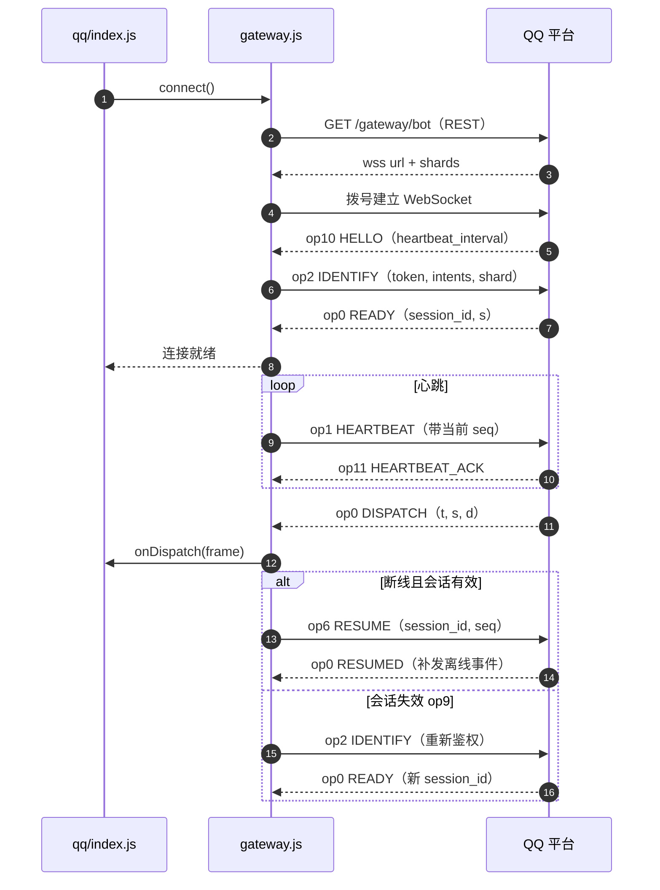

# QQ 机器人 channel 通信方式

通信分两个方向：入站由平台把事件送到机器人，出站由机器人调平台 REST。两者相互独立——入站连接断开不影响出站调用，出站也不占用入站 socket。

## 入站模式

`channels/contract.js:13` 的 `EVENT_MODES` 列出四种入站模式。`capabilities.eventMode` 由驱动声明，manager 在 `snapshot()` 中原样上报（`manager.js:86`）。

| 模式 | 连接方向 | 谁发起 | 部署前提 | 项目落地 |
|---|---|---|---|---|
| `ws` 长连接 | 机器人 → 平台 `wss` | 机器人拨号 | 只需出网 | QQ、飞书、云湖默认、fake |
| `webhook` 回调 | 平台 → 机器人 HTTPS 端点 | 平台 POST | 公网 HTTPS 入口与签名校验 | 云湖 `options.mode: "webhook"` |
| `reverse-ws` 反向连接 | 平台 → 机器人本地 ws | 平台作为客户端接入 | 同机或同网 | 契约声明，未落地 |
| `poll` 轮询 | 机器人 → 平台 REST | 机器人定时拉取 | 只需出网，延迟与配额代价 | 契约声明，未落地 |

`ws` 与 `webhook` 互斥：平台控制台选择哪种投递方式，驱动就只能收到哪种。云湖的两种模式在同一驱动内实现（`yunhu/index.js:38`），解析层共用同一个 `events.js`——socket 推送与 webhook 收到的是同一份信封（`yunhu/ws-client.js:15`）。飞书只实现 `ws`。

`ackDeadlineMs` 的真实性随模式变化：`webhook` 模式下平台等待回调响应，超时会重投；`ws` 模式下没有人在等 ack，这个值是名义上的。QQ 声明 5000ms（`index.js:74`），云湖也在 socket 模式下把它当作名义值（`yunhu/index.js:55-58`）。

## 平台双模式

QQ 开放平台提供 WebSocket 与 Webhook 两种入站方式，在管理端「事件与回调方式选择」中切换，切换后立刻生效。

| 方式 | 连接方向 | 部署前提 | 适用 |
|---|---|---|---|
| WebSocket | 机器人拨 `wss` 并维持长连接 | 只需出网 | 个人单机，不依赖公网服务器 |
| Webhook | 平台 POST 到开发者配置的 HTTPS 回调地址 | 端口限 80/443/8080/8443，需签名校验 | 公开服务，运维更可靠 |

协议层用 opcode 区分接入方式：op0 DISPATCH 两种模式都下发；op12 HTTP Callback ACK 与 op13 回调地址验证仅 Webhook 使用；op1、op2、op6、op7、op9、op10、op11 仅 WebSocket 使用。

当前代码只实现 WebSocket：`index.js:73` 把 `capabilities.eventMode` 固定为 `"ws"`，没有模式配置开关。管理端的投递方式必须与代码一致——若切换为 Webhook，驱动不会建立 HTTP 回调端点，机器人收不到任何事件。

参考资料：

- [Webhook 方式](https://bot.q.qq.com/wiki/develop/api-v2/dev-prepare/event-emit/webhook.html)
- [通用数据结构与 OpCode](https://bot.q.qq.com/wiki/develop/api-v2/dev-prepare/event-emit/payload.html)

## QQ 的选择

QQ 驱动走官方机器人 + WebSocket（`index.js:3-20`）。理由写在源码注释里：官方路线是合规的 bot 身份，WebSocket「不依赖公网服务器部署，适合个人单机使用」；OneBot 走个人号，有封号风险且要求常驻一个 QQ 客户端。

订阅范围在 IDENTIFY 时一次谈定，运行中不可改。`gateway.js:16` 定义两个 intent 位：

| intent | 值 | 作用 |
|---|---|---|
| `GROUP_AND_C2C` | `1 << 25` | 群 @ 消息、群全量消息（需群主授权）、私聊 |
| `INTERACTION` | `1 << 26` | 按钮回调 `INTERACTION_CREATE` |

驱动默认同时订阅两者（`index.js:296`）。缺少 `INTERACTION` 时卡片能发出但点击不会回传。

## 可靠性与风险

### 官方维护状态

BotGo SDK 的公告写明 WebSocket 事件推送链路在 2024 年底逐步下线、官方不再维护。官方文档站仍保留 WebSocket 方式页面（2026-07 更新），本项目也用真实 appid 实测过 token 交换、`GET /gateway/bot`、IDENTIFY 与 READY 全部成功（`index.js:13-15`）。两者描述的是同一件事的不同侧面：存量机器人仍能连接，但这是官方不再投入的方向，长期运行不应建立在它之上。

2025-04 起官方停止主动消息推送，群聊与单聊改为被动回复——回复须携带原消息 `msg_id` 且落在回复窗口内。这与本项目 `streaming: false` 和 `replyFields()` 的实现一致（`index.js:78-108`），属于同一轮能力收敛，不因入站模式而改变。

### 两种模式的故障面

| 层面 | WebSocket | Webhook |
|---|---|---|
| 事件补偿 | op6 RESUME 带 `seq` 补发离线事件，协议级保障 | 无会话续传，靠平台重推与事件 id 幂等 |
| 故障模式 | 长连接保活：NAT 老化、网络切换、心跳与 seq 状态、错误码分类 | 公网入口：证书过期、DNS 变更、反代配置、源站 5xx |
| 可观测性 | opcode 与错误码语义明确 | 依赖自身访问日志，平台侧报错信息有限 |

单看事件补偿机制，WebSocket 更完备；单看长期可持续性与日常运维，Webhook 更稳——它把风险从协议状态机转移到了可控的公网入口运维上。

没有公网入口时，本机直连的官方模式只有 WebSocket。若需要长期运行且能接受运维成本，可用 Cloudflare Tunnel 或 frp 取得公网 HTTPS 入口后切到 Webhook。切换前须在沙箱验证回调配置：确认后平台会停止 WebSocket 链路。

### 参考资料

- [BotGo SDK](https://github.com/tencent-connect/botgo)
- [WebSocket 方式](https://bot.q.qq.com/wiki/develop/api-v2/dev-prepare/event-emit/websocket.html)

## WebSocket 生命周期

`gateway.js` 实现的是平台 opcode 协议，不是裸文本 socket。`dial` 由 `deps.dial` 注入，默认是 `new WebSocket(url)`。

opcode 全集（`gateway.js:25-34`）：

| op | 名称 | 方向 | 说明 |
|---|---|---|---|
| 0 | DISPATCH | 平台 → 机器人 | 事件推送，带递增序号 `s` |
| 1 | HEARTBEAT | 机器人 → 平台 | 心跳，携带当前 `seq` |
| 2 | IDENTIFY | 机器人 → 平台 | 携带 token、intents、shard |
| 6 | RESUME | 机器人 → 平台 | 携带 `session_id` 与 `seq` 恢复订阅 |
| 7 | RECONNECT | 平台 → 机器人 | 要求重连，resume 仍可用 |
| 9 | INVALID_SESSION | 平台 → 机器人 | 会话失效，须清空后重新 IDENTIFY |
| 10 | HELLO | 平台 → 机器人 | 握手，带心跳间隔 |
| 11 | HEARTBEAT_ACK | 平台 → 机器人 | 心跳确认 |

`session_id` 和 `seq` 保存在 gateway 内部（`gateway.js:59-60`），不放在 driver 层——重连时只有这里持有恢复所需的状态。close 处理器按固定延迟重拨（`gateway.js:164-190`）：优先 RESUME，收到 op9 才清空状态重新 IDENTIFY，统计计入 `reidentifies`。

## 出站通信

出站不走 socket，全部是对 `api.sgroup.qq.com` 的 HTTPS 调用（`api.js:17`）：

| 端点 | 用途 |
|---|---|
| `GET /gateway/bot` | 取入站 socket 地址与分片数 |
| `POST /v2/groups/{id}/messages`、`POST /v2/users/{id}/messages` | 发消息或按钮卡 |
| `PUT /interactions/{id}` | 确认按钮回调 |

鉴权头由 `createQqAuth` 提供（`api.js:41`）：`Authorization: QQBot <access_token>`，token 由 `bots.qq.com` 用 appId/appSecret 换取，按平台返回的有效期提前刷新。`api.js:73` 的 `call()` 统一做 QPS 节流和错误分类，因此出站调用不依赖入站连接是否存活。

## 相关源码

| 文件 | 职责 |
|---|---|
| `channels/contract.js:13` | 四种入站模式的枚举与校验 |
| `channels/qq/index.js:296` | 订阅的 intents 组合 |
| `channels/qq/gateway.js:36` | 网关地址获取、opcode 状态机、心跳、resume、重连 |
| `channels/qq/api.js:67` | REST 调用、限流、错误分类 |
| `channels/yunhu/index.js:38` | 同一驱动内 ws 与 webhook 双模式 |
| `channels/feishu/transport.js:12` | 长连接的传输接缝，生产走官方 SDK |
