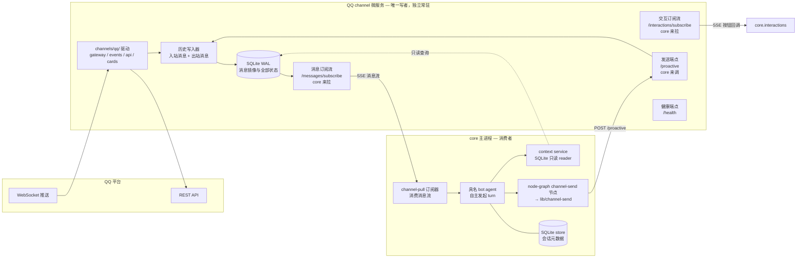

# QQ channel 微服务

> 公共运行时已抽到 `lib/channel-service/runtime.js`，QQ 与云湖试点共用；本文的进程模型、SQLite 写权与 core-pull 约束仍然适用，启动细节见 `docs/accounts/channels/channel-service.md`。

将 QQ 机器人 channel 拆成独立常驻服务。它只做三件事：收消息、存消息、接受发送调用。bot agent 在 core 里，由 core 主动订阅 channel 的消息流并发起 turn——core-pull 模型，channel 不依赖 core。

## 目标与边界

### 目标

把 QQ 消息的收发与存储从 agent 运行时里剥离。channel 服务独立常驻，core 不在时它照样收消息、去重、写库；core 启动后通过订阅拿到消息再处理。QQ 消息不进 core 的 store，只落在 channel 服务自己的 SQLite WAL 库。

### 服务边界

- 独立进程 + 独立数据文件，复用 `channels/qq/` 驱动代码，不复制源码。
- systemd 用户服务负责开机自启与崩溃重启，日志交 journald。
- 同机不同进程，经 `127.0.0.1` 通信。本机回环不是身份边界：同一用户下的任意进程都能读 SSE 或冒充机器人发消息，因此所有端点共享一个 0600 的 bearer token（`CHANNEL_SERVICE_TOKEN` 或 `data/channels/service-token`）。
- channel 服务对外暴露消息订阅流、交互订阅流、发送端点和健康端点。它从不主动调用 core。

### 不在范围内

- 不把 agent、工具循环、权限门复制到 channel 服务。bot agent 仍是 core 中的具名 agent，由 core 按配置选中。
- 不把 core 的整个 store 迁到消息库。会话元数据、workspace、任务状态继续留在 core 的 store。
- 不引入需要常驻服务的时序数据库方案。

## 总体架构

写权归属是这套架构的核心约束：channel 服务是 SQLite 文件的唯一写入进程，core 以 `readonly: true` 打开同一文件。SQLite WAL 原生支持**跨进程**单写多读（同机），实测确认：写连接保持打开时，另一进程能只读读到最新数据。这正是选用 SQLite 而非 DuckDB 的原因——DuckDB 跨进程连只读都拿不到锁。

**依赖方向**：core 依赖 channel 服务（订阅消息 + 调发送），channel 服务不依赖 core。core 不在时 channel 服务照常运行，消息进库不丢；core 启动后从订阅流补消费。

## 单一数据源

### 写入内容

写入范围 = 入站消息 + 实际发出的出站消息：

- 入站：`parseDispatch()` 产出的 `InboundMessage`，保留原始 `messages` 结构，由 `onMessage` 写入。
- 出站：core 经发送端点投来的消息，由 `channel.project()` 发出后写入。
- 不写：`token` 事件。QQ 没有编辑消息接口，流式片段不会被发出（`index.js:331`）。

出站历史只由发送端点写入，不依赖平台把已发消息回推到 WebSocket。全量模式（`GROUP_MESSAGE_CREATE`）下自己发的消息确实会以 `author.bot = true` 回到网关，但不能用它替代写入：身份识别不可靠（群 OpenID 与 READY 的 bot id 不同空间）、全量开关无事件通知、相同 `msg_id` 可能多次推送、卡片回推未必保留键盘语义。REST 返回的 `{id, timestamp}` 才是发送成功的权威确认。

只存原始 `messages`，人工回看时由展示层渲染。

### 关联键

消息镜像用 channel `conversationKey` 作为主键。core 订阅到的每条消息都携带 `conversationKey`、`instanceId` 与 `eventId`，core 据此选中具名 agent 并决定用哪个会话上下文。core 自己的 session id 与 `conversationKey` 的映射由 core 侧的 binder 维护（本地 sink 路径）；core-pull 路径下开 transient agent，不依赖该映射。

### 状态归并

以下状态进同一个 SQLite WAL 库，不再散落在 JSON 文件：

| 状态 | 原位置 | 用途 |
|---|---|---|
| 消息镜像 | 无 | 入站与出站消息，按会话 + 时间回放 |
| `dedupe` | `data/channels/dedupe-<id>.json` | `eventId` 幂等，平台重投不重复投递（`inbound/dedupe.js:47`） |
| `sessions` | `data/channels/sessions-<id>.json` | `conversationKey` ↔ core session id 映射 |
| `pendingActors` | 进程内存 | 记录哪张卡由谁点击（`index.js:63`） |
| `questionBatches` | 进程内存 | 汇总多选问题的逐项回答 |
| `textWaits` | 进程内存 | 等待文本续答的计划修改或自由问题 |
| `replySeq` | 进程内存 | 同一入站消息的回复序号，控制 `msg_seq`（`index.js:93`） |

四张交互表持久化后，进程重启不会让已发出的按钮失效——重启后点击仍能命中 `pendingActors` 并通过身份校验。

### 保留与归档

消息永久保留。热库只保留最近 90 天；更旧的数据由定时任务（启动时 + 每 24h 扫描一次）按月滚动导出为独立的 SQLite 文件（`YYYY-MM.db`），按月份分目录存放在 `data/archive/qq/`。core 的只读 reader 把热库与全部归档库一起读，按 `conversationKey` 和时间合并，回放不受影响。未投递消息不归档。

归档任务每次先导出满 90 天的月份，再从热表删除已归档行。归档文件写入和热表删除分别在各自 SQLite 连接的事务内完成；两个文件之间不是全局事务，极端崩溃点仍可能留下可重放的重复行（event_id 幂等可挡住）。

## 与 core 的交互

### 消息订阅（channel → core）

channel 服务暴露 streaming 订阅端点 `/messages/subscribe`，推送已归一化的消息。它沿用 `channel.subscribe`（`core/rpc/handlers/channels.js:106`）的 streaming 形态：订阅建立时发全量未处理消息快照，之后每来一条新消息推一条增量。

每条消息携带：`instanceId`、`conversationKey`、`eventId`、`type`、`messages`、`attachments`、`raw`。channel 服务不关心谁来消费，也不等待消费结果——core 不在时消息留在库里，下次订阅重放。重放只计数，不 ACK；只有 core 明确 ACK 后才从 pending 移除。

### core 发起 turn

core 侧的订阅器收到消息后，按 `instanceId` 找到对应 agent，直接调用 `core.agent.chat()`——**不经过 channel 服务**。agent 的选择、session 的绑定、上下文的组装全在 core 内部完成：

- `agentId` 由 core 按 `instanceId` 从配置中解析（沿用 `channel.setAgent` 的绑定规则），channel 服务不传这个参数。
- 不传 `sessionId` 让 agent 以 transient 模式运行（`persist: false`），QQ 正文不写进 core 的 store。会话上下文由 core 的 SQLite 只读 reader 按 `conversationKey` 提供。
- `mode: "bare"` 不在方案内：bare 无工具、不使用 store（`core/bare-chat.js:5`），会让 QQ 的审批卡与提问卡失去意义。

从这条消息之后，turn 的执行与 channel 服务无关——它跑在 core 的 node-graph 里。

### 发消息（core → channel）

core 要向 QQ 发消息时，经 node-graph 的 `channel-send` 节点调用 `lib/channel-send`，POST 到 channel 服务的 `/proactive` 端点。节点与未来的工具共用这个底层实现。

- 节点由编排层注入 `ctx.channelDelivery`（`endpoint`、`instanceId`、`conversationKey`、`text`），由编排 hook 的 `goto` 跳入；text 可为函数，从当前模型响应取值。
- 端点按 `instanceId` 找 channel，经 `channel.project()` 发出消息并写入出站历史。无 `replyTo` 时按主动消息发送，由 QQ 的主动配额决定投递。
- 按钮回调由 channel 服务直接 ack，并按 `pendingActors` 校验点击者身份；结果经 `/interactions/subscribe` 回灌 core，不进消息订阅流。
- 发送端点返回 `{ok, sent, acked}`：`ok:false, sent:true` 表示 QQ 已发出但 ACK 失败，core 不应重发。
- 审批卡、提问卡、计划审批卡在 turn 挂起时由 `channel-listen` 经 `/proactive` 的 `event` 字段回传；callback 直接调 `channel.project(message,event)`，不发送文本、不 ACK。final 文本仍由 `channel-send` 发送，不重复投影。

### 上下文读取

SQLite WAL 的跨进程单写多读让 core 直接只读打开 channel 服务的历史文件（实测确认）。`channel-listen` 开 turn 时通过 reader 取回该会话历史，作为 `contextMessages` 注入。无额外 HTTP 端点。

## 实施顺序

1. 建立 SQLite WAL schema 与写入器，覆盖消息镜像与状态。
2. 把 dedupe 从 JSON 改为原子写；其余状态按 core-pull 实际需要评估。
3. 把 `channel-run.js` 升级为常驻服务：收消息与写入器接入，去掉对 `createCore()` 的依赖。
4. 在 channel 服务开 `/messages/subscribe` 流式端点与 `/proactive` 发送端点。
5. 在 core 侧实现 channel-pull 订阅器，按 `instanceId` 选中 agent 并发起 turn。
6. 给 core 增加 SQLite 只读 reader。
7. 用 node-graph 的 `channel-send` 节点承载 core 主动发消息，经 `lib/channel-send` 调发送端点。
8. 编写 systemd 用户 unit，配置日志与崩溃重启。
9. 实现按时间滚动的冷数据归档任务。

## 实现决策

### channel 服务不依赖 core

channel 服务只做收消息、存消息、接受发送调用。sink 接口可以是一个只归档不调 agent 的实现——`manager.js:157` 要求 sink 存在，但 sink 的内容由入口层决定，与 core 无关。core 是 channel 消息流的消费者，不是 channel 的前置条件。

### 归档参数

热库保留 90 天。每月滚动导出为独立 SQLite 文件（`YYYY-MM.db`），按月份分目录存放于 `data/archive/qq/`。reader 读热库 + 全部归档库；未投递消息不归档。

### 旧状态处理

不迁移。开发项目中旧会话历史不重要，旧 `sessions.json` 与 `dedupe-*.json` 在服务首次启动时忽略，可直接删除。

### 不采用 WebSocket echo 作为历史来源

出站历史只由发送端点写入，不依赖平台把已发消息回推到 WebSocket。理由见「写入内容」：身份识别不可靠、全量开关无通知、回推不保证唯一、回推内容不完整。REST 返回的 `{id, timestamp}` 才是权威确认。

### 服务框架：沿用自建 HTTP，不引入 NestJS

channel 服务的端点是四个：`/messages/subscribe`（SSE）、`/interactions/subscribe`（SSE）、`/proactive`（POST，兼作 ACK）和 `/health`（GET）。沿用项目现有的 `http.createServer` 模式（`core/transports/http.js`、`core/a2a/http.js`、`channels/yunhu/webhook-server.js`、`channels/callback.js`），扩展 `channels/callback.js` 即可。

不引入 NestJS：它的模块/DI/装饰器体系是为多租户、认证中间件、ORM、OpenAPI 这类大型应用准备的，这几个端点没有它要解决的问题；而且它与项目现有的纯 ESM、零框架、显式组合根装配风格冲突，还要为装饰器和反射引入额外依赖与运行时。SSE 订阅的"快照 + 增量 + 重放"是 channel 服务的核心逻辑，框架帮不上忙。

若后续服务规模增长到需要框架，优先评估 Fastify（轻量、原生 ESM、SSE 支持好、无装饰器魔法），而非 NestJS。

### 两种"激活"互不冲突

"激活"在两个不同层次上使用，对象不同，不构成冲突：

- **UI 激活 channel**：启动或关闭 channel 微服务进程。UI 通过 `channel.start` / `channel.stop`（`core/rpc/handlers/channels.js:67-77`）控制服务；独立服务与 UI 本地 manager 共用 `data/channels/run-<id>.lock`，同一实例只允许一条 WebSocket。
- **节点激活**：服务已运行时，core 与 channel 服务建立消息通讯。`channel-subscribe` 激活节点在引擎构造时建立到 `/messages/subscribe` 的 SSE 订阅，使 `channel-listen` 入口节点可用。作用对象是通讯链路。

UI 启停的是消息源，节点激活建立的是消费端——前者决定"有没有消息"，后者决定"消息来了有没有 turn 接"。消息订阅与交互订阅都自带断线重连；health probe 每 30s 重试，服务晚于 core 启动时会在探测到 `interactions` 后自动打开交互流，后续 turn 切到 supervised。
