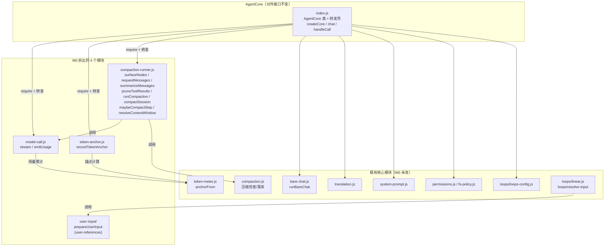
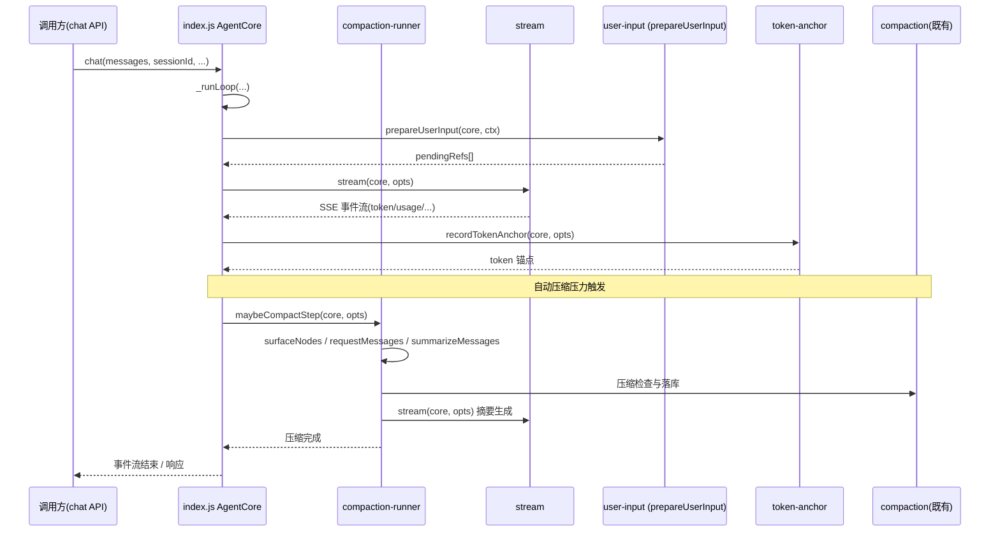

# core 模块构成与调用关系

`core` 是 Agent 的后端核心（CommonJS，Node 运行）。M0 重构把原本集中在 `index.js` 的 `AgentCore` 拆为多个独立模块：类只保留「转发壳」，对外接口（`createCore` 返回的 `core` 对象、`chat`、事件）完全不变。

## 1. 文件构成

## 2. 调用关系（M0 转发链路）

`index.js` 把原 `_stream` / `_emitUsage` / `_recordTokenAnchor` / 压缩系列方法改造为转发壳，调用方（cli / web api / tests）拿到的 `core` 对象行为与拆分前一致。引用解析已从 `core` 上摘除，独立为 `core/user-input`（由 `prepareUserInput` 收口两条 loop 路径的输入准备），不再挂在 `core` 上。

## 3. 拆分要点

- **纯转发，接口不变**：`createCore` 返回的 `core` 对象结构、`chat`、`handleCall`、`requestApproval`、`requestUserQuestion` 未动；`compaction-runner` 通过 `core._selectTools()` / `core._toolDefs()` / `core._resolveTarget()` 回调类内方法，避免循环依赖。
- **流式与用量**：`model-call.js` 的 `emitUsage` 是纯函数（由 `core.usageState` 聚合），`stream` 调用 `core._post` / `core.reasoningParamFor` / `core.effort` / `core.model` / `core.baseUrl`。
- **压缩自治**：`compaction-runner` 自带 `resolveContextWindow`（不 import `index.js`），仅向上发 `compaction` 事件，由 UI 层（`compaction-ui.js`）呈现。
- **token 锚点**：`token-anchor.js` 仅依赖 `token-meter.anchorFrom`，与对话循环解耦。
