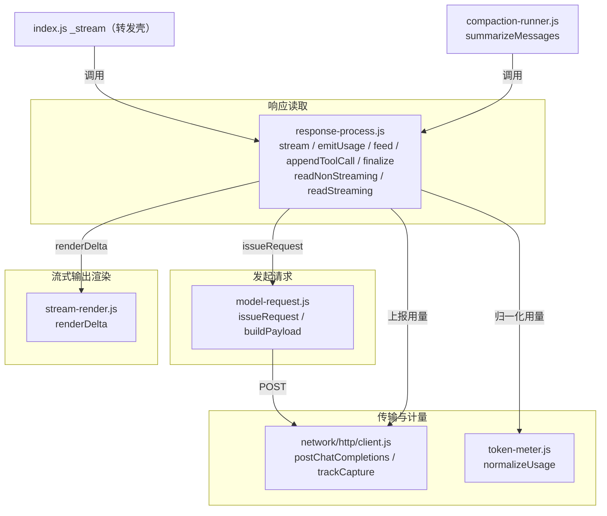
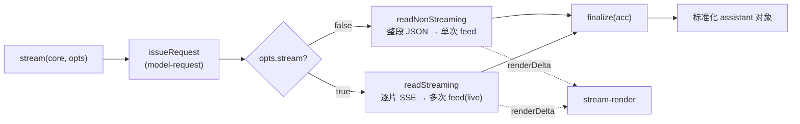

# model-call 模块（模型请求与流式解析）

`model-call` 是 Agent 后端负责「一次模型调用」的模块，覆盖构造请求、发出 HTTP、读取响应（流式或非流式）、累积增量、归一化为统一返回对象的完整生命周期。模块在 M0 从 `AgentCore._stream` 抽出，并由 `stream-refactor` 拆为三个子模块，使「流式 = 非流式 + 增量渲染」在代码结构上也显式成立。

## 1. 三个子模块

| 子模块 | 文件 | 职责 |
|---|---|---|
| 发起请求 | `core/model-request.js` | 构造 payload（含 effort→provider 推理字段翻译）并调用 `postChatCompletions` 取响应，挂 `trackCapture`。只关心「怎么发」，不解析响应内容。 |
| 响应读取 | `core/response-process.js` | 读取响应（流式逐片 / 非流式整段）、累积增量、归一化为统一返回对象。只关心「怎么读」，请求发出委托 `model-request`。 |
| 流式输出渲染 | `core/stream-render.js` | 把模型增量渲染为 UI 事件（`token` / `reasoning`）。只关心「增量怎么变成事件」，不累积、不解析。 |



## 2. 分层设计（streaming = non-streaming + 增量渲染）

两分支最终都收敛到同一归一化对象，共享同一个累积器 `acc`，仅「取响应的节奏」与「渲染的节奏」不同：

- `newAccumulator()` 返回 `{ content, reasoning_content, toolCalls, finishReason, lastUsage }`，由 `readNonStreaming` 与 `readStreaming` 共同填充。
- `feed(acc, onEvent, kind, delta)`（在 `response-process.js`）是**唯一**的 delta-append 入口：累积进 `acc`（本模块职责），并委托 `stream-render.renderDelta` 发渲染事件（渲染层职责）。流式每收到一片调一次（live 渲染），非流式把整段 content / reasoning 当单个 delta 调一次。下游 `chat-tab.onChatEvent` 对 `token` 是纯追加语义（`AgentMarkdown.append(ensureAnswer(), evt.delta)`），两种节奏对它无差别。
- `finalize(acc)` 是**共享**归一化函数，两分支共用，输出统一返回对象（见 §5.3）。
- `appendToolCall(acc, tc)` 单列处理 tool_calls 的跨 chunk 拼接（按 `index` 累加 `arguments` 字符串，非纯文本渲染），与文本 delta 分支独立。



## 3. 发起请求层 model-request.js

### 3.1 buildPayload(core, opts)

构造 Chat Completions payload：`{ model, messages, stream, tools }`，按 `maxTokens` 可选带 `max_tokens`，并把 effort 翻译为 provider 推理字段：

- effort 缺省时取 `core.effort`；显式传 `null`/`undefined` 走默认；`off` 与 `none` 同义。
- 按 `core.reasoningParamFor(baseUrl)` 的 `reasoning_param`：
  - `none`/`off` + `thinking` → `{ thinking: { type: "disabled" } }`
  - `none`/`off` + 其他（`reasoning_effort` / 缺省）→ `{ reasoning_effort: "none" }`
  - 其他等级 + `reasoning_param !== "none"` → `{ reasoning_effort: <等级> }`
  - `reasoning_param === "none"` → 一律不注入推理参数

### 3.2 issueRequest(core, opts)

调用 `buildPayload` 构造 payload，经 `postChatCompletions({ baseUrl, apiKey, payload, sessionId })` 发出，取回仍处于暂停态的 `{ res, cap }`，并挂 `trackCapture(res, cap)`。返回 `{ res, cap }` 供 `response-process.stream` 读取。`stream` 标志由调用方通过 `opts.stream` 决定（不是 effort 决定）。

## 4. 流式输出渲染层 stream-render.js

### 4.1 renderDelta(onEvent, kind, delta)

把单个增量渲染为 UI 事件：空增量直接跳过；`kind === "reasoning"` 发 `{ type: "reasoning", delta }`，否则发 `{ type: "token", delta }`。非流式把整段 content / reasoning 当单个 delta 渲染；流式逐片渲染（live）。两者走同一个 `renderDelta`，对下游 handler 无差别。该层不累积、不解析，纯粹是「增量 → 事件」的映射。

## 5. 响应读取层 response-process.js

### 5.1 stream(core, opts) 入参

| 字段 | 说明 |
|---|---|
| `messages` | 发送给模型的消息数组 |
| `toolDefs` | 工具定义数组（放入 payload.tools） |
| `model` | 覆盖模型；缺省用 `core.model` |
| `onEvent` | 事件回调，用于流式渲染与用量上报 |
| `sessionId` | 透传给 transport 做请求追踪 |
| `stream` | 是否流式（SSE）；缺省 `false` |
| `maxTokens` | 可选生成上限（摘要调用用 8192） |
| `baseUrl` / `apiKey` | 可选覆盖，缺省用 `core.baseUrl` / `core.apiKey` |
| `effort` | 可选推理等级覆盖；缺省用 `core.effort` |

`stream()` 先发 `model-http-status` on-post，经 `issueRequest` 取响应后发 on-get（带 `status`），再按 `opts.stream` 选 `readNonStreaming` / `readStreaming`，最后 `finalize`。

### 5.2 事件（onEvent 发出）

| 类型 | 时机 | 负载 |
|---|---|---|
| `model-http-status` | 发请求前 | `{ state: "on-post" }` |
| `model-http-status` | 取到响应后 | `{ state: "on-get", status }` |
| `reasoning` | 收到 reasoning 增量（流式逐片 / 非流式整段一次） | `{ delta }` |
| `token` | 收到内容增量（流式逐片 / 非流式整段一次） | `{ delta }` |
| `usage` | 用量到达（流式随末 chunk / 非流式整段 JSON） | `{ promptTokens, completionTokens, totalTokens, cachedTokens }`（兼容字段缺失与厂商命名差异） |

`emitUsage(onEvent, raw)` 是纯函数，负责把厂商用法对象标准化后发 `usage` 事件，不依赖 `core` 实例。

### 5.3 返回对象（finalize 输出）

```js
{
  role: "assistant",
  content: string,
  reasoning_content: string,
  tool_calls: [{ id, type: "function", function: { name, arguments } }] | undefined,
  finish_reason: string | null,
  usage: { prompt, completion, total, cached } | null,  // token-meter.normalizeUsage 归一化
}
```

`tool_calls` 为空数组时输出 `undefined`；`usage` 缺失时为 `null`。该对象直接被 `model-request` 节点落库（`message.add` / `call.add`）与 `compaction-runner` 摘要消费。

### 5.4 两个 read 分支

- `readNonStreaming(res, acc, onEvent)`：整段读 JSON，把 `message.content` / `message.reasoning_content` 作为单个 delta 喂给 `feed`（无 live 层），`tool_calls` 一次性映射进 `acc.toolCalls`，usage 直接取自 `json.usage`。JSON 解析失败抛 `bad JSON response: ...`。
- `readStreaming(res, acc, onEvent)`：逐行解析 SSE（`data:` 前缀、`[DONE]` 跳过、单行 JSON 失败跳过），每片 delta 即时 `feed`（live）并 `appendToolCall` 跨 chunk 拼 `arguments`；`finish_reason` 与 `usage` 取末片；响应结束发 `usage`。

## 6. 调用方

| 调用方 | 入口 | stream 值 | 用途 |
|---|---|---|---|
| `index.js` `_stream` | 转发壳 → `streamMod.stream` | 由 loop 决定 | 主对话 |
| `loops/nodes/model-request/run.js` | `core._stream` | `ctx.effStream` | 主循环模型请求节点 |
| `loops/linear.js` | `core._stream` | `st.stream` | 线性主循环 |
| `bare-chat.js` | `core._stream` | 会话设置 | 无持久化对话 |
| `compaction-runner.js` `summarizeMessages` | 直接 `stream(...)` | `false` | 上下文压缩摘要生成 |

所有路径最终经 `core._stream` 或 `stream()` 走同一 `finalize`，行为一致。

## 7. 数据流（一次流式对话）

```mermaid
sequenceDiagram
    participant Loop as model-request 节点
    participant RP as response-process.stream
    participant MR as model-request.issueRequest
    participant HTTP as http/client
    participant SR as stream-render.renderDelta
    participant UI as onEvent 消费者

    Loop->>RP: stream(core, opts)
    RP->>UI: model-http-status on-post
    RP->>MR: issueRequest(core, opts)
    MR->>HTTP: postChatCompletions + trackCapture
    HTTP-->>MR: { res, cap }
    MR-->>RP: { res, cap }
    RP->>UI: model-http-status on-get
    loop 每片 SSE
        RP->>RP: feed(...)/appendToolCall(...)
        RP->>SR: renderDelta(kind, delta)
        SR->>UI: reasoning / token（增量）
    end
    RP->>UI: usage
    RP-->>Loop: finalize(acc) 标准化 assistant 对象
```

## 8. 重构背景（stream-refactor）

模型请求与流式输出的模块化重构：让「流式 = 非流式 + 对中间流式输出的动态渲染」在代码结构上也显式成立。

### 8.1 背景

`response-process.stream` 把「发请求 + 整段解析 / 逐片解析 + 事件发射 + 归一化返回」揉在一个函数两个分支。流式分支（SSE 解析）与非流式分支（整段读 JSON）各自重复了归一化（构造 `{role, content, reasoning_content, tool_calls, finish_reason, usage}`）与 `token` / `reasoning` 事件发射；实时渲染与累积交织而非分层。

### 8.2 设计判定

流式本质 = 非流式 + 增量渲染——两者最终都收敛到同一归一化对象，下游 `chat-tab.onChatEvent` 对 `token` 是纯追加语义（`AgentMarkdown.append(ensureAnswer(), evt.delta)`），故分片追加与一次性整段追加对 handler 无差别，流式中间帧与最终帧走同一个 delta-append 函数。非流式只是把整段 content 当成单个 delta 发一次。

### 8.3 设计形状（已落地）

- 共享 `finalize` / `normalize`：把累积结果归一化为统一返回对象，并交给最终响应处理函数；`token` / `reasoning` 的 delta-append 由 handler 统一消费，与是否流式无关。
- `model-request`：负责构造 payload（含推理等级翻译）并调用 transport 取响应（流式或非流式只是「怎么取」不同）。
- `stream-render`：流式专属的渲染层，流式在收增量时发 `token` / `reasoning` 增量；非流式不引入该层（仍走同一 `renderDelta`，只是节奏为一次整段）。
- 归并两分支重复，使流式 = 非流式 + 增量渲染在代码上显式。

### 8.4 注意

`tool_calls` 按 `index` 跨 chunk 拼 `arguments` 字符串（非纯文本渲染）是独立于文本增量的小分支，单列 `appendToolCall` 处理。

### 8.5 判据

流式 / 非流式共用同一 `finalize`；流式仅多一层增量渲染；两分支重复消除；回归——对话、摘要（`summarizeMessages` 走 `stream:false`）、压缩调用方行为不变。
