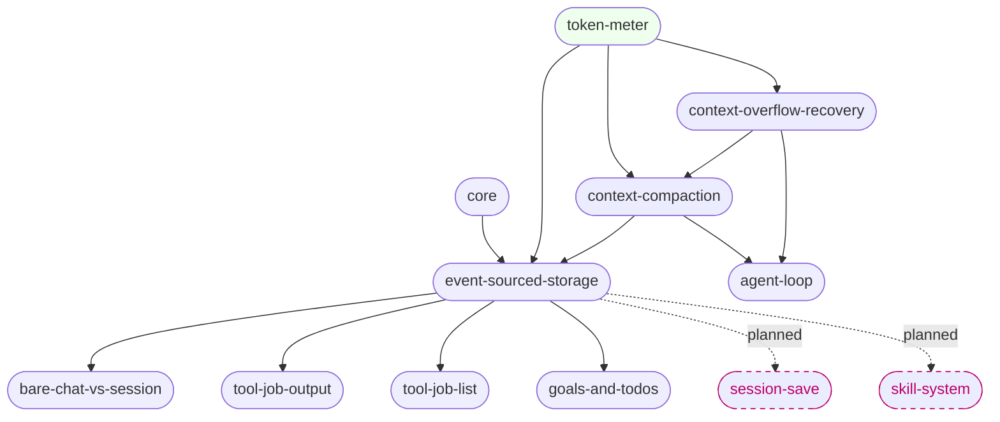
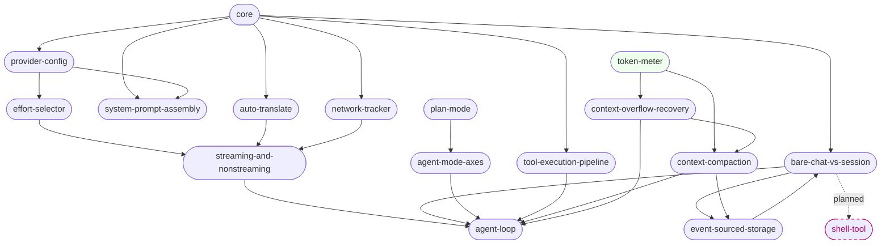
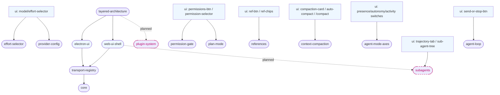

# Feature Dependency Graph (docs/feature_list.json)

A directed graph of the agent's features, showing how capabilities depend on and
compose into one another. Edges point `A --> B` meaning "B depends on / is built
on A". `pending` features are boxed dashed; all others are solid.

```mermaid
graph TD
    classDef pending stroke-dasharray: 5 5, stroke:#b06, color:#b06;
    classDef infra fill:#eef;

    %% ===== Root / composition =====
    project([agent: micro AI agent]):::infra
    layered-architecture
    project --> layered-architecture

    layered-architecture --> core[core / business logic]:::infra
    layered-architecture --> transport-registry
    layered-architecture --> electron-ui
    layered-architecture --> web-ui-shell

    %% ===== Conversation engine =====
    core --> settings-and-function-dispatch
    core --> agent-loop
    core --> bare-chat-vs-session
    core --> streaming-and-nonstreaming
    core --> provider-config
    core --> system-prompt-assembly
    core --> workspace-resolution

    provider-config --> system-prompt-assembly
    provider-config --> effort-selector
    effort-selector --> streaming-and-nonstreaming
    streaming-and-nonstreaming --> agent-loop
    bare-chat-vs-session --> agent-loop

    %% ===== Tool system wiring =====
    core --> directory-tool-registry
    directory-tool-registry --> tool-execution-pipeline
    directory-tool-registry --> tool-lib
    tool-execution-pipeline --> permission-gate
    tool-execution-pipeline --> agent-loop

    %% every tool depends on the execution pipeline
    tool-read --> tool-execution-pipeline
    tool-write --> tool-execution-pipeline
    tool-edit --> tool-execution-pipeline
    tool-glob --> tool-execution-pipeline
    tool-grep --> tool-execution-pipeline
    tool-bash --> tool-execution-pipeline
    tool-web-search --> tool-execution-pipeline
    tool-web-fetch --> tool-execution-pipeline
    tool-ask-user-question --> tool-execution-pipeline
    tool-request-user-job --> tool-execution-pipeline
    tool-job-output --> tool-execution-pipeline
    tool-job-list --> tool-execution-pipeline
    tool-job-kill --> tool-execution-pipeline
    tool-create-goal --> tool-execution-pipeline
    tool-get-goal --> tool-execution-pipeline
    tool-update-goal --> tool-execution-pipeline
    tool-todo-write --> tool-execution-pipeline
    tool-exit-plan-mode --> tool-execution-pipeline
    tool-calculator --> tool-execution-pipeline
    tool-get-current-time --> tool-execution-pipeline

    %% tool subgroups / shared deps
    tool-lib --> tool-glob
    tool-lib --> tool-grep
    tool-lib --> tool-web-search
    tool-lib --> tool-web-fetch
    tool-bash --> permission-gate
    tool-read --> fs-observation-policy[fs-observation-policy]:::infra
    tool-write --> fs-observation-policy
    tool-edit --> fs-observation-policy
    tool-write --> fs-path-policy
    tool-edit --> fs-path-policy
    fs-observation-policy --> core
    fs-path-policy --> permission-gate

    %% interaction / jobs cluster
    tool-ask-user-question --> interaction-tools
    tool-request-user-job --> interaction-tools
    tool-job-output --> interaction-tools
    tool-job-list --> interaction-tools
    tool-job-kill --> interaction-tools
    interaction-tools --> agent-mode-axes

    %% goals / todos cluster
    tool-create-goal --> goals-and-todos
    tool-get-goal --> goals-and-todos
    tool-update-goal --> goals-and-todos
    tool-todo-write --> goals-and-todos
    goals-and-todos --> goal-auto-continue

    %% plan / mode
    tool-exit-plan-mode --> plan-mode
    plan-mode --> agent-mode-axes
    agent-mode-axes --> agent-loop

    %% ===== Persistence / context =====
    core --> event-sourced-storage
    event-sourced-storage --> bare-chat-vs-session
    event-sourced-storage --> tool-job-output
    event-sourced-storage --> tool-job-list
    event-sourced-storage --> goals-and-todos
    context-compaction --> event-sourced-storage
    context-compaction --> agent-loop
    context-overflow-recovery --> context-compaction
    context-overflow-recovery --> agent-loop
    token-meter --> context-compaction
    token-meter --> context-overflow-recovery
    token-meter --> event-sourced-storage

    %% translation / references / network
    core --> auto-translate
    auto-translate --> streaming-and-nonstreaming
    core --> references
    core --> network-tracker
    network-tracker --> streaming-and-nonstreaming

    %% ===== Quality / roadmap =====
    project --> test-suite
    core --> test-suite

    %% pending (roadmap) items
    session-save:::pending
    skill-system:::pending
    plugin-system:::pending
    subagents:::pending
    shell-tool:::pending
    goal-auto-continue:::pending

    event-sourced-storage -. planned .-> session-save
    event-sourced-storage -. planned .-> skill-system
    layered-architecture -. planned .-> plugin-system
    web-ui-shell -. planned .-> subagents
    bare-chat-vs-session -. planned .-> shell-tool
    goals-and-todos -. planned .-> goal-auto-continue
```

## Subgraph: Tool System (local dependency view)

Focused 1–2 hop view of the `tool-*` features: how the registry loads tools, how
the execution pipeline gates them, and the shared subsystems each tool leans on.
Nodes outside the tool system (`core`, `agent-loop`, `interaction-tools`,
`goals-and-todos`, `plan-mode`, `agent-mode-axes`) are shown as the immediate
upstream/downstream context only.

```mermaid
graph TD
    classDef pending stroke-dasharray: 5 5, stroke:#b06, color:#b06;
    classDef infra fill:#eef;
    classDef gate fill:#fee;

    %% loading + execution core
    directory-tool-registry([directory-tool-registry])
    tool-execution-pipeline([tool-execution-pipeline])
    permission-gate([permission-gate]):::gate
    tool-lib([tool-lib])
    directory-tool-registry --> tool-execution-pipeline
    directory-tool-registry --> tool-lib
    tool-execution-pipeline --> permission-gate

    %% immediate upstream/downstream context (1 hop out of tool system)
    core([core]):::infra --> directory-tool-registry
    tool-execution-pipeline --> agent-loop([agent-loop]):::infra

    %% shared subsystems directly used by tools
    fs-observation-policy([fs-observation-policy]):::infra
    fs-path-policy([fs-path-policy]):::gate
    fs-path-policy --> permission-gate

    %% ---- filesystem tools ----
    tool-read([tool-read])
    tool-write([tool-write])
    tool-edit([tool-edit])
    tool-glob([tool-glob])
    tool-grep([tool-grep])
    tool-read --> tool-execution-pipeline
    tool-write --> tool-execution-pipeline
    tool-edit --> tool-execution-pipeline
    tool-glob --> tool-execution-pipeline
    tool-grep --> tool-execution-pipeline
    tool-read --> fs-observation-policy
    tool-write --> fs-observation-policy
    tool-edit --> fs-observation-policy
    tool-write --> fs-path-policy
    tool-edit --> fs-path-policy
    tool-lib --> tool-glob
    tool-lib --> tool-grep

    %% ---- bash ----
    tool-bash([tool-bash])
    tool-bash --> tool-execution-pipeline
    tool-bash --> permission-gate

    %% ---- web ----
    tool-web-search([tool-web-search])
    tool-web-fetch([tool-web-fetch])
    tool-web-search --> tool-execution-pipeline
    tool-web-fetch --> tool-execution-pipeline
    tool-lib --> tool-web-search
    tool-lib --> tool-web-fetch

    %% ---- interaction / jobs ----
    tool-ask-user-question([tool-ask-user-question])
    tool-request-user-job([tool-request-user-job])
    tool-job-output([tool-job-output])
    tool-job-list([tool-job-list])
    tool-job-kill([tool-job-kill])
    tool-ask-user-question --> tool-execution-pipeline
    tool-request-user-job --> tool-execution-pipeline
    tool-job-output --> tool-execution-pipeline
    tool-job-list --> tool-execution-pipeline
    tool-job-kill --> tool-execution-pipeline
    tool-ask-user-question --> interaction-tools([interaction-tools]):::infra
    tool-request-user-job --> interaction-tools
    tool-job-output --> interaction-tools
    tool-job-list --> interaction-tools
    tool-job-kill --> interaction-tools

    %% ---- goals / todos ----
    tool-create-goal([tool-create-goal])
    tool-get-goal([tool-get-goal])
    tool-update-goal([tool-update-goal])
    tool-todo-write([tool-todo-write])
    tool-create-goal --> tool-execution-pipeline
    tool-get-goal --> tool-execution-pipeline
    tool-update-goal --> tool-execution-pipeline
    tool-todo-write --> tool-execution-pipeline
    tool-create-goal --> goals-and-todos([goals-and-todos]):::infra
    tool-get-goal --> goals-and-todos
    tool-update-goal --> goals-and-todos
    tool-todo-write --> goals-and-todos

    %% ---- plan / builtins ----
    tool-exit-plan-mode([tool-exit-plan-mode])
    tool-calculator([tool-calculator])
    tool-get-current-time([tool-get-current-time])
    tool-exit-plan-mode --> tool-execution-pipeline
    tool-calculator --> tool-execution-pipeline
    tool-get-current-time --> tool-execution-pipeline
    tool-exit-plan-mode --> plan-mode([plan-mode]):::infra
    plan-mode --> agent-mode-axes([agent-mode-axes]):::infra
```

## Subgraph: Context Compaction (local dependency view)

Focused 1–2 hop view of the `context-compaction` feature: the token accounting
that triggers it (`token-meter`), the overflow recovery path
(`context-overflow-recovery`), the event-sourced store it projects (`event-sourced-storage`),
and the immediate consumers of that store. `core` / `agent-loop` are shown as the
upstream driver and downstream consumer only.

## Subgraph: Agent Loop (conversation engine, local dependency view)

Focused 1–2 hop view of the `agent-loop` feature: the request pipeline that feeds
it (`streaming-and-nonstreaming`), the session/mode context (`bare-chat-vs-session`,
`agent-mode-axes`, `plan-mode`), the tool execution that runs inside it
(`tool-execution-pipeline`), and the context window that bounds it
(`context-compaction`, `context-overflow-recovery`, `token-meter`). `core` is the
container; `provider-config` / `effort-selector` / `auto-translate` / `network-tracker`
are shown where they feed the request path.

## Subgraph: UI (local dependency view)

Focused 1–2 hop view of the UI features (`electron-ui`, `web-ui-shell`): how the
client is wired to the core through the transport, and which backend features the
key UI controls depend on. The concrete layout nodes (shell / thread-sidebar /
composer / chat-viewport …) live in `docs/ui.md` — this graph shows only the
**feature-level** dependencies, not the layout tree. `core` / `transport-registry`
are the wiring; the `ui:*` nodes are representative UI controls from the layout tree.

## Legend
- **Dashed arrows (`.planned.`)** — a roadmap relationship: the pending feature is
  slated to extend the source feature.
- **Dashed pink boxes** — `pending` features (code not yet present; see `pending`
  entries in `feature_list.json`).
- **`fs-observation-policy` / `core` / `transport`** style nodes are in-repo
  subsystems referenced by features but not themselves rows in the feature list.
