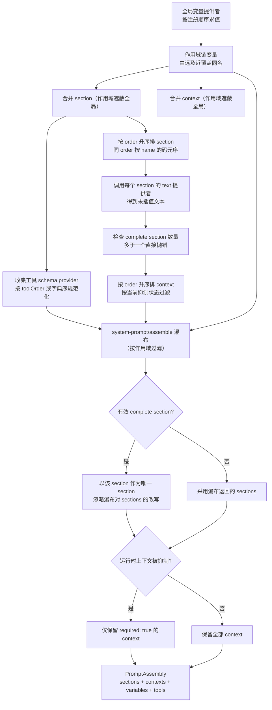

# system-prompt（驱动）

系统提示词组装规则。本文件是**定义性**的：凡是要往系统提示词里注入内容的功能，都必须按这里的规则接入；各功能只写"自己贡献什么、在哪个时机贡献"，不重复规则。驱动的清单见 `communicate-contract.md`。

## 1 职责与边界

`ctx.systemPrompt`（包 `@deepseek-ai/dsh-system-prompt`）是每次组装前收集提示词输入的注册表，并负责把收集到的输入变成一次请求可用的 `PromptAssembly`。

它负责：合并全局层与作用域层、解析与排序 section、渲染插值、施加 `complete` 与运行时上下文抑制、提供工具 schema 的收集入口（但 schema 内容由执行器提供，见 `tools/README.md`）。

它不负责：具体段落文本（功能负责）、运行时上下文的具体条目与刷新（见 `runtime-context.md`）、消息如何落进历史（见 `communicate-contract.md` 的消息通道）。

## 2 三类输入

| 输入 | 变成什么 | 由谁注册 | 详细 |
|---|---|---|---|
| section | 系统提示词里的一段文本 | 各功能 | 本文件 |
| context | 模型历史里的 user 角色快照 | 运行时上下文驱动 | `runtime-context.md` |
| variable | 只供前两者渲染时引用 | 任意插件 | 本文件 |

三者相互独立：section 与 context 不共享排序空间，也不共享去重规则。工具 schema 也属于同一次组装，但由执行器拥有，表现瀑布不能替换。

## 3 组装流程



流程分两步：`assemble()` 负责合并、排序、解析，产出 `PromptAssembly`；`renderPrompt()` 负责插值、丢空、拼接，产出模型看到的文本。

## 4 合并、遮蔽与排序

- 同一层内同名 section 重复注册抛错；注册与注销都会发出 `system-prompt/change`（不按作用域过滤，因为全局变更影响所有作用域）。
- section 先按 `order` 数值升序，`order` 相同按 `name` 的码元序（与区域设置无关，保证各机器一致）；context 只按 `order` 升序，同 order 保持注册顺序。
- 作用域层遮蔽全局层：同一作用域链上同名 section / context / variable，最近的层胜出。`deployment:persona-prefix` 与 `deployment:persona-suffix` 靠同名遮蔽实现「预设覆盖部署默认文案」。
- 仓库内贡献者必须经 `getSectionOrder(name)` / `getContextOrder(name)` 取中心分配的序号，不允许自拟数字；外部贡献可以使用任意有限数。

## 5 序号分配

section 与运行时上下文的位置由注册表中心的命名序号分配。

`SECTION_ORDERS`：

| 名称 | 值 | 名称 | 值 |
|---|---|---|---|
| `HARNESS_IDENTITY` | -1000 | `TOOL_WEB_SEARCH` | 2000 |
| `DEPLOYMENT_PERSONA_PREFIX` | 0 | `TOOL_WEB_FETCH` | 2100 |
| `PLAN_POLICY` | 500 | `TOOL_LSP` | 2200 |
| `TEAM_POLICY` | 600 | `TOOL_SESSION_QUERY` | 2300 |
| `PTC_ONLY` | 800 | `TOOL_GOAL` | 2400 |
| `FILE_REFERENCE` | 900 | `TOOL_SCHEDULE` | 2500 |
| `TOOL_BASH` | 1000 | `TOOL_WORKFLOW` | 2600 |
| `TOOL_PWSH` | 1010 | `TOOL_RALPH` | 2700 |
| `TOOL_READ` | 1100 | `TOOL_SUBAGENT` | 2800 |
| `TOOL_WRITE` | 1200 | `TOOL_REPORT` | 2900 |
| `TOOL_EDIT` | 1300 | `TOOL_COMPUTER_USE` | 3000 |
| `TOOL_APPLY_PATCH` | 1350 | `MCP_SERVERS` | 3100 |
| `TOOL_GLOB` | 1400 | `TOOLS_SDK` | 5000 |
| `TOOL_GREP` | 1500 | `DELIVERABLE_FILE_REFERENCES` | 9000 |
| `TOOL_JOBS` | 1600 | `STRUCTURED_OUTPUT` | 9900 |
| `TOOL_PTY` | 1700 | `HARNESS_SOURCE` | 10000 |
| `TOOL_PTY_PANEL` | 1710 | `WEB_SURFACE` | 10100 |
| | | `DEPLOYMENT_PERSONA_SUFFIX` | 10200 |

`CONTEXT_ORDERS` 见 `runtime-context.md`。

按序号升序，一个组合实际渲染出的系统提示词依次为（仅列非空段落）：

```text
[-1000] harness:identity
[    0] deployment:persona-prefix
[  120] timeline:planning（实验）
[  500] plan:policy（仅计划态）
[  600] team:policy（仅 Team 启用）
[  800] tools:ptc-only（仅 PTC 执行器）
[  900] context:file-reference
[ 1000..1500] tool:bash / tool:pwsh / tool:read / tool:write / tool:edit / tool:apply_patch / tool:glob / tool:grep
[ 1600..1710] tool:jobs / tool:pty / tool:pty-panel
[ 2000..2400] tool:web_search / tool:web_fetch / tool:lsp / tool:session-query / tool:goal
[ 2500..2800] tool:schedule / tool:workflow / tool:ralph / tool:subagent
[ 3000..3100] 设备操作类段落 / mcp:* / mcp-resource-servers
[ 5000] tools:sdk
[ 9000] ui:deliverable-file-references
[ 9900] tool:structured_output（仅结构化子代理）
[10000] harness:source
[10100] app:web-surface
[10200] deployment:persona-suffix
```

空段落被丢弃，因此上图并非固定行数；相同 order 的段落按 name 的码元序排列。

## 6 渲染规则

`renderPrompt(assembly)` 的行为逐条固定：

1. 对每个 section：`interpolate: false` 的原样输出；否则严格插值 `{{name}}`。
2. 丢弃长度为零的文本；以空行（`\n\n`）连接剩余段落。全部为空时返回空串。
3. 插值严格性：`{{}}`、含非 `[a-z][a-z0-9_]*` 字符的名字、未注册的名字、注册了但本组装返回 `undefined` 的名字都抛错；`{{` 之后再也找不到 `}}` 时按普通文字处理；替换进去的值不再二次扫描。
4. 不属于任何变量的 `{` / `}` 不触发错误——但含 `{{` 且随后出现 `}}` 的片段会被识别为格式错误的引用。

## 7 变量

变量注册名必须匹配 `^[a-z][a-z0-9_]*$`，同层重复注册抛错，作用域值遮蔽全局值。提供者每次组装都会被求值，可以返回 `undefined`（此时引用它的段落渲染会失败）。

| 变量 | 注册者 | 取值 | 典型用法 |
|---|---|---|---|
| `provider` | `dsh-agent-loop` | 本步捕获的模型选择中的 provider | 外部 persona |
| `model` | `dsh-agent-loop` | 本步捕获的 model id | 预设 persona 前缀 `You are a coding agent powered by the {{model}} model.` |
| `response_language` 等 | 任意插件 | 插件自有事实 | 插件自有段落 |

`cwd` 不是变量：工作目录由 `runtime-context.md` 以 context 形式提供，任何段落引用 `{{cwd}}` 都会在组装阶段失败。

## 8 complete 与运行时上下文抑制

- `complete: true` 的 section 在瀑布跑完后被恢复为**唯一** section：瀑布仍会执行（以便解析工具、context 与变量），但它对 sections 的改写失效。有效 complete section 多于一个时组装抛错。
- `suppressRuntimeContext()` 是作用域内的抑制标记：被抑制时可选 context 全部移除，`required: true` 的 context 保留；多个抑制器互相独立，全部注销后可选 context 恢复。

## 9 作用域与生命周期

- 注册项归属于注册它的 context 作用域：通过 `agent.ctx` 注册即只对该 agent 生效并遮蔽同名全局项；注销（插件卸载、HMR 替换、effect 释放）即时移除并发出变更通知。
- 作用域链的变量合并由远及近，最近的层胜出；section 与 context 合并后遮蔽规则相同。
- 表现瀑布 `system-prompt/assemble` 是 scope-filtered waterfall：作用域监听者只收到本作用域的组装。监听者可以就地修改 assembly（如 `runtime-context.md` 里工作目录服务把自己的 context 提到首位并刷新文本），也可以整体替换返回值并短路后续监听者。传入的 `signal` 只控制本次组装，不得被保留用于后续轮次。
- `refreshContext(assembly, context)` 在请求准入前刷新运行时事实：只重新解析 context 提供者，section、tools、变量与瀑布都不重跑；被抑制的可选 context 移除，缺失的 required context 按注册顺序补回。

## 10 注册 API

```ts
interface AssembleContext {
  scope?: ScopeKey
  signal?: AbortSignal
}

interface PromptSection {
  readonly name: string
  readonly order: number
  readonly text: string | ((context: AssembleContext) => string)
  readonly interpolate?: boolean
  readonly complete?: boolean
}

interface ToolProviderResult {
  readonly schemas: readonly ToolSchema[]
  readonly knownNames?: readonly string[]
}
```

```ts
section(section: PromptSection): () => void
getSectionOrder(name: PromptSectionOrderName): number
variable(name: string, provider: (context: AssembleContext) => string | undefined): () => void
refreshContext(assembly: PromptAssembly, context?: AssembleContext): PromptAssembly
assemble(context?: AssembleContext): Promise<PromptAssembly>
```

context 与工具相关的注册方法见 `runtime-context.md` 与 `tools/README.md`。`AssembleContext` 由 `dsh-agent` 合并扩展出可选字段 `agent` 与 `modelSelection`；`assembleContextFor(agent, signal)` 把它设为 `{ agent, scope: agent, signal }`；loop 另外传入本步工具集 `toolSet`，供工具感知的段落判断可见性。

## 11 何时组装

- 每个候选 step 的**首次尝试**前调用一次 `assemble()`；同一步的重试复用已渲染文本与已接受工具集，不再组装。
- 组装发生在 `agent/pre-step` 之前。pre-step 的监听者可以往消息批次里塞 user 消息（技能目录、工作区指令、时间读数），但不会触发重新组装。
- 准入前调用 `refreshContext()`，只刷新 context。
- 组装结果如何变成 system 节点、何时追加或替换，见 `communicate-contract.md` 的消息通道与准入规则。

## 12 组合差异

同一套规则在不同组合下装载不同的贡献者。三类参照组合：

| 差异项 | base | web standard 预设 | sdk-minimal |
|---|---|---|---|
| `harness:identity` | 开启 | 开启 | 关闭 |
| `deployment:persona-prefix` | 全局为空 | 编码代理 persona | `DSH_SYSTEM_PROMPT` 或通用助手 persona |
| 运行时上下文 | 开启 | 开启 | 关闭，`required` 条目仍保留 |
| `harness:source` / `app:web-surface` | 无 | 有 | 无 |
| `ui:deliverable-file-references` | 无 | 有 | 有 |

agent 预设（`dsh-agent-preset`）按预设替换 persona 并挂载不同工具组；预设内的同名 section 遮蔽全局同名项。

## 13 组合敏感的段落

段落的文本与有无可能取决于兄弟工具的可见性。这类影响只发生在段落与可见性两层，规则的完整清单与逐条展开见 `tools/README.md` 的「有状态组合包」与各工具页的「组合条件」小节。本节只保留结论：

- 少数段落的文本函数会查询兄弟工具（`tool:write`、`tool:grep`、`tool:web_search`、`context:file-reference`）。
- 多工具共用一段时，只有排序第一者贡献非空文本。
- 工具限制与按步激活谓词会改变可见性，进而改变上面两类结果。
- 执行器模式（native / ptc）整体替换段落形态，见 `tools/README.md`。
