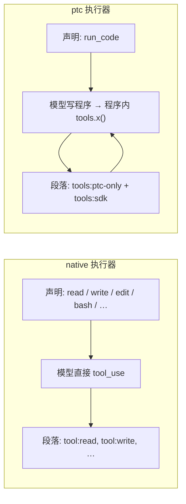

# DSH 工具总览与通信契约

本文件是工具契约目录的总览：按领域列出全部模型可见工具，汇总它们的系统提示词段落、启用条件、结果形态与组合依赖。每个工具的完整契约（name、description、system-section 原文、schema、result-format、启用条件与可见性、组合条件）各有一页，见文末索引。总览与驱动/功能清单见上一级目录的 `communicate-contract.md`；工具段落如何配合组装规则见 [`system-prompt.md`](../system-prompt.md) 与 [`runtime-context.md`](../runtime-context.md)。

## 通用规则

### 声明面

- 进入模型请求的工具声明只有三个字段：`name`、`description`、`parameters`（JSON Schema）。`output`、超时、并发标记、展示回调都不发给模型。
- 名称约束来自 DeepSeek 函数名契约：`[A-Za-z0-9_-]`，最长 64 字符。MCP 工具按 `mcp__<server>__<raw>` 对外命名。
- 参数 schema 是隐式开放的对象根；属性上的 `required: true` 汇入 `required` 数组，`additionalProperties` 随未知字段的允许与否生成。
- 只有本步可见的工具才出现在声明里；可见性由作用域、工具限制、激活谓词共同决定。

### 展示层

- 界面只消费持久化的展示投影：`presentationMeta` 存入结果 `meta`，`presentResult(args, result)` 从日志重放卡片；两者都是纯函数，不参与模型输入。
- 工具页的「展示投影」小节描述该工具给界面补了什么，不改变模型可见文本。

### 结果面

- 工具返回规范化 JSON 值，先按 `output.schema` 校验，再由 `render(args, value)` 投影成模型可见内容块（文本与图片）。
- 展示用 `meta`（`presentationMeta` 或 `presentResult` 的投影）只进会话日志与 UI，不进模型消息。
- 任何失败（抛错、参数校验失败、未知工具、策略拒绝、取消）都渲染为单条文本：`Error: <message>`，并以 `isError` 标记。
- 启动后被取消的调用渲染为 `Error: tool call aborted`；未启动即被取消的渲染为 `Error: tool call aborted before dispatch`。
- 超出内联预算的文本结果会被截断：保留头尾预览，末尾附 `(Omitted <n> bytes. Full formatted result stored at: <path>. Use read with offset/limit, or grep this path to search within it.)`；单个工具也可以用自己的页脚就地提示截断（例如 `web_fetch` 的 `(Content truncated. …)`）。完整结果落在会话私有的临时产物目录。

### 失败与取消

- 策略拒绝：`Error: <拒绝理由>`，带拒绝原因与可选的结构化信息。
- 参数校验：`Error: invalid arguments: <逐条 violation>; …`，在工具体执行前返回。
- 工具体抛错：`Error: <错误消息>`，保留异常名与错误码供上层归类。
- 输出校验：`Error: tool "<name>" returned invalid output: …`，由执行器统一生成。

### 执行器模式

工具与“怎么调用工具”是两件事。执行器（`ToolExecutor`，经 `ctx.tools.setExecutor(...)` 注册）决定模型以什么形态发起一次工具调用；同一个作用域只能挂一个执行器，再注册第二个会抛错。工具本身不关心自己被谁托管。

| 执行器 | 模型怎么调工具 | 模型看到的工具声明 | 模型看到的段落 |
|---|---|---|---|
| native（`dsh-tool-executor-native`） | 每个工具**直接是一个声明**，一次 `tool_use` 调用一个工具 | 全部可见工具，各自带 `parameters` | 各工具插件注册的 `tool:<name>` 段落 |
| ptc（`dsh-tool-executor-ptc`） | 只有 `run_code` 一个入口；模型写 TypeScript 程序，`await tools.read(...)` 调其他工具 | 只有 `run_code` | `tools:ptc-only`（800）+ 执行器动态生成的 `tools:sdk`（5000），各工具的 `tool:*` 段落不生效 |

- `tools:ptc-only` 的原文：`` `run_code` is the only tool you can call directly — a tool call naming any other tool fails. Reach every tool the SDK declares below from inside the program.``
- `tools:sdk` 是本步可见工具的类型声明，`interpolate: false`，内容随工具集变化，不是固定文本。
- 执行器能力还会影响单个工具的声明：`bash` / `pwsh` 只有在装配了 `ctx.jobs` 时才有后台参数，只有在装配了沙箱执行器时才有 `sandbox_permissions` / `justification`。这类变化属于执行器能力，不按兄弟工具变化。
- 切换执行器属于组合级配置（`standard` 预设用 native，`ptc` 预设用 ptc），不在会话中途改变。

## 工具总览

共 77 个模型可见工具（shipped 54、experimental 23），按使用领域分为 15 组。每行给出工具名、提供包、贡献的系统段落与首要可见条件；完整的可见条件、结果格式与组合条件见各自的工具页。

### 文件系统

| 工具 | 包 | 段落 | 可见条件 |
|---|---|---|---|
| [`apply_patch`](apply_patch.md) | `@deepseek-ai/dsh-tool-fs` | `tool:apply_patch` | `tool-fs` 的 `applyPatch` 配置为真时注册；`base` 与 Web `standard` 预设开启，`ptc`、`cordis` 预设与 PTC overlay 关闭 |
| [`edit`](edit.md) | `@deepseek-ai/dsh-tool-fs` | `tool:edit` | `base` 组合常挂 |
| [`read`](read.md) | `@deepseek-ai/dsh-tool-fs` | `tool:read` | `base` 组合常挂 |
| [`read_image`](read_image.md) | `@deepseek-ai/dsh-tool-fs` | - | 组合装配了附件服务（`ctx.attachments`）时注册 |
| [`write`](write.md) | `@deepseek-ai/dsh-tool-fs` | `tool:write` | `base` 组合常挂 |
| [`glob`](glob.md) | `@deepseek-ai/dsh-tool-fs-search` | `tool:glob` | `base` 组合常挂；通过 `ctx.subprocess` 调用打包的 ripgrep，不依赖宿主安装 |
| [`grep`](grep.md) | `@deepseek-ai/dsh-tool-fs-search` | `tool:grep` | `base` 组合常挂；ripgrep 通过 `ctx.subprocess` 以普通前台进程执行，从不进入后台任务 |
| [`str_replace_editor`](str_replace_editor.md) | `@deepseek-ai/dsh-tool-str-replace-editor` | - | 独立可选工具，与 fs 工具可任意组合；不随 shipped 组合默认挂载 |

### shell 与后台任务

| 工具 | 包 | 段落 | 可见条件 |
|---|---|---|---|
| [`bash`](bash.md) | `@deepseek-ai/dsh-tool-bash` | `tool:bash`（组内共用） | `base` 组合常挂；Web 组合在 Windows 上由 `pwsh` 替换 |
| [`bash（持久）`](bash-persistent.md) | `@deepseek-ai/dsh-tool-bash-persistent` | `tool:bash`（组内共用） | `base` 组合常挂；Web 组合在 Windows 上由 `pwsh` 替换 |
| [`pwsh`](pwsh.md) | `@deepseek-ai/dsh-tool-pwsh` | `tool:pwsh`（组内共用） | 组合装配了 PowerShell 方言的 shell 后端时注册（Web 组合在 Windows 上默认启用） |
| [`pwsh（持久）`](pwsh-persistent.md) | `@deepseek-ai/dsh-tool-pwsh-persistent` | `tool:pwsh`（组内共用） | 组合装配了 PowerShell 方言的 shell 后端时注册（Web 组合在 Windows 上默认启用） |
| [`job_output`](job_output.md) | `@deepseek-ai/dsh-tool-jobs` | `tool:jobs` | 组合装配 `ctx.jobs` 时注册 |
| [`job_list`](job_list.md) | `@deepseek-ai/dsh-tool-jobs` | - | 组合装配 `ctx.jobs` 时注册 |
| [`job_kill`](job_kill.md) | `@deepseek-ai/dsh-tool-jobs` | - | 组合装配 `ctx.jobs` 时注册 |

### 终端

| 工具 | 包 | 段落 | 可见条件 |
|---|---|---|---|
| [`terminal_open`](terminal_open.md) | `@deepseek-ai/dsh-tool-terminal` | `tool:pty` | 实验工具；组合装配 `ctx.terminals` 后按需挂载 |
| [`terminal_send`](terminal_send.md) | `@deepseek-ai/dsh-tool-terminal` | - | 同 `terminal_open` |
| [`terminal_read`](terminal_read.md) | `@deepseek-ai/dsh-tool-terminal` | - | 同 `terminal_open` |
| [`terminal_list`](terminal_list.md) | `@deepseek-ai/dsh-tool-terminal` | - | 同 `terminal_open` |
| [`terminal_signal`](terminal_signal.md) | `@deepseek-ai/dsh-tool-terminal` | - | 同 `terminal_open` |
| [`terminal_close`](terminal_close.md) | `@deepseek-ai/dsh-tool-terminal` | - | 同 `terminal_open` |
| [`user_terminal_list`](user_terminal_list.md) | `@deepseek-ai/dsh-terminal-panel` | `tool:pty-panel` | `terminal-panel` 挂载时注册；`readUserTerminals: false` 时移除两个读取工具 |
| [`user_terminal_read`](user_terminal_read.md) | `@deepseek-ai/dsh-terminal-panel` | - | 同 `user_terminal_list` |

### 网络

| 工具 | 包 | 段落 | 可见条件 |
|---|---|---|---|
| [`web_search`](web_search.md) | `@deepseek-ai/dsh-tool-web` | `tool:web_search` | 组合装配了 `ctx.web` 搜索后端时注册；`fetch` 能力决定 `web_fetch` 是否同时可见 |
| [`web_fetch`](web_fetch.md) | `@deepseek-ai/dsh-tool-web` | `tool:web_fetch` | 组合装配 `ctx.web` 抓取后端且 `fetch: true` 时注册 |

### 会话与工作区

| 工具 | 包 | 段落 | 可见条件 |
|---|---|---|---|
| [`working_directory`](working_directory.md) | `@deepseek-ai/dsh-tool-working-directory` | - | `base` 组合常挂；要求存在调用 agent |
| [`session_search`](session_search.md) | `@deepseek-ai/dsh-tool-session-query` | `tool:session-query` | 组合装配 `session-query` 后端（base 的默认行 `openAt: never`，需显式开启）时注册 |
| [`session_event_search`](session_event_search.md) | `@deepseek-ai/dsh-tool-session-query` | - | 同 `session_search` |
| [`session_event_read`](session_event_read.md) | `@deepseek-ai/dsh-tool-session-query` | - | 同 `session_search` |
| [`session_event_trace`](session_event_trace.md) | `@deepseek-ai/dsh-tool-session-query` | - | 同 `session_search` |
| [`session_trace`](session_trace.md) | `@deepseek-ai/dsh-tool-session-query` | - | 同 `session_search` |
| [`todo_write`](todo_write.md) | `@deepseek-ai/dsh-tool-todo` | - | `base` 组合常挂 |

### goals 与计划

| 工具 | 包 | 段落 | 可见条件 |
|---|---|---|---|
| [`create_goal`](create_goal.md) | `@deepseek-ai/dsh-tool-goal` | `tool:goal` | `base` 组合常挂（`tool-goal`），依赖 `ctx.goals` |
| [`get_goal`](get_goal.md) | `@deepseek-ai/dsh-tool-goal` | - | 与 `create_goal` 同组合挂载 |
| [`update_goal`](update_goal.md) | `@deepseek-ai/dsh-tool-goal` | - | 与 `create_goal` 同组合挂载；complete / blocked 额外接受目标轮次身份 |
| [`exit_plan_mode`](exit_plan_mode.md) | `@deepseek-ai/dsh-plan-mode` | `plan:policy` | 计划态首次生效的 step 起被披露，并在该会话余下时间里保持可见；非计划态调用会被拒绝 |

### 任务与团队

| 工具 | 包 | 段落 | 可见条件 |
|---|---|---|---|
| [`team_task_create`](team_task_create.md) | `@deepseek-ai/dsh-tool-agent-team` | `team:policy` | `agent-team` 与 `tool-agent-team` 同时挂载且该 agent 启用 Team 模式时注册 |
| [`team_task_get`](team_task_get.md) | `@deepseek-ai/dsh-tool-agent-team` | - | 同 `team_task_create` |
| [`team_task_list`](team_task_list.md) | `@deepseek-ai/dsh-tool-agent-team` | - | 同 `team_task_create` |
| [`team_task_update`](team_task_update.md) | `@deepseek-ai/dsh-tool-agent-team` | - | 同 `team_task_create` |

### 技能与工作区依赖

| 工具 | 包 | 段落 | 可见条件 |
|---|---|---|---|
| [`skill`](skill.md) | `@deepseek-ai/dsh-tool-skill` | - | 组合装配技能注册表与文件系统提供者时注册 |
| [`load_workspace_dependencies`](load_workspace_dependencies.md) | `@deepseek-ai/dsh-tool-workspace-dependencies` | - | 仅挂载该插件的组合中出现 |

### 决策与交互

| 工具 | 包 | 段落 | 可见条件 |
|---|---|---|---|
| [`ask_user_question`](ask_user_question.md) | `@deepseek-ai/dsh-tool-ask-user` | - | 组合装配问题 seam（`ctx.userQuestions`）时注册 |
| [`present`](present.md) | `@deepseek-ai/dsh-tool-present` | - | Web / SDK 桌面组合挂载该工具；交付归属调用方会话 |

### 委派

| 工具 | 包 | 段落 | 可见条件 |
|---|---|---|---|
| [`subagent`](subagent.md) | `@deepseek-ai/dsh-tool-subagent` | `tool:<toolName>`（组内共用） | 提供者已注册时按 `provider`（spawn / fork）挂载 |
| [`subagent_oar`](subagent_oar.md) | `@deepseek-ai/dsh-experimental-tool-subagent-oar` | - | 实验工具，仅在挂载该插件的组合中出现 |
| [`list_subagent_models`](list_subagent_models.md) | `@deepseek-ai/dsh-tool-subagent` | - | `subagent` 的 `modelDiscovery` 开启时注册 |
| [`send_message`](send_message.md) | `@deepseek-ai/dsh-tool-subagent-control` | - | `tool-subagent-control` 挂载时注册；`interrupt` / `wait` 等能力由配置开关 |
| [`list_agents`](list_agents.md) | `@deepseek-ai/dsh-tool-subagent-control` | - | `tool-subagent-control` 挂载时注册 |
| [`interrupt_agent`](interrupt_agent.md) | `@deepseek-ai/dsh-tool-subagent-control` | - | `tool-subagent-control` 的 `interrupt: true` 时注册（shipped Web 预设为 `false`） |
| [`wait_agent`](wait_agent.md) | `@deepseek-ai/dsh-tool-subagent-control` | - | `tool-subagent-control` 挂载时注册 |
| [`workflow`](workflow.md) | `@deepseek-ai/dsh-tool-workflow` | `tool:<toolName>`（组内共用） | 组合挂载 `tool-workflow` 与 PTC 工作流引擎时注册；工具名可配置；机制见 [`prototype/workflow.md`](../workflow.md) |

### 设备操作

| 工具 | 包 | 段落 | 可见条件 |
|---|---|---|---|
| [`stagehand_act`](stagehand_act.md) | `@deepseek-ai/dsh-experimental-browser-use-stagehand-native` | `browser-use:stagehand-native` | 实验工具；组合挂载 `browser-use-stagehand-native` 时注册 |
| [`stagehand_observe`](stagehand_observe.md) | `@deepseek-ai/dsh-experimental-browser-use-stagehand-native` | - | 同 `stagehand_act` |
| [`stagehand_extract`](stagehand_extract.md) | `@deepseek-ai/dsh-experimental-browser-use-stagehand-native` | - | 同 `stagehand_act` |
| [`stagehand_navigate`](stagehand_navigate.md) | `@deepseek-ai/dsh-experimental-browser-use-stagehand-native` | - | 同 `stagehand_act` |
| [`stagehand_screenshot`](stagehand_screenshot.md) | `@deepseek-ai/dsh-experimental-browser-use-stagehand-native` | - | 同 `stagehand_act` |
| [`stagehand_tabs`](stagehand_tabs.md) | `@deepseek-ai/dsh-experimental-browser-use-stagehand-native` | - | 同 `stagehand_act` |

### 子代理 / 外部能力

| 工具 | 包 | 段落 | 可见条件 |
|---|---|---|---|
| [`office_convert`](office_convert.md) | `@deepseek-ai/dsh-tool-office` | - | 该 agent 成功加载 Office 技能后的下一步起披露；只要上一请求头仍声明 Office 工具就保持可见 |
| [`office_recalculate`](office_recalculate.md) | `@deepseek-ai/dsh-tool-office` | - | 同 `office_convert` |
| [`office_render`](office_render.md) | `@deepseek-ai/dsh-tool-office` | - | 同 `office_convert` |
| [`lsp`](lsp.md) | `@deepseek-ai/dsh-tool-lsp` | `tool:lsp` | 需要已注册的 LSP 提供者（如 `dsh-lsp-stdio`）；未注册时 schema 不变、执行失败 |
| [`ralph`](ralph.md) | `@deepseek-ai/dsh-tool-ralph` | `tool:ralph` | 实验工具；shipped 组合不挂载 |
| [`propose_action`](propose_action.md) | `@deepseek-ai/dsh-action-cards` | - | 仅对加载了已注册卡片类型技能的 agent 声明 |
| [`create_worktree`](create_worktree.md) | `@deepseek-ai/dsh-experimental-tool-worktree` | - | 实验工具，仅在挂载该插件的组合中出现 |

### 插件与市场

| 工具 | 包 | 段落 | 可见条件 |
|---|---|---|---|
| [`plugin_manager`](plugin_manager.md) | `@deepseek-ai/dsh-plugin-manager` | - | 存在 `profileContext` 时注册；否则禁用 |
| [`plugin_market`](plugin_market.md) | `@deepseek-ai/dsh-plugin-market` | - | shipped 组合默认禁用（`tool-plugin-market disabled: true`） |
| [`cordis_inspect_list`](cordis_inspect_list.md) | `@deepseek-ai/dsh-tool-cordis` | - | Creator 模式提供只读运行时检查工具；需要 Cordis 宿主运行器 |
| [`cordis_inspect_query`](cordis_inspect_query.md) | `@deepseek-ai/dsh-tool-cordis` | - | 同 `cordis_inspect_list` |

### MCP

| 工具 | 包 | 段落 | 可见条件 |
|---|---|---|---|
| [`list_mcp_resources`](list_mcp_resources.md) | `@deepseek-ai/dsh-mcp-resources` | - | 组合装配 `mcp-resources` 且至少一个 MCP server 暴露资源能力时注册 |
| [`list_mcp_resource_templates`](list_mcp_resource_templates.md) | `@deepseek-ai/dsh-mcp-resources` | - | 组合装配 `mcp-resources` 且至少一个 MCP server 暴露资源能力时注册 |
| [`read_mcp_resource`](read_mcp_resource.md) | `@deepseek-ai/dsh-mcp-resources` | - | 组合装配 `mcp-resources` 且至少一个 MCP server 暴露资源能力时注册 |

MCP 的模型可见信息不止工具：每个 server 还会贡献 `mcp:<server>` 段落与 `mcp-resource-servers` 汇总，见 [`mcp.md`](../mcp.md)。

### 执行器入口

| 工具 | 包 | 段落 | 可见条件 |
|---|---|---|---|
| [`run_code`](run_code.md) | `@deepseek-ai/dsh-tool-executor-ptc` | `tools:ptc-only` | 组合把 PTC 执行器设为当前执行器时，它是唯一可直接调用的工具 |

## 系统段落总表

每个贡献到系统提示词的段落名、序号与提供者；同一段落被多个工具共用时只出现一次。

| 段落 | 序号 | 提供者 |
|---|---|---|
| `plan:policy` | PLAN_POLICY（500） | `@deepseek-ai/dsh-plan-mode` |
| `team:policy` | TEAM_POLICY（600） | `@deepseek-ai/dsh-tool-agent-team` |
| `tools:ptc-only` | PTC_ONLY（800） | `@deepseek-ai/dsh-tool-executor-ptc` |
| `tool:bash` | TOOL_BASH（1000） | `@deepseek-ai/dsh-tool-bash` |
| `tool:pwsh` | TOOL_PWSH（1010） | `@deepseek-ai/dsh-tool-pwsh` |
| `tool:read` | TOOL_READ（1100） | `@deepseek-ai/dsh-tool-fs` |
| `tool:write` | TOOL_WRITE（1200） | `@deepseek-ai/dsh-tool-fs` |
| `tool:edit` | TOOL_EDIT（1300） | `@deepseek-ai/dsh-tool-fs` |
| `tool:apply_patch` | TOOL_APPLY_PATCH（1350） | `@deepseek-ai/dsh-tool-fs` |
| `tool:glob` | TOOL_GLOB（1400） | `@deepseek-ai/dsh-tool-fs-search` |
| `tool:grep` | TOOL_GREP（1500） | `@deepseek-ai/dsh-tool-fs-search` |
| `tool:jobs` | TOOL_JOBS（1600） | `@deepseek-ai/dsh-tool-jobs` |
| `tool:pty` | TOOL_PTY（1700） | `@deepseek-ai/dsh-tool-terminal` |
| `tool:pty-panel` | TOOL_PTY_PANEL（1710） | `@deepseek-ai/dsh-terminal-panel` |
| `tool:web_search` | TOOL_WEB_SEARCH（2000） | `@deepseek-ai/dsh-tool-web` |
| `tool:web_fetch` | TOOL_WEB_FETCH（2100） | `@deepseek-ai/dsh-tool-web` |
| `tool:lsp` | TOOL_LSP（2200） | `@deepseek-ai/dsh-tool-lsp` |
| `tool:session-query` | TOOL_SESSION_QUERY（2300） | `@deepseek-ai/dsh-tool-session-query` |
| `tool:goal` | TOOL_GOAL（2400） | `@deepseek-ai/dsh-tool-goal` |
| `tool:schedule` | TOOL_SCHEDULE（2500） | `@deepseek-ai/dsh-tool-schedule` |
| `tool:ralph` | TOOL_RALPH（2700） | `@deepseek-ai/dsh-tool-ralph` |
| `tool:<toolName>` | TOOL_SUBAGENT（2800） | `@deepseek-ai/dsh-tool-subagent` |
| `browser-use:stagehand-native` | TOOL_COMPUTER_USE（3000） | `@deepseek-ai/dsh-experimental-browser-use-stagehand-native` |

## 有状态组合包

一个**有状态组合包**是互相影响模型可见契约的一组工具：某个成员是否出现，会改变同组其他成员段落的有无或文本。这类影响只发生在段落与可见性两层，工具的 name / description / schema 不随兄弟工具变化（`bash` / `pwsh` 的参数随执行器能力增减，属执行器而非兄弟工具）。以上全部条目专指 native 执行器；一旦换成 PTC 执行器，所有工具的段落形态整体改变，不再逐包区分，见上文「执行器模式」。

共 14 个有状态组合包：3 个单句联动、1 个整段依赖、1 个委派组、7 个多工具共用段落、2 个可见性依赖。

| 组合包 | 成员 | 触发 | 变化 | 层级 |
|---|---|---|---|---|
| write / edit 段句联动 | [`write`](write.md) / [`edit`](edit.md) | `edit` 在本作用域是否可见 | `tool:write`（1200）在 `edit` 可见时为完整句，不可见时只剩前半句；`tool:edit`（1300）自身不依赖 `write` | 段落文本 |
| grep / read 段句联动 | [`grep`](grep.md) / [`read`](read.md) | `read` 在本作用域是否可见 | `tool:grep`（1500）在 `read` 可见时追加 “Use read on a matched file when you need surrounding context.” | 段落文本 |
| web_search / web_fetch 段句联动 | [`web_search`](web_search.md) / [`web_fetch`](web_fetch.md) | `web_fetch` 是否可见且抓取后端就绪（`fetchReady`）；搜索后端就绪（`searchReady`）决定 `web_search` 是否披露 | `tool:web_search`（2000）第二句二选一：有 `web_fetch` 时 “Follow up with web_fetch …”，否则 “Use the returned source snippets …” | 段落文本 + 可见性 |
| @ 文件引用 / read 整段依赖 | `context:file-reference` / [`read`](read.md) | `file-reference-local` 挂载时，`read` 是否可见 | `context:file-reference`（900）整段为空串或整段为规范原文，没有 `read` 时 `@` 引用规范完全消失 | 段落有无 |
| 委派组共用段落 | [`subagent`](subagent.md) / `subagent_fork` | 委派组里哪些工具可见、以及它们名字的排序 | `tool:<toolName>`（2800）只由名字排序第一可见的委派工具贡献非空文本，其余贡献空串；文本里列出全部可见委派工具名；到深度上限时额外出现 `tool:subagent:depth` 运行时上下文 | 段落文本 + 段落有无 + 运行时上下文 |
| goal 三件套共用段落 | [`create_goal`](create_goal.md) / [`get_goal`](get_goal.md) / [`update_goal`](update_goal.md) | 三个工具中任意一个被挂载 | 共用一个 `tool:goal`（2400）；`blockedAfterConsecutiveRounds` 配置值直接改写段落里的轮次数字 | 段落有无（去重） |
| jobs 三件套共用段落 | [`job_output`](job_output.md) / [`job_kill`](job_kill.md) / [`job_list`](job_list.md) | `ctx.jobs` 装配，且三件套中任意一个被挂载 | 共用一个 `tool:jobs`（1600）；`bash` / `pwsh` 是否带后台参数由同一个 `ctx.jobs` 决定 | 段落有无（去重） |
| schedule 四件套共用段落 | [`schedule_create`](schedule_create.md) / [`schedule_edit`](schedule_edit.md) / [`schedule_list`](schedule_list.md) / [`schedule_view`](schedule_view.md) | `schedule_create` 或 `schedule_edit` 任一可见 | 共用一个 `tool:schedule`（2500）；两者都不可见时段落为空 | 段落有无 |
| team 四件套共用段落 | [`team_task_create`](team_task_create.md) / [`team_task_get`](team_task_get.md) / [`team_task_list`](team_task_list.md) / [`team_task_update`](team_task_update.md) | Team 模式对该 agent 开启（`when` 谓词） | 共用一个 `team:policy`（600）；模式未开启时段落为空且四个工具都不披露 | 段落有无 + 可见性 |
| session-query 五项共用段落 | [`session_search`](session_search.md) / [`session_event_search`](session_event_search.md) / [`session_event_read`](session_event_read.md) / [`session_event_trace`](session_event_trace.md) / [`session_trace`](session_trace.md) | `session-query` 后端开启 | 共用一个 `tool:session-query`（2300）；后端关闭时五者皆不披露 | 段落有无 + 可见性 |
| terminal 六件套共用段落 | [`terminal_open`](terminal_open.md) / [`terminal_send`](terminal_send.md) / [`terminal_read`](terminal_read.md) / [`terminal_list`](terminal_list.md) / [`terminal_signal`](terminal_signal.md) / [`terminal_close`](terminal_close.md) | `ctx.terminals` 装配 | 共用一个 `tool:pty`（1700）；与 `terminal-panel` 同时挂载时 `tool:pty-panel`（1710）并列出现 | 段落有无 |
| stagehand 六件套共用段落 | [`stagehand_act`](stagehand_act.md) / [`stagehand_observe`](stagehand_observe.md) / [`stagehand_extract`](stagehand_extract.md) / [`stagehand_navigate`](stagehand_navigate.md) / [`stagehand_screenshot`](stagehand_screenshot.md) / [`stagehand_tabs`](stagehand_tabs.md) | Stagehand 原生插件挂载；与 computer-use 原生工具同时存在时共用序号 3000 | 共用一个 `browser-use:stagehand-native` 段落；同序号的其他设备工具按名字码元序插入 | 段落有无 + 排序 |
| Office 三件套激活依赖 | [`office_convert`](office_convert.md) / [`office_recalculate`](office_recalculate.md) / [`office_render`](office_render.md) | `skill` 工具成功加载 Office 技能，或上一请求头仍声明 Office 工具 | 三件套按 `when` 谓词在下一步起披露；PTC 下失去内存标记需重新加载技能 | 可见性 |
| Tool 限制与撤销 | [`todo_write`](todo_write.md) / `Timeline` | Timeline 拥有该 agent（`allowTodo: false`） | `tools.restrict({ deny: ['todo_write'] })` 把 `todo_write` 从可见集合剥掉；`allowTodo: true` 时恢复 | 可见性 |

每条组合包的具体行在对应工具页的「组合条件」小节里逐条展开。

## 与驱动篇的配合

工具契约依赖两个驱动，规则细节以驱动篇为准：

| 驱动 | 工具如何配合 |
|---|---|
| [`system-prompt.md`](../system-prompt.md) | 每个工具的段落经 `section()` 注册，序号取自中心的 `TOOL_*` 分配；合并、遮蔽、排序、插值、complete 与抑制的规则全由该驱动定义，工具只提供文本与可见性判断 |
| [`runtime-context.md`](../runtime-context.md) | 少数工具贡献运行时上下文（如 `tool:subagent:depth`），按 order 排序、按命名贡献去重、被抑制时按 `required` 保留 |

工具段落的有无还取决于兄弟工具（见有状态组合包）与执行器模式（见上节），这两类都不改变驱动规则本身。

## 工具索引

### shipped

| 工具 | 包 |
|---|---|
| [`apply_patch`](apply_patch.md) | `@deepseek-ai/dsh-tool-fs` |
| [`ask_user_question`](ask_user_question.md) | `@deepseek-ai/dsh-tool-ask-user` |
| [`bash`](bash.md) | `@deepseek-ai/dsh-tool-bash` |
| [`bash`](bash-persistent.md) | `@deepseek-ai/dsh-tool-bash-persistent` |
| [`cordis_inspect_list`](cordis_inspect_list.md) | `@deepseek-ai/dsh-tool-cordis` |
| [`cordis_inspect_query`](cordis_inspect_query.md) | `@deepseek-ai/dsh-tool-cordis` |
| [`create_goal`](create_goal.md) | `@deepseek-ai/dsh-tool-goal` |
| [`edit`](edit.md) | `@deepseek-ai/dsh-tool-fs` |
| [`exit_plan_mode`](exit_plan_mode.md) | `@deepseek-ai/dsh-plan-mode` |
| [`get_goal`](get_goal.md) | `@deepseek-ai/dsh-tool-goal` |
| [`glob`](glob.md) | `@deepseek-ai/dsh-tool-fs-search` |
| [`grep`](grep.md) | `@deepseek-ai/dsh-tool-fs-search` |
| [`interrupt_agent`](interrupt_agent.md) | `@deepseek-ai/dsh-tool-subagent-control` |
| [`job_kill`](job_kill.md) | `@deepseek-ai/dsh-tool-jobs` |
| [`job_list`](job_list.md) | `@deepseek-ai/dsh-tool-jobs` |
| [`job_output`](job_output.md) | `@deepseek-ai/dsh-tool-jobs` |
| [`list_agents`](list_agents.md) | `@deepseek-ai/dsh-tool-subagent-control` |
| [`list_mcp_resource_templates`](list_mcp_resource_templates.md) | `@deepseek-ai/dsh-mcp-resources` |
| [`list_mcp_resources`](list_mcp_resources.md) | `@deepseek-ai/dsh-mcp-resources` |
| [`list_subagent_models`](list_subagent_models.md) | `@deepseek-ai/dsh-tool-subagent` |
| [`load_workspace_dependencies`](load_workspace_dependencies.md) | `@deepseek-ai/dsh-tool-workspace-dependencies` |
| [`lsp`](lsp.md) | `@deepseek-ai/dsh-tool-lsp` |
| [`office_convert`](office_convert.md) | `@deepseek-ai/dsh-tool-office` |
| [`office_recalculate`](office_recalculate.md) | `@deepseek-ai/dsh-tool-office` |
| [`office_render`](office_render.md) | `@deepseek-ai/dsh-tool-office` |
| [`plugin_manager`](plugin_manager.md) | `@deepseek-ai/dsh-plugin-manager` |
| [`plugin_market`](plugin_market.md) | `@deepseek-ai/dsh-plugin-market` |
| [`present`](present.md) | `@deepseek-ai/dsh-tool-present` |
| [`pwsh`](pwsh.md) | `@deepseek-ai/dsh-tool-pwsh` |
| [`pwsh`](pwsh-persistent.md) | `@deepseek-ai/dsh-tool-pwsh-persistent` |
| [`read`](read.md) | `@deepseek-ai/dsh-tool-fs` |
| [`read_image`](read_image.md) | `@deepseek-ai/dsh-tool-fs` |
| [`read_mcp_resource`](read_mcp_resource.md) | `@deepseek-ai/dsh-mcp-resources` |
| [`run_code`](run_code.md) | `@deepseek-ai/dsh-tool-executor-ptc` |
| [`schedule_create`](schedule_create.md) | `@deepseek-ai/dsh-tool-schedule` |
| [`schedule_edit`](schedule_edit.md) | `@deepseek-ai/dsh-tool-schedule` |
| [`schedule_list`](schedule_list.md) | `@deepseek-ai/dsh-tool-schedule` |
| [`schedule_view`](schedule_view.md) | `@deepseek-ai/dsh-tool-schedule` |
| [`send_message`](send_message.md) | `@deepseek-ai/dsh-tool-subagent-control` |
| [`skill`](skill.md) | `@deepseek-ai/dsh-tool-skill` |
| [`str_replace_editor`](str_replace_editor.md) | `@deepseek-ai/dsh-tool-str-replace-editor` |
| [`subagent`](subagent.md) | `@deepseek-ai/dsh-tool-subagent` |
| [`team_task_create`](team_task_create.md) | `@deepseek-ai/dsh-tool-agent-team` |
| [`team_task_get`](team_task_get.md) | `@deepseek-ai/dsh-tool-agent-team` |
| [`team_task_list`](team_task_list.md) | `@deepseek-ai/dsh-tool-agent-team` |
| [`team_task_update`](team_task_update.md) | `@deepseek-ai/dsh-tool-agent-team` |
| [`todo_write`](todo_write.md) | `@deepseek-ai/dsh-tool-todo` |
| [`update_goal`](update_goal.md) | `@deepseek-ai/dsh-tool-goal` |
| [`wait_agent`](wait_agent.md) | `@deepseek-ai/dsh-tool-subagent-control` |
| [`web_fetch`](web_fetch.md) | `@deepseek-ai/dsh-tool-web` |
| [`web_search`](web_search.md) | `@deepseek-ai/dsh-tool-web` |
| [`workflow`](workflow.md) | `@deepseek-ai/dsh-tool-workflow` |
| [`working_directory`](working_directory.md) | `@deepseek-ai/dsh-tool-working-directory` |
| [`write`](write.md) | `@deepseek-ai/dsh-tool-fs` |

### experimental

| 工具 | 包 |
|---|---|
| [`create_worktree`](create_worktree.md) | `@deepseek-ai/dsh-experimental-tool-worktree` |
| [`propose_action`](propose_action.md) | `@deepseek-ai/dsh-action-cards` |
| [`ralph`](ralph.md) | `@deepseek-ai/dsh-tool-ralph` |
| [`session_event_read`](session_event_read.md) | `@deepseek-ai/dsh-tool-session-query` |
| [`session_event_search`](session_event_search.md) | `@deepseek-ai/dsh-tool-session-query` |
| [`session_event_trace`](session_event_trace.md) | `@deepseek-ai/dsh-tool-session-query` |
| [`session_search`](session_search.md) | `@deepseek-ai/dsh-tool-session-query` |
| [`session_trace`](session_trace.md) | `@deepseek-ai/dsh-tool-session-query` |
| [`stagehand_act`](stagehand_act.md) | `@deepseek-ai/dsh-experimental-browser-use-stagehand-native` |
| [`stagehand_extract`](stagehand_extract.md) | `@deepseek-ai/dsh-experimental-browser-use-stagehand-native` |
| [`stagehand_navigate`](stagehand_navigate.md) | `@deepseek-ai/dsh-experimental-browser-use-stagehand-native` |
| [`stagehand_observe`](stagehand_observe.md) | `@deepseek-ai/dsh-experimental-browser-use-stagehand-native` |
| [`stagehand_screenshot`](stagehand_screenshot.md) | `@deepseek-ai/dsh-experimental-browser-use-stagehand-native` |
| [`stagehand_tabs`](stagehand_tabs.md) | `@deepseek-ai/dsh-experimental-browser-use-stagehand-native` |
| [`subagent_oar`](subagent_oar.md) | `@deepseek-ai/dsh-experimental-tool-subagent-oar` |
| [`terminal_close`](terminal_close.md) | `@deepseek-ai/dsh-tool-terminal` |
| [`terminal_list`](terminal_list.md) | `@deepseek-ai/dsh-tool-terminal` |
| [`terminal_open`](terminal_open.md) | `@deepseek-ai/dsh-tool-terminal` |
| [`terminal_read`](terminal_read.md) | `@deepseek-ai/dsh-tool-terminal` |
| [`terminal_send`](terminal_send.md) | `@deepseek-ai/dsh-tool-terminal` |
| [`terminal_signal`](terminal_signal.md) | `@deepseek-ai/dsh-tool-terminal` |
| [`user_terminal_list`](user_terminal_list.md) | `@deepseek-ai/dsh-terminal-panel` |
| [`user_terminal_read`](user_terminal_read.md) | `@deepseek-ai/dsh-terminal-panel` |
