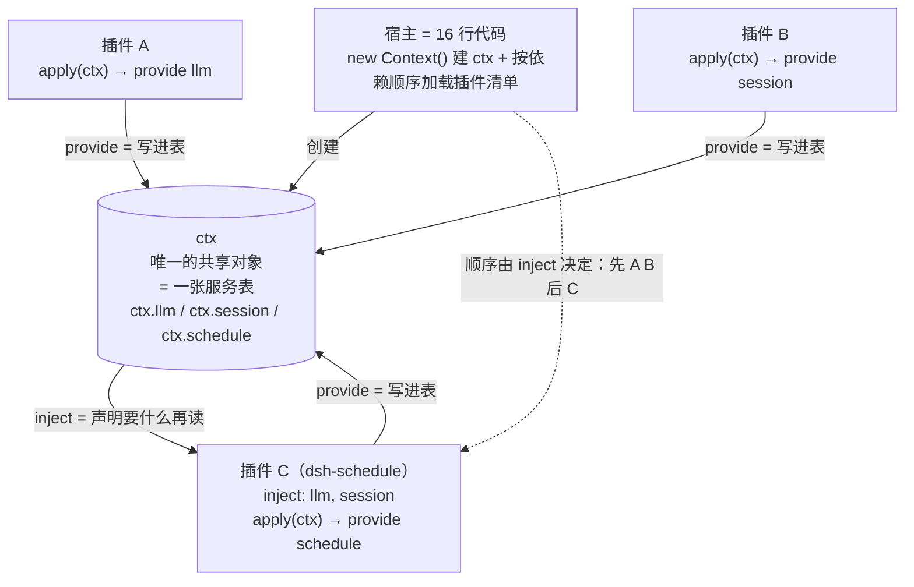
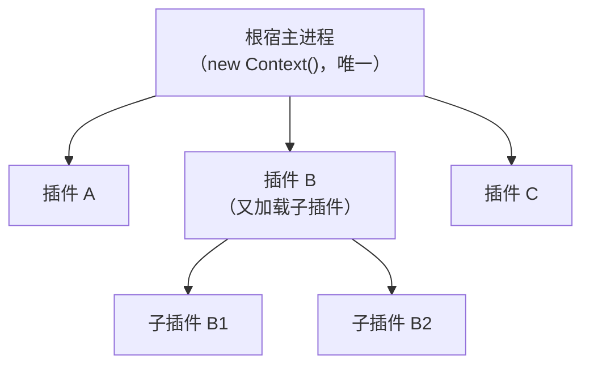
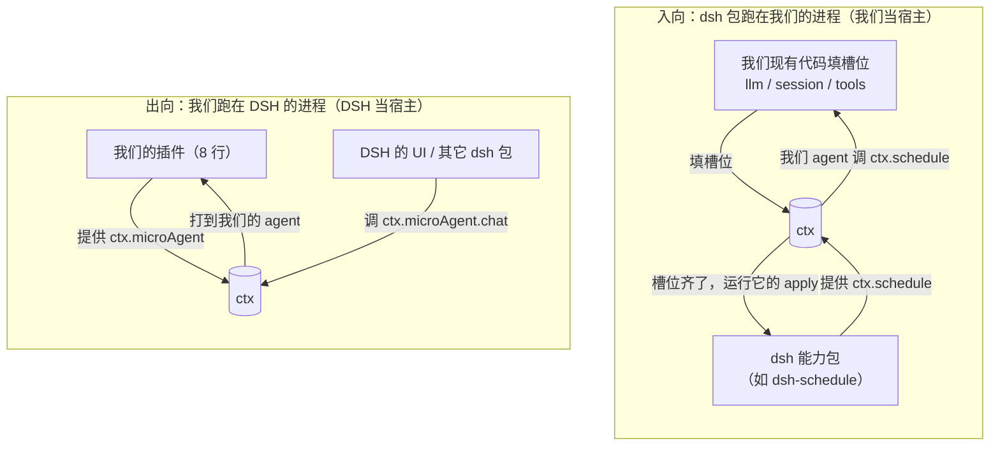
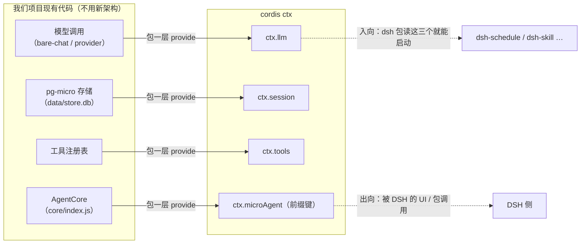
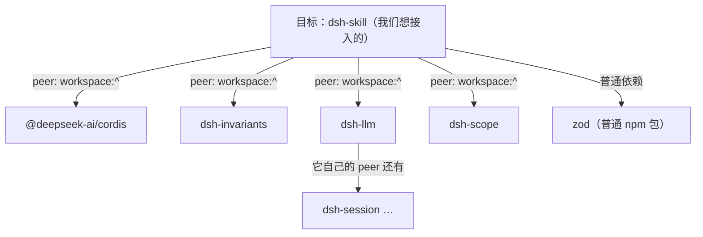

# DSH（本地参照物：reference/deepseek-harness）

> 可参考项目资料（`docs/roadmap-references.md` 分册）。采集 2026-11-11。
> 本项目与 DSH 关系最直接：我们的 DSH 式上下文压缩、轨迹面板、活动模型均借鉴自它。本地是完整源码快照，`docs/subsystems/` 全套子系统文档是实现状态的权威来源。

## 仓库

- 本地快照：`reference/deepseek-harness/`（含 docs/subsystems/、docs/capability-seams.md、docs/architecture.md、docs/rescope.md）
- 项目内分析文档：`docs/dsh/dsh-replica.md`（UI 借鉴决策基线）、`docs/dsh/PLAN.md`（特性规划与依赖）

## 简介

DeepSeek Harness：基于 cordis 框架的 agent harness，"一切皆插件"。每个 `ctx.X` 服务都是一个**可替换的能力接缝（capability seam）**：声明在哪个包、有哪些实现包、谁在消费，全部成图。

cordis 插件模型（本地 `vendor/cordis/` 源码 + `docs/cordis-primer.md`）：
- 五个核心概念：插件 = Service 对象（函数 + `inject`/`apply`，或 Service 子类）；Context = 服务仓库（`ctx.<key>` 稳定键）；加载顺序 = `inject` 服务依赖声明（非手动 boot 排序）；类型化事件（五种派发模式：emit/waterfall/parallel/serial/bail）；注册即可逆 effect（`ctx.effect()`/`ctx.on()`，teardown 由 disposer 回卷）。
- 生态包：`plugin-loader`（cordis.yml 加载 + 仓库缓存）、`plugin-include`（YAML include + patches）、`plugin-group`（嵌套组）、`plugin-hmr`、`plugin-timer`、`schemastery`（每个插件 Config 的 schema）。
- **DSH 的 headless profile = `cordis.yml`**：条目列表（`id/name/config`），`plugin-include` 做 patches insert；环境选择走 overlays。
- 组装形态：`packages/` 五十余个能力包 + `apps/cli` + `apps/web`，全部包以框架为 peer dependency。

## 已实现的子系统（docs/subsystems/ 逐一有文档，摘录与我们 roadmap 相关的）

- **subagent**（+ in-process driver，独立实现包）与 **agent-team**：两个子系统分开，对应"子 agent 执行"与"团队协作"两层。
- **session-persistence**：作为**可替换 seam**（`ctx.sessionPersistence`），jsonl / sqlite 两个实现包 —— 持久化是接口，实现可换。
- session 全家桶：session-projection（投影缓存）、session-query（读取/轨迹/过滤/搜索）、session-reference（跨会话快照）、session-telemetry、session-title。
- **schedule**（定时）、**workflow**、**jobs**、**webhook**：自动化四件套。
- **skills**（skill provider registry + filesystem provider，`ctx.sessionSkillCatalog` seam）、**extensions**、**commands**。
- **shell** 与 **terminal** 分开（对应我们 roadmap 里 shell 条目的原语义参照）。
- plan、goal、todo、user-questions、permission-presets、credentials、attachment、system-prompt、compaction（+ tool-result-pruner 独立包）、token-meter、spill、storage（json/sqlite 两个实现）、lsp、sandbox、invariants、scope、typert（运行时类型注册表）。

架构要点（capability-seams.md + rescope.md）：
- vendored cordis 框架 4.0.0-rc.7（+ cosmokit/schemastery/plugin-loader 等基础库），每个 harness 包以框架为 peer dependency。
- 能力接缝图（mermaid）覆盖全部 `ctx.X` 服务的声明/实现/消费关系 —— 我们的 plugin-system 可以产出同样的接缝图。

## cordis 接口实态（源码实测）

> 2026-11-12 实测：vendor/cordis 源码 + docs/cordis-* 文档 + npm registry。⑱ dsh-compat 的实现参照。

**npm 发布状态**（`npm view` 实测）：
- `@deepseek-ai/cordis` 已发布：latest **4.1.0**（本地 vendor 为 4.0.2，轻微漂移），MIT，纯 ESM，源码 144K（9 个文件：context/events/fiber/index/logger/reflect/registry/service/utils）；依赖 `@deepseek-ai/cosmokit`（1.9.0）
- dsh-* 能力包**全部已发布**（实测 9 个常用）：dsh-compaction-basic 0.0.1-rc.3 / dsh-schedule 0.0.1-rc.3 / dsh-goal 0.0.1-rc.1 / dsh-tool-goal 0.0.1-rc.1 / dsh-skill 0.0.1-rc.1 / dsh-session-persistence 0.0.1-rc.1 / dsh-session 0.0.1-rc.1 / dsh-llm 0.0.1-rc.1 / dsh-tools 0.0.1-rc.1 —— 均在 0.0.1-rc 段，churn 快，使用需钉版本
- 本地 dsh 包 peerDeps 为 `workspace:^`：本地直接加载需整套 pnpm workspace 工具链（本项目为纯 npm）

**插件三种形态**（docs/cordis-tutorial/01）：
```ts
// 1) 函数（最常见）
export const name = 'consumer'          // 可选显示元数据
export const inject = ['greeter']       // 服务依赖声明（命名导出）
export function apply(ctx: Context) { console.log(ctx.greeter.greet('world')) }
// 2) 对象：{ name, apply(ctx) {} }
// 3) 类：class X extends Service { constructor(ctx) { super(ctx, 'xService') } }
//    —— 类形态自动注册为 ctx.xService，随 fiber 卸载自动移除
```
无框架 bootstrap 代码："a plugin describes what it contributes, and cordis.yml composes the application." 加载失败 = 响亮失败（进程报错退出）；entry 模块无法解析 = 经 logger 报告（不崩进程，易被忽略）。

**inject 语义**（docs/cordis-tutorial/03）：
- PENDING：插件挂起直到声明的全部服务存在；不崩、不部分运行；cordis.yml 列表顺序无关，依赖决定启动顺序
- 加载后依赖持续跟踪：所需服务消失（卸载/热替换）→ 所有依赖插件一并卸载，服务返回时重新加载 —— 这是"实现可替换"的框架原生机制（换 provider，消费者干净重启）
- 可选依赖：`ctx.get('name')` 探测（无 provider 为 undefined，插件照常运行）
- 编译时：`declare module '@deepseek-ai/cordis' { interface Context { ... } }` 声明合并（仅类型，不生成代码）
- 命名：**单应用一个 flat 命名空间**；harness 占 plain names（`tools` / `llm` / `agents`）；**第三方必须用前缀/命名空间键**

**ctx 表面**（docs/cordis-api/context.md + vendor/cordis/src/context.ts）：Proxy 依赖容器
| 组 | API | 备注 |
|---|---|---|
| 服务存储 | `ctx.provide(name, value)` → disposer / `ctx.get(name, strict?)` / `ctx.set` / `ctx.accessor` / `ctx.mixin` / `ctx.plugin(Class)` | provide **同 scope 重名抛错**；mixin 把服务成员转发到 ctx（如 `ctx.on` ← `ctx.events.on`） |
| 事件 | `ctx.on` / `ctx.emit` 等 | 5 种派发模式：emit（观察）/ **waterfall（around 中间件，next() 短路——策略钩子原语）** / parallel / serial / bail（首个 bail 停）；模式是事件公共契约的一部分（`@mode` 标签） |
| 生命周期 | fiber | 所有注册（provide/on/effect）都是可逆 effect，fiber 卸载时回卷 |
| 作用域 | `ctx.extend(meta)` / `ctx.isolate(name, label?)` / `ctx.intercept(name, config)` | 子上下文 / 单服务独立作用域 / 下游配置合并 |
| 内置 | `ctx.events` / `ctx.logger` / `ctx.reflect` / `ctx.registry`（ctx.plugin、ctx.inject） | |

**真实 seam 键名**（实测）：
- DSH 的 agent 包注册 **`ctx.agents`**（`packages/core/agent/src/index.ts:258` `super(ctx, 'agents')`）——roadmap 原写 "ctx.agent" 有误，已纠正
- 实用规则（cordis-primer）：工具管道 → `ctx.tools`；模型流式 → `ctx.llm`；agent 协作 → `ctx.agents`；"prefer events for interception and policy; prefer service methods for direct capability calls"

**profile 实例**（apps/cli/tests/profiles/headless/goal.cordis.yml，共 11 行）：
```yaml
- id: base
  name: '@deepseek-ai/cordis-plugin-include'
  config:
    path: ./cordis.yml
    patches:
      - insert:
          - id: goal
            name: '@deepseek-ai/dsh-goal'
```
= 挂 base profile 并 patch 插入包；`name` 是模块说明符（相对路径或 npm 包名）；环境变体走 include/patches/overlays 叠加。

## 接入机制图解（mermaid）

> 2026-11-12 增：四张图对应四个卡点——ctx 是什么 / 入向出向的区别 / 怎么落到我们的代码 / workspace: 为什么重要。一句话核心：**「生态」= 一个共享对象 `ctx` + 一堆 `apply(ctx)` 包；「接入」= 让对方的 `apply(ctx)` 跑起来，双方在同一个对象上填/读槽位。**

### ① 基础概念：ctx 是"一张服务表"，插件是"读写这张表的函数"



一个"插件"就是导出 `apply(ctx)` 的 JS 模块：`ctx.provide(key, value)` 把一个能力写进共享表；`inject` 声明"我要哪些能力"——**cordis 会等它们全部就绪才运行你的 apply**（只等不崩），所以**清单顺序无关、依赖决定顺序**。「宿主」只有 16 行：建 ctx + 加载 cordis.yml 里的清单。

**宿主是相对角色，可嵌套成树**：宿主/插件是"跟谁比"的相对关系（像父子/左右）——同一个组件对上是"插件/房客"、对下是"宿主/房东"，同时扮演两个身份。一套组合里**根宿主只有一个**（建根 `Context()` 的进程，树顶终极房东），但任何插件再加载子插件（`plugin-group` 嵌套组 / `ctx.extend()` 子上下文）就成了子插件的"子宿主"。所以不是"只有一个组件当宿主"，而是"只有一个根宿主"，宿主身份按树嵌套。



插件 B 对 ROOT 是房客、对 B1/B2 是房东——同一组件，两个身份。

### ② 入向 / 出向：区别只在"谁是宿主、在谁的进程里跑"



记法：**入向 = 我们当房东，dsh 是房客**——我们填它要的槽位（llm/session/tools），它跑在我们家。**出向 = DSH 当房东，我们是房客**——我们填 microAgent 这个槽，跑在 DSH 家。两边代码是同一套 `ctx.provide` / `inject`，只是"房东"不同。

### ③ 落到我们项目的代码：现有模块就是槽位，适配只是"包一层"



适配层的实际工作量 = 写几行 `ctx.provide`，把**现有函数**包成 `ctx.X`。现有架构不用动，新增的只有这层薄"包装" + 那个 16 行宿主。

### ④ workspace: 为什么重要：包体没问题，挂的是依赖声明



- **包体本身已发布、没问题**（lib/ 编译好的 JS）。问题**只在依赖声明**：dsh 能力包的 peerDependencies 全是 `workspace:^`。
- `workspace:^` 是 **pnpm 协议，npm 解析不了** → `npm i dsh-skill` 会卡在这 4+ 个 peer 上。
- 实测扇出：每包 4–12 个（skill=4 / token-meter=7 / schedule=9 / tool-bash=12），但**高度重叠**（cordis / llm / session / invariants 反复出现），真正"核心集"不大。
- 所以入向只有两条路：**pnpm workspace**（能解析 `workspace:^`，最正统）或 **vendor 最小集 + 把 `workspace:^` 改写成真实版本号**（npm 友好，但要自维护）。出向不受影响（我们的插件只依赖 cordis，npm 可装）。

## 对本项目的借鉴/融合点

| 我们的条目 | 借鉴点 |
|---|---|
| M1 ④ session-save | 直接抄"持久化 = seam + 多实现"的形态（我们 pg-micro 是其一，jsonl 可作轻量实现） |
| M2 ⑥ skill-system | provider registry + filesystem provider 两段式，与我们复用 `~/.agents/skills` 格式正好对齐 |
| M3 ⑪ subagents | subagent（执行层）的实现包结构（in-process driver 独立） |
| M4 多 agent | **subagent（执行层）与 agent-team（协作层）拆成两个子系统**的分层方式，是我们"代码/调研专门 agent"最接近的完整本地参照 —— 源码可直接读 |
| M3 ⑯ plugin-system | "每个 ctx.X 都是可替换 seam"的拆分粒度参照：先按 seam 切（流式/压缩/引用/持久化/skills/子 agent 各是独立 seam），再谈插件化 |
| M3 ⑱ dsh-compat | 双向兼容的全部素材本地齐备：`vendor/cordis` 框架源码、`docs/cordis-primer.md`、12 份 `*.cordis.yml` 实例（含 headless profile）、`packages/` 五十余个插件包作出向打包参照；另见上文「cordis 接口实态」节（npm 发布状态 / 插件与 inject 形态 / ctx 表面 / 真实 seam 键名 / profile 实例） |
| M3 ⑫ shell | shell/terminal 分离：印证我们保留 shell 原语义 + 需要时新建子功能的决策 |
| M3 ⑮ schedule | schedule/workflow/webhook 已实现：排程是 harness 标配（与 OpenClaw/Goose/Hermes 相互印证） |

## 链接

- 本地 `reference/deepseek-harness/docs/`（subsystems/、capability-seams.md、architecture.md、rescope.md、cordis-primer.md、cordis-api/、cordis-tutorial/）
- 本地 `reference/deepseek-harness/vendor/cordis/`（框架源码）与 `apps/cli/tests/profiles/**/*.cordis.yml`（12 份配置实例）
- 项目内 `docs/dsh/`（dsh-replica.md、PLAN.md、plan-trajectory.md）
