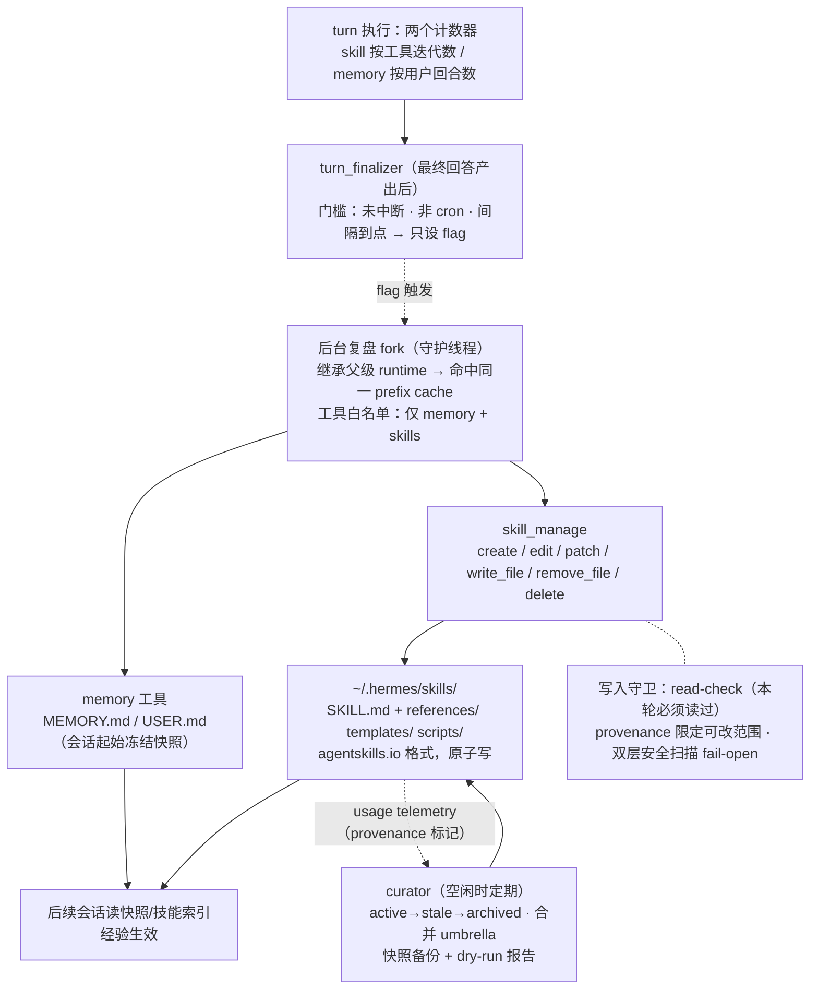

# hermes-agent (Nous Research)

> 可参考项目资料（`docs/roadmap-references.md` 分册）。采集 2026-11-11。

## 仓库

- https://github.com/NousResearch/hermes-agent （MIT，Python，2026-02 开源）
- 生态：https://github.com/NousResearch/hermes-agent-self-evolution （DSPy+GEPA 进化优化）

## 简介

"the agent that grows with you" —— 声称**唯一内置学习闭环**的自托管个人 agent。五支柱设计：**Memory / Skills / Soul / Crons / Self-Improvement**。单网关进程接 Telegram/Discord/Slack/WhatsApp/Signal/CLI，语音备忘录转写、跨平台会话连续；模型无关（`hermes model` 切换）；可跑 $5 VPS 或 serverless（空闲休眠近乎零成本）。

## 关键特性

- **双文件记忆**：`MEMORY.md`（agent 自笔记：环境事实/约定/教训，2200 字符上限）+ `USER.md`（用户画像：偏好/沟通风格，1375 字符上限）。上限逼出策展。
- **冻结快照**：system prompt 注入在会话开始时捕获一次，会话中不变（保 LLM prefix cache）；写入立即落盘但下一会话才进 prompt；工具响应始终显示 live 状态。
- **后台反思**：每轮结束后的 self-improvement review 自动把反复纠正/持久教训沉淀为记忆条目或技能，聊天内通知（`💾 Memory updated`）；`memory.write_approval: true` 可要求先经人审批。
- **跨会话检索**：全部会话入 SQLite + FTS5 全文搜索（`session_search` 工具）+ LLM 摘要 —— 不用向量库。
- **用户建模**：Honcho 辩证式用户建模，跨会话加深对用户的理解（个性化核心）。
- **SOUL.md**：独立人格文件（定义"它是谁"），与 MEMORY.md（"学到了什么"）分层。
- **技能**：完成复杂任务（如 ≥5 工具调用）后自动抽取建技能；**技能在使用中自我改进**；`skill_manage` 工具全 CRUD（CREATE/EDIT/PATCH/DELETE/WRITE_FILE/REMOVE_FILE）；兼容 agentskills.io 开放标准。
- **Crons**：内置 cron 调度器，自然语言定义任务，可投递任意平台（日报/夜备/周审计，无人值守）。
- **子 agent 与 RPC 脚本**：隔离 subagents 并行工作流；Python 脚本经 RPC 调工具，把多步管道压成"零上下文开销"的轮次。
- **轨迹/RL**：批量轨迹生成 + 压缩，用于训练下一代工具调用模型（Tinker-Atropos）。
- **自我进化生态**（独立 repo / 社区）：
  - `hermes-agent-self-evolution`：DSPy+GEPA（ICLR 2026 Oral）进化优化技能/工具描述/prompt/代码；护栏：全测试套件、尺寸上限（skill ≤15KB）、**所有变更走人工 PR review**。
  - `hermes-lucid`：分阶段自我改进 —— stage → review → approve → apply，记忆/技能更新在显式 apply 前不碰 live 状态。
  - `hermes-self-improvement`：观察 hooks（工具失败/用户纠正）→ evidence pack → planner → 经官方工具应用变更。
  - Open issue #10354 "Living System"：元认知、记忆温度（重要性权重）、梦境整理（离线记忆整合）、身份进化。

## self-evolution 实现机制（源码级）

> 来源：官方源码（`agent/background_review.py`、`agent/curator.py`、`tools/skill_manager_tool.py`、`agent/turn_finalizer.py`）+ RELEASE_v0.12.0 说明 + 多篇源码级分析（lleg.dev、rememorio、6ixgodd/hermes-analysis、HZ0108/hermes-agent-insights）。2026-11-11 补充。

**不是**在线训练权重，**不是**自改核心源码，而是五层经验沉淀闭环：

```
self-improvement = 触发计数器 + 后台复盘 fork（critic）+ memory/skill 写入器 + 使用遥测 + curator（维护/回收）
```



**① 触发层**：skill nudge 按工具调用迭代计数（默认间隔 10，`skills.creation_nudge_interval`），memory nudge 按用户回合计数（默认 10）；agent 主动用了对应工具即重置计数。turn 收尾只设 flag 不调模型；跳过条件：无最终回答 / 被中断 / cron 任务（fork ~30K tokens/次，无人值守无收益）/ safe-worker 模式。

**② 批判层（后台复盘 fork）**：回放本轮会话快照（剔除前轮工具消息）；继承父级 provider/model/凭据/缓存 system prompt（保 prefix cache）；**主会话与 prompt cache 永不被触碰**，已生成回答不被改写。工具白名单 `enabled_toolsets=["memory","skills"]`，terminal/browser/文件写默认全拒（`extra_tools` 可放宽但须已存在于父级清单）。skill 复盘 prompt 要求"Be ACTIVE——多数会话至少产生一次技能更新"，信号清单含：用户纠正风格/语气/格式/冗长（**一等技能信号**）、纠正工作流、非平凡技巧/workaround/debug 路径、已加载技能过时（立即 patch）；动作优先级 **patch 已加载技能 > 更新 umbrella > 加支持文件 > 新建**（目标 class-level 技能库，禁止一会话一技能）。

**③ 写入层**：`skill_manage` 全 CRUD（patch 优先于 edit：更安全便宜）+ 支持文件（references/ 研究摘录、templates/、scripts/ 可重跑脚本）+ 原子写 + frontmatter/path 校验；**使用中自我改进**——后续会话发现技能有错/有更优路径时任务中途 patch。`memory` 写 MEMORY.md/USER.md（字符上限逼策展）；**冻结快照**：会话起始注入的 prompt 快照不变，工具响应显示 live 状态。

**④ 维护层（curator，2026-04 加入）**：空闲时运行，防技能库腐烂。两阶段：确定性状态机（usage timestamp → active→stale→archived）+ fork curator agent 决定合并/patch/建 umbrella/归档。运行前打快照（可回滚），支持 dry-run。

**⑤ 写入守卫**：read-check（改任何已有文件前，fork 必须本轮读过该文件）；provenance（`skill_provenance` 标记 background review 创建的技能，无值守复盘只能改自己创建的，删除只接受 curator 管理且未保护的本地技能）；双层安全扫描（正则静态 + Rust 语义）fail-open（只警告不阻塞）。

**"用户需要"的驱动路径**：用户纠正是第一信号源（进技能库 + USER.md）；`memory.write_approval` 可要求后台写入先经审批；`/skills` 可浏览、curator 报告可回滚。同时有自驱成分（复杂任务/错误恢复/计数器 nudge）。

**明确不做**：不在线改核心源码、不在线训练（RL 管道是离线研究设施：轨迹→奖励→压缩，训练下一代模型）、不绕工具审批、不管 bundled/hub 技能、不做不可恢复删除。

**v0.12.0 演进**（loop 的迭代方向）：rubric-based 评级替代 free-form、active-update bias（优先更新刚加载的技能）、支持 references/templates 子文件、fork 继承 runtime 修复、scoped toolsets、clean shutdown。

## 对本项目的借鉴/融合点

| 我们的条目 | 借鉴点 |
|---|---|
| M2 ⑦ memory | 最完整的"最小记忆"参照：双文件分工（MEMORY=环境/教训，USER=用户画像）+ 字符上限 + 冻结快照（保 prefix cache）+ 轮后后台反思（带通知、审批可选）+ FTS5 跨会话搜索（免向量库） |
| M2 ⑥ skill-system | 自动建技能触发器（复杂任务检测）+ `skill_manage` 全 CRUD + "技能在使用中自我改进"；agentskills.io 兼容（我们已复用 `~/.agents/skills` 格式） |
| M3 ⑮ schedule | cron + 自然语言任务 + 跨平台投递（我们投到自家 UI 即可） |
| M3 ⑪ subagents | RPC 脚本模式：脚本调工具，多步管道零上下文开销 |
| M4 专门 agent | SOUL.md 作独立人格层（"它是谁"）与记忆（"学到了什么"）分开；issue #11919（SOUL.md 应随使用进化）是方向信号 |
| M3 ⑮ self-evolution | 计数器 + turn 末 flag + 受限后台复盘（bare-chat 形态）+ skill_manage 全 CRUD + read-check（= 现有 fs-observation-policy 复用）+ 事件流通知 + 权限 gate 审批；curator 做简单版（标记未用技能），Honcho 云建模/RPC 脚本/RL 管道不做。hermes 默认自动应用+通知，我们的"提议→评审→应用"门更严（对应 hermes-lucid 分阶段模式） |

## 链接

- https://github.com/NousResearch/hermes-agent （README / README.zh-CN）
- https://github.com/NousResearch/hermes-agent/blob/main/website/docs/user-guide/features/memory.md
- https://github.com/HZ0108/hermes-agent-insights （第三方自我进化机制深度分析）
- https://github.com/NousResearch/hermes-agent/issues/10354 （Living System 提案）
