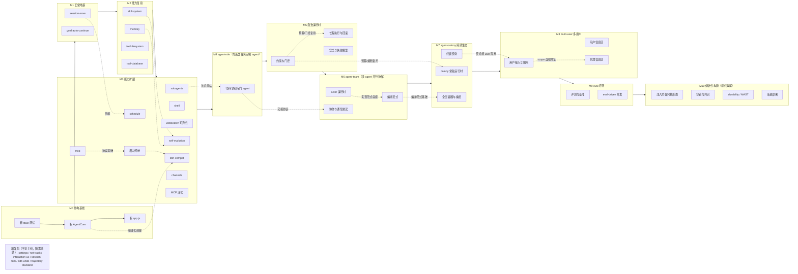
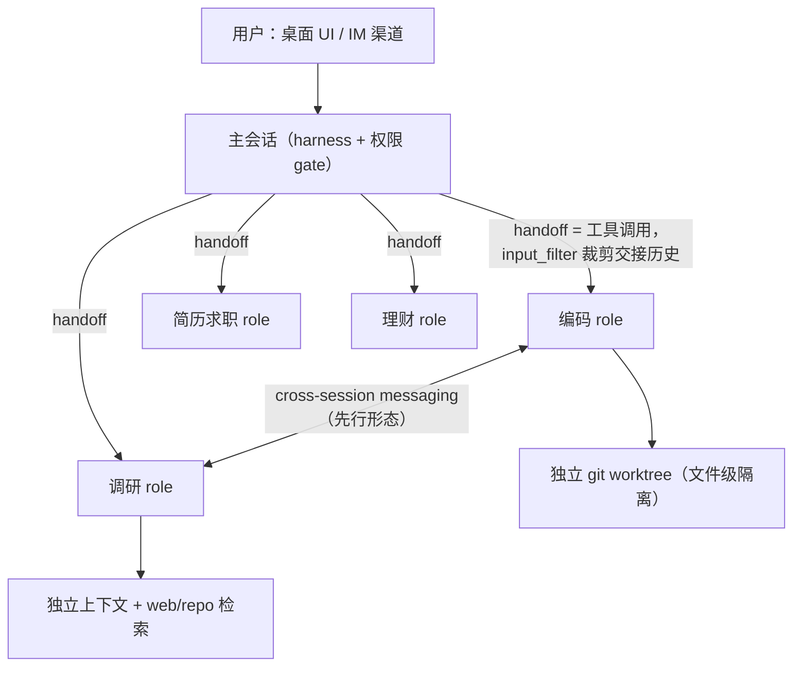

# roadmap

主线：满足个人使用的agent助手，采用dsh的模型通信格式，并兼容其插件生态。
支线：学习harness开发以及作为求职作品，各子系统做到完整自洽、设计可讲清楚即可。
里程：minimal → tool → workflow → role → auto → team → colony → users → eval → robus

## principles & collaboration rules

- **铁律**：功能集只增不删 —— 只能增添功能、调整整体结构关系，不能删减和覆盖原有功能语义。
- **流程**：每个里程碑启动前、每个条目落盘前，先与用户讨论达成一致再动手。
- **优先级标准**：实用 > 架构自洽 > 学习价值。
- **设计哲学：默认+扩展点** —— 默认是我们自己的轻量模型；外部标准（cordis）、高级需求（scope / 隔离域）、自我变更（self-evolution）都落在扩展点 / 适配层 / 权限项上，不进主体。
- **模块 = 运行时能力包** —— 编译时解耦（模块不静态 import 彼此），运行时接合（registry 注册）；权限 gate 统一覆盖自变更（self-evolution）与外部变更（插件 / 配置变更）：新增动作域（memory.write / skill.* / module.install / config.set），默认 allow + 事件流通知，用户可收紧 ask/deny。
- **可观测作为模块设计基本准则** —— 每个模块默认产出可观测信号：span / 轨迹 / 成本 / 延迟指标，是模块的基本设计准则而非独立功能。

## 核心概念定义

全局术语基准。四层自底向上，上层可包含下层；subagent 是 agent 的内含能力而非独立构成层；用户是层外的授予者 / 观察者，不算作 agent。

| 层 | 定义 | 边界 |
|---|---|---|
| **agent** | 最基础的单一 agent 单元，可派生 subagent 作为其内含的委派能力 | 包含 subagent 与作为构成单元供上层组合；不含人类用户 |
| **subagent** | 受 agent 调用、执行小型子任务的委派 agent | 仅 1 个轮次会话周期，完成后即终止、不续轮；生命周期从属于调用它的 agent，不构成团队；与 agent-team 成员的区别 = 被单个 agent 直接调用 vs 按角色分工协作 |
| **agent-team** | 为完成 1 项任务、由多个 agent 并行协作组成的团队 | 面向单项大任务、任务完成即解散；成员是角色化（职业化）配置的 agent；由编排层组建 / 解散 |
| **agent-colony** | 可包含 agent（含其 subagent 委派能力）与 agent-team、持续自动运作的 agent 复合生态 | 常驻、无预设终点，一般由用户授予一个需持续推进的**终极使命**；与 agent-team 不互斥（team 一次性、colony 跨任务常驻，team 不自动升级为 colony） |

层级关系：`subagent ⊂ agent ⊂ agent-team ⊂ agent-colony`（subagent 被 agent 包含、是 agent 的内含委派能力；agent 是上层的构成单元；colony 是包含全部层的容器）。

命名说明：**agent-colony**（常驻复合生态）与 **parallel swarm**（并行 / 优化编排范式）是不同概念。

最小待定边界：终极使命的授予 / 表示 / 推进 / 终止机制、colony 常驻运行时与定时任务 / 预算熔断的关系、多用户下 colony 与使命的隔离粒度。

## main-line overview

> 实线 = 主线里程碑顺序；虚线 = 跨里程碑依赖（与下文条目描述一致）。

## main line

### M0 baseline

目的：提供安全的基础基线（技术债重构 + 工具链切换）。

#### 拆 `core/index.js` 的 AgentCore

流式（`_stream`）、压缩（`_runCompaction` / `_maybeCompactStep` / `_pruneToolResults`）、references（`_resolveReferences`）、token 锚点（`_emitUsage` / `_recordTokenAnchor`）各自独立成模块。
#### 拆 `ui/web/app.js`

按域分文件 —— 会话 / 消息 / composer / 轨迹 / 弹层。
#### 切 pnpm

包管理器 npm → pnpm（`pnpm-lock.yaml` 替换 `package-lock.json`、脚本 npm → pnpm、corepack 启用 pnpm）；与 dsh-* 生态（pnpm workspace）对齐。

粗判据：测试全绿；每个文件单一职责；切 pnpm 后 `pnpm i && pnpm test` 全绿。

### M1 daily-foundation

判据：关掉应用重开，会话和进行中的任务都活着。

#### session-save

重启后恢复会话 + 挂起状态（待审批 / 待回答 / user job）接续。事件溯源已存全量数据，缺的是恢复投影与在途交互的接续。
#### goal-auto-continue

goal 驱动自动续轮（max_goal_rounds 上限，blocked/complete 终止，连续失败自动暂停防死循环，参照 Cline mistake limits / Goose Ralph Loop 完成判据）。goal CRUD 已就绪，缺驱动侧。进阶形态 = ToT / LATS 完整形态：在单路径续轮之上做树搜索 / 多分支展开 + 评估 + 回溯 + LATS 反思闭环。

### M2 capability-reuse

判据：agent 能自主选用技能、能跨会话记住。

#### skill-system

技能加载 / 注入 / 选择（复用 `~/.agents/skills` 的技能格式）。深化能力清单：**发现与渐进披露**（先给技能名/摘要、按需展开全文，避免全量注入）、**调用与路由**、**评测 / 打包 / 可移植**（技能效果评测、打包分发、跨 host 可移植）。
#### memory

跨会话持久记忆。最小形态 = 结构化记忆文件（如 `user/memory/`）+ 注入 system prompt + 记忆写入工具（经审批）；进阶 = compaction 后反思沉淀。进阶形态一 = hybrid memory：vector + graph + KV 混合记忆后端，经 memory store（可切换模块 / 可引入新后端）承载，不焊死具体实现。进阶形态二 = repo memory & 初始化脚本：仓库级持久记忆 / durable state（参照 Letta git-backed MemFS、「记忆不是插件而是 harness 核心职责」）与 agent 初始化脚本（会话启动时载入项目约定 / 仓库上下文）；与 repo map（代码智能 / 上下文工程）不同物，后者是检索能力，此处是记忆与初始状态。
#### basic-tools

- filesystem：文件系统工具扩展（现有 read/write/edit/glob/grep；扩展具体范围待定）。
- database：agent 操作项目 DB（读优先，写走权限 gate）。

### M3 capability-extension

判据：复杂任务可分身；外部 MCP 工具可接入；越用越强；扩展不改核心代码；DSH 双向兼容；多渠道可达。

#### subagents

受 agent 调用的委派 agent，独立上下文执行子任务、结果汇回主 agent，仅 1 个轮次会话周期、完成即终止。
#### extend-tools

- shell：独立 shell 工具（保留原语义；有新需要则新建子功能，不重定义）。
- websearch 可靠性：多 provider 降级 / 配额管理（现有 Tavily 实现保留）。
- mcp：MCP 客户端支持 —— 外部 MCP server 工具接入工具注册表。
- MCP 深化：补齐 MCP 协议族的生产级能力 —— **tasks extension**（无状态核心上的持久工作）、**registry supply chain**（stateless gateways & registry admission、admission / drift / rollback）、**conformance engineering**（versioning / evidence / operations）、**security & authorization**（poisoned metadata / routing / MRTR state、CIMD / Issuer binding / PKCE、Issuer-Bound enrollment & tokens）；另含 apps on the stateless protocol、tool contracts、reliability / cancellation / flow control。
#### self-evolution

宿主的**特殊机制**（非普通模块）—— 学习闭环：计数器 + 轮后后台反思（受限工具集）沉淀记忆/技能 + 复杂任务后自动抽取建技能 + 技能在使用中自我改进；其中「轮后后台反思」即 **sleep-time compute / memory blocks**（compaction 后的后台反思步骤，把近期对话沉淀进记忆、不占交互；Letta 称其为「自我进化的温和形态」）；所有变更走「提议 → 评审 → 应用」分阶段门，经统一权限体系新动作域（memory.write / skill.*，默认 allow + 事件流通知，用户可收紧 ask/deny）。扩展面复用模块系统通用机制：它写入的 memory store / skill store 本身是模块（用户可创建/切换；可引入 curator 或新后端优化此功能）；反思与写入前后由 hooks 拦截；策略参数（nudge 间隔 / 反思 prompt / 门控松紧）走 config。见 refs/hermes.md（hermes background review / skill_manage / curator 源码级机制）、refs/pi.md、refs/letta.md。
#### schedule

定时任务 / 自动化（cron 式）。
#### 模块系统（plugin-system + hooks）

模块 = 运行时能力包（统一 manifest：name + 提供的能力 + config schema + 生命周期 + scope），编译时解耦（模块不静态 import 彼此）、运行时接合（registry 注册）。宿主的根 ctx 是我们自己轻量模块系统的 ctx（不重用 cordis）。宿主：registry + 模块事件总线 + 生命周期（宿主持有）+ hooks（生命周期事件订阅：PreToolUse/PostToolUse/Stop/子 agent 生命周期）+ 权限 gate。scope = 声明该模块相关数据的地址（不做代码级限制，默认共享上下文，支持为模块指定隔离域）。子模块两级制：定义级（manifest + prompt 片段 + config，无代码）/ 代码级（ESM，导出 register 函数，可信代码，宿主环境兜底）；放置双位置：项目级 + 全局级。用户可创建和切换任何模块（含默认包集合）的通用能力包；kernel（最小不可变集）= 模块系统本身（registry / 事件总线 / 生命周期 / hooks 注册面）+ 权限 gate，其余（含 turn loop 与全部默认包、第一批模块）均为可切换的默认包。默认包集合：turn loop / prompt 组装 / 会话存储接口（seam，pg-micro 为默认实现）/ self-evolution 机制；第一批模块：tools（工具实现）/ transports / providers / loops 节点 / compaction / translation；plan/goals/todo/token-meter 暂不模块化（仍属默认包，非 kernel，需要时再拆）。含开放插件规范 vs 自有格式的设计决策。
#### dsh-compat

与 DSH（cordis）生态双向兼容。格式决策：**双向适配** —— 宿主内部保持轻量模型，边界适配层物化 cordis 接口（cordis 接口是进程内 ctx 对象 API，不是协议）。适配形态：**一核两面** —— 单一「上下文桥」模块，核心是映射表（我们的服务名 ↔ ctx 键；我们的事件名 ↔ cordis 事件名 + 派发模式；config schema 映射），出向面 = 薄 cordis 插件（`apply` → 引导宿主 → provide + 事件桥 + disposer），入向面 = **真 cordis Context 子宿主**（npm `@deepseek-ai/cordis`，`new Context()` + loader，即 16 行宿主，**非 mini ctx 仿造**）+ 缝适配器（把 dsh 包要读的槽位填上、桥接到我们根 ctx 的服务）+ profile 加载器（cordis.yml 子集）。出向：注册前缀键 `ctx.microAgent`（一个服务：chat/stream/session API）+ 事件桥（turn/step/tool → cordis 事件，默认 emit，拦截点用 waterfall）+ entry config（model/provider 等），与 DSH 自带 `ctx.agents` 共存（flat 命名空间；更深接缝替换 = v2，另议），可装入 DSH 或任何 cordis host（cordis.yml profile 加一条 entry）。入向：真 cordis 子宿主 + 缝适配器 + 加载器，加载 DSH 能力包（`@deepseek-ai/dsh-*` 0.0.1-rc 段，钉版本使用）与 profile（cordis.yml include/patches）。优先级：**出向先行**（面小、真 cordis host 验证映射表），入向等出向摸清 ctx 语义后再做。依赖策略：**pnpm**（项目级决定：pnpm 是更好的包管理器、且与 dsh-* 生态（pnpm workspace）对齐；cordis + dsh-* 钉版本；本地快照只作只读参照）。npm 上的 dsh-* 包 peerDeps 为真实版本号（`workspace:^` 仅存在于本地源码快照），npm 亦可安装；选 pnpm 是项目级偏好，非 dsh-compat 必需。待定：入向试点包、具体 seam 键集 / 事件映射。见 refs/dsh.md（含「cordis 接口实态」「接入机制图解」节）、本地 `reference/deepseek-harness/`（vendor/cordis 源码 + docs/cordis-primer.md + 12 份 cordis.yml 实例）。
#### channels

多渠道入口 —— 新增渠道客户端（先选一个主流 IM 打通）走现有 http transport，agent 可在手机/IM 上被使唤；渠道 = 接入 transport 注册表的可插拔客户端。见 OpenClaw / Hermes 多渠道网关（refs/openclaw.md、refs/hermes.md）。
#### workflow

多步骤任务的编排与执行框架：将任务分解为可管理的步骤序列，支持计划制定、逐步执行与中途调整。

- plan-mode：workflow 的计划态 —— 在落地执行前先产出并确认计划（步骤 / 依赖 / 目标），用户可在执行前审阅与调整；计划状态由 activity 驱动。
当前需要修复 2 个 stale 的 plan-mode 测试（plan-mode 状态现由 activity 驱动，测试仍直接设置旧状态），恢复 63/63 全绿。

### M4 agent-role（为某类任务定制 agent）

判据：可为主流任务类别定制专职 agent role，各 role 独立干活并互相交接（会话间可直接传话，不必等完整协议）；role 定义格式统一、可切换。

#### coding（编码）

角色化配置（专属 system prompt / 工具集 / 模型；定义文件格式待定）；带代码智能能力（repo map / LSP 式上下文工程，具体形态待定）；独立 git worktree 做文件级隔离。

#### research（调研）

独立上下文 + web / repo 检索；与 coding 等 role 通过交接协议协作。

#### code review（代码评审）

对 diff / PR 做评审的专职 role，可复用 coding 的代码智能能力；作为 coding 大类下的子任务角色，与 coding 平级编排。

#### 科研（research agent for science）

面向科研流程的 role：文献检索与综述、实验设计辅助、数据分析与可视化、论文写作辅助；可调用 web / repo 检索与计算工具。

#### 简历求职助手（job-hunting assistant）

面向求职流程的 role：简历撰写与优化、岗位匹配与 JD 解析、面试准备（模拟问答 / 知识点梳理）、投递跟踪。

#### 个人理财助手（personal finance assistant）

面向个人财务的 role：收支记账与分类、预算规划、投资标的资讯聚合与初步分析、报表生成；只读外部数据、写操作走权限 gate。

#### 逆向工程（reverse engineering）

面向二进制 / 协议逆向的 role：反汇编 / 反编译、符号与调用关系重建、协议报文解析；可调用代码智能与检索工具。

角色集按需扩展，上述为首批计划实现的 agent role。

目标态草图（多角色调度示意，不限于 code / research）：

### M5 autonomous-runtime（自治运行时）

判据：长程任务在预算/门控内可控运行、越界可熔断、失败可回滚、每次纠正沉淀为系统改进。

#### 约束与门控（action budgets / iteration caps / cost governor / HITL propose-then-commit / scope contract）

动作预算、迭代上限、成本 governor；危险动作走「提议 → 人工提交」；任务边界用 scope contract 声明。复用统一的分阶段门与权限体系。
#### 长程执行与回滚（durable execution / checkpoints / rollback）

长时任务可暂停恢复、按检查点回退。
#### 安全与失败模型（failure models / kill switch / circuit breaker / feedback ratchet）

失败分类与归因、kill switch / 熔断 / canary token、把每次人工纠正沉淀为可复用的系统改进（feedback ratchet）。

### M6 agent-team（多 agent 并行协作）

判据：可按任务装配任意角色团队、可切换编排范式、有统一通信协议。

#### actor 运行时（实现范式底座）

agent 即 actor、消息驱动、独立 mailbox 与生命周期。作为本里程碑全部编排范式的实现底座。
#### 编排范式（supervisor / swarm / hierarchical / role specialization / shared memory / consensus / debate）

多范式可切换；角色分工（planner / critic / executor / verifier）；blackboard / shared memory；投票、self-consistency、debate、协商。
#### 协作与通信协议（A2A / communication protocols / handoff routines / group chat / speaker selection / multi-session handoff / MAST 失败模型）

A2A 协议与通用通信协议、无状态编排的 handoff & routines、群聊与 speaker selection、跨会话交接、群体失败模型（MAST / groupthink）。

### M7 agent-colony（持续生态 / 终极使命）

判据：一个常驻、无预设终点的 agent 复合生态，能自包含 agent（含其 subagent 委派能力）/ agent-team 全部层次，在用户授予的终极使命下持续自动推进。

#### colony 常驻运行时

常驻、无预设终点的运行底座；以动作预算 / 成本 governor / HITL propose-then-commit 作安全边界，以 kill switch / 熔断作使命终止底座；需独立运行时（cron 不足以承载常驻）。不引入 sandbox：工具仍直接操作真实系统，权限 gate 是唯一边界；常驻自治体的权限建议单独收紧为默认 ask / HITL。
#### 终极使命（mission）

用户显式授予、需持续推进的使命；用独立 mission 对象表示（不复用 goal），由 mission loop 统管推进；终止 / 撤销走 kill switch + HITL propose-then-commit。无终点使命与预算 / 成本 governor / 熔断并存——熔断是安全底座，不取消使命。授予 / 表示 / 推进 / 终止的具体机制待定。
#### 全层容器与编组

colony 作为容器嵌套包含 agent（含其 subagent 委派能力）/ agent-team；以编排范式（supervisor / swarm / hierarchical / role specialization）与 actor 运行时作编组底座。

### M8 multi-user（多用户）

判据：在核心用户之外可接入并服务其他用户，且每个 agent 只看到它干该用户相关工作所需的信息。这是**贯穿式架构改动**（会话 / 存储 / 配置 / 权限 / UI / channels 均需按用户隔离），不是一个单点功能；开发项目旧数据可删、不做迁移。

> **用户目录约定**：`user/`（单数）= **核心用户 / 第一个用户 / 默认用户**，为进程级全局配置（permissions / fs-policy / providers / settings / loops）；`users/`（复数）= **可接入并服务的其他用户**。两者并存。

#### 用户接入与隔离

用户标识、接入、会话 / 存储 / 配置 / 权限 / UI / channels 的按用户隔离；使命与 colony 实例按 user 命名空间隔离。隔离粒度（每用户私有 colony / 共享 colony 使命按命名空间隔离）待定。
#### **用户信息区**（`users/<xxx>/`）

存储每个用户的**原始信息**，是用户数据的真值源。
#### **代理信息区**（`agent/users/<xxx>`，虚拟地址）

在每个 agent 相关目录下，由**模块 scope 指向的虚拟地址**（scope = 声明该模块相关数据的地址，不是代码级限制），物理存储交给模块系统；存**从用户信息区提炼出的、该 agent 完成其相关工作所需的该用户相关信息**——是按 agent 切分的加工视图 / 投影，不是原始副本。

两区关系：`users/<xxx>/`（原始，真值源） →「提炼」→ `agent/users/<xxx>`（按 agent 切分的相关信息，经 scope 寻址）。「提炼」动作的机制待定（反思沉淀按 agent 切分投影，或由编排层统一提炼分发）。代理信息区复用 scope 机制，不另造隔离体系。

### M9 eval（评测，倒数第二里程碑）

判据：改动好不好由评测说话，而非感觉。

#### 评测与基准（eval harness / benchmarks / eval dashboard）

fixture 任务评测框架、SWE-bench / GAIA / AgentBench / WebArena / OSWorld 等基准、LLM eval（RAGAS / DeepEval / G-Eval）、评测看板。
#### eval-driven 开发（feedback loop / evidence-backed plan / success metrics）

把评测接进开发闭环 —— 先定成功指标再动手、以证据支撑执行计划、评测结果回流驱动特性筛选。

### M10 robustness（健壮性构建，最终收尾）

判据：在正常功能与界面都成型之后，系统能顶住恶意输入、部分失效、群体失协调与发布风险；这是「先功能实现、再界面美观、最后恶劣条件健壮」开发优先级的落点，故排在主线最后。

#### sandbox

明确不做 sandbox runner，安全边界仍是权限 gate（AGENTS.md 规则 7）。
#### prompt injection defense 完整形态（PVE / indirect）

展开注入防御的完整机制 —— PVE（prompt virus exposure）防御、间接提示注入（indirect injection，经工具结果 / 网页 / 文件等外部内容注入）的检测点、元数据投毒（poisoned metadata）与路由劫持防护、输入 / 输出分类与人工门。安全边界仍是权限 gate，不引入 sandbox。
#### 容错与共识（consensus / BFT / voting topology / agent economies / MARL）

群体决策的健壮性 —— 一致性协议 / 拜占庭容错、投票与自洽拓扑、协商与博弈、agent 经济 / 声誉激励、MARL（MADDPG / QMIX / MAPPO）。群体认知与涌现侧 —— **ToM（Theory of Mind，心智理论，agent 对他者意图 / 信念的建模）** 与 **emergent coordination（涌现协调，无中心调度下自发形成的协作秩序）**，作为「群体行为为什么会这样」的研究侧，与「不失控」的容错侧并列。
#### durability 与群体失败模型（production scaling / queues / checkpoints / MAST）

长时与规模化运行的健壮性 —— 队列 / 检查点 / 持久执行、群体失败模型（MAST / groupthink / monoculture）、生产级扩缩。
#### 渐进部署（A/B 测试 / canary / shadow deployment）

发布侧健壮性 —— LLM 特性的 A/B 实验、灰度 / 金丝雀 / 影子部署、特性开关与回滚（发布风险治理属健壮性而非评测）。

## personal-pack（不进主线，随需排期）

- auto-translate：点词翻译 / 生词本 / 发音（翻译不落库，旧会话直接删除不做迁移）。

## enhancement-pack（不进主线，随需排期）

- settings 增强：per-project / per-session 设置 + UI 热更。
- net-track 增强：请求可视化 / 调试面板。
- interaction-ux：消息排队（agent 工作时可继续发）+ 运行中中断 + 编辑重发。
- session-fork：从历史消息点派生新会话（原会话保留）。
- edit-undo：agent 文件改动的检查点/回退（写入类工具批量前打文件快照，回退走工具 + UI 入口；见 Cline checkpoints / OpenHands selective undo / Gemini /restore）。
- trajectory-standard：轨迹/经验格式标准化 —— 把会话归一化成可被子 agent / self-evolution / 调研消费的经验格式（基于 `harness-trace/` 雏形；见 Letta trajectory 包，refs/letta.md）。
- computer use / voice agents / browser agents：远期交互 / 执行形态 —— 操作桌面 GUI、语音对话（ASR→LLM→TTS）、浏览器代理；超出当前主线，随需排期。

## 已实现能力

- model-provide：baseurl + apikey 走 config（providers.json）。
- agent-loop：bare-chat / stream-output / turn-step / goal-plan / prompt-assemble。
- context-compress：DSH 式上下文压缩 —— 手动 `/compact` + 自动压力触发 + context-overflow 恢复 + tool-result pruner。见 `docs/context-compact.md`。
- auto-translate MVP：中文输入译英发模型、英文回答译中显示、中英对照、设置开关；翻译不落库。见 `docs/translate.md`。

## strategic-direction

主线从单 agent 起步，经能力复用、子 agent、agent-role、自治运行时、agent-team，到 agent-colony 持续生态、多用户、评测，最终以健壮性构建收尾；可观测性作为模块设计基本准则贯穿各里程碑，健壮性课题按「先功能实现、再界面美观、最后恶劣条件健壮」的开发优先级放在最后统一收口。

## 外部参照

15 份单项目文档在 `docs/refs/`，以下索引表保留外链。

### 索引

| 项目 | 定位 | 一句话 | 文档 |
|---|---|---|---|
| Hermes (Nous Research) | 自我进化个人 agent | 内置学习闭环；五支柱 memory/skills/soul/crons/self-improvement | [refs/hermes.md](refs/hermes.md) |
| OpenClaw | 个人 agent（多渠道） | local-first 个人助手，定位与我们最接近 | [refs/openclaw.md](refs/openclaw.md) |
| OpenHands | 开发 agent + SDK | v1 重构 SDK/CLI/Server；Agent Canvas 多 agent 控制中心 | [refs/openhands.md](refs/openhands.md) |
| Cline | 编码 agent SDK | 无状态 loop/有状态 runtime 分层；会话跨 surface 存活 | [refs/cline.md](refs/cline.md) |
| Goose (Block) | MCP-native 可扩展平台 | 开放插件规范 + ACP+ + meta-agent 编排 | [refs/goose.md](refs/goose.md) |
| Letta | memory-first harness | git-backed 记忆（MemFS）+ sleep-time + "记忆不是插件" | [refs/letta.md](refs/letta.md) |
| DSH（本地） | 我们的直接参照物 | 全套子系统文档；压缩/轨迹/活动模型之源 | [refs/dsh.md](refs/dsh.md) |
| OpenCode (sst) | 会话驱动 runtime | primary/sub agents + 子会话 + JS/TS 插件 + LSP | [refs/opencode.md](refs/opencode.md) |
| Claude Code (Anthropic) | 业界标准 harness（闭源） | 扩展面最全：skills/subagents/hooks/plugins/动态工作流/跨会话消息 | [refs/claude-code.md](refs/claude-code.md) |
| Gemini CLI (Google) | 开源终端 agent | GEMINI.md 层级记忆 + manifest 式扩展 | [refs/gemini-cli.md](refs/gemini-cli.md) |
| Codex CLI (OpenAI) | 开源终端 agent + 云 | 并行 subagents + /agents 面板 + codex cloud 交接 | [refs/codex-cli.md](refs/codex-cli.md) |
| Pi (badlogic) | 最小自扩展 harness | 4 工具 + 自己写扩展 + 会话树 | [refs/pi.md](refs/pi.md) |
| Aider | 终端 pair-programmer | repo map + architect/editor 双模型之源 | [refs/aider.md](refs/aider.md) |
| CrewAI | 角色型多 agent 框架 | role/goal/backstory + Flow/Crew 两层 | [refs/crewai.md](refs/crewai.md) |
| OpenAI Agents SDK | 官方多 agent SDK | handoff=工具 + guardrails + Session/RunState | [refs/openai-agents-sdk.md](refs/openai-agents-sdk.md) |

### 差距矩阵（我们的 roadmap vs 参照 agent 的共性项）

对照全部里程碑 + 增强包：

| Gap | 参照覆盖 | 我们 roadmap 状态 |
|---|---|---|
| 跨会话记忆 | **15/15 全有**（Hermes 双文件+FTS5、Claude Code auto memory、Letta MemFS、Goose Chat Recall、OpenHands parity 项、Gemini GEMINI.md、Codex AGENTS.md 回顾…） | 跨会话记忆 |
| 定时/自动化 | OpenClaw cron / Goose scheduled recipes / Hermes crons / OpenHands Automation Server / DSH schedule | 定时 / 自动化 |
| MCP 客户端 | Goose / Cline / OpenCode / Gemini / Codex / Hermes / OpenHands / OpenClaw | MCP 客户端 |
| DSH/cordis 兼容 | DSH（cordis 插件框架，"一切皆插件"） | DSH / cordis 兼容（双向适配） |
| 消息排队 / 中断 / 编辑重发 | Cline / Goose / Codex（instant_interrupt） | 消息排队 / 中断 / 编辑重发 |
| 会话 fork / 检查点回退 | Codex /fork / Pi 会话树 / OpenCode --fork / Goose fork / OpenHands selective undo / Gemini /restore | 会话 fork（Pi 会话树是完整形态） |
| 文件改动检查点/回退（edit-undo） | Cline checkpoints / OpenHands selective undo / Gemini /restore | 文件改动检查点 / 回退 |
| 多渠道入口（IM/移动） | OpenClaw（Telegram/Discord/Slack/WhatsApp）/ Hermes（同） | 多渠道入口（可插拔客户端，走现有 transport） |
| 轨迹/经验格式标准化 | Letta（trajectory 包）/ DSH（session-query） | 轨迹 / 经验格式标准化 |
| agent 间通信 / 交接协议 | OpenAI SDK handoff=工具+input_filter / OpenClaw team RFC / Claude Code 跨会话消息 / Codex worktree / CrewAI context+guardrail | 交接=动作（工具调用）、输入过滤 + 依赖声明 + 校验门；跨会话消息为先行形态 |
| **自我进化 / 学习闭环** | Hermes（自动建技能+后台反思+GEPA 生态）、Pi（自己写扩展）、Claude Code（auto memory）、Letta（sleep-time） | 自我进化 / 学习闭环 |
| 生命周期 hooks | Claude Code / Gemini CLI / Goose / Cline / OpenCode 插件 / Pi 扩展 | 生命周期 hooks |
| 代码智能（LSP / repo map） | OpenCode LSP / Claude Code code intelligence / Aider repo map / DSH lsp | 代码智能（tree-sitter 还是 LSP 待定） |
| 评测 / 可观测性 | Claude Code tracing / Langfuse / Phoenix / Opik / SWE-bench 系 | 评测（M9）/ 可观测性作为模块设计基本准则 |
| 自治约束 / 预算 / 熔断 / 回滚 | METR / OpenHands / Cline mistake limits | 自治约束 / 预算 / 熔断 / 回滚 |
| 通用多 agent 编排平台 | Goose meta-agent / OpenClaw team RFC / OpenHands Canvas / Codex /agents | 通用编排平台 |
| 持续生态 / 终极使命（agent-colony） | 15 参照无「常驻生态 + 授予使命」产品形态 | 独立方向：持续生态 |
| 多用户（用户信息区 / 代理信息区） | 15 参照均为单用户个人 agent | 独立方向：多用户 |
| sandbox | DSH / OpenClaw (Crabbox) / Codex | 明确不做（AGENTS.md 规则 7，有意 gap） |

### 收敛趋势（15 项目 roadmap 的共性方向）

- **Session 是一等对象**：持久、跨 surface 存活、checkpoint/resume（Cline SDK、OpenClaw checkpoint+resume、OpenHands session checkpoint、DSH session-persistence seam、OpenAI SDK Session/RunState）。
- **记忆是核心能力而非插件**：Letta 明确论证，15/15 各有形态。
- **Skills 是能力打包的第一形式**（Letta / Goose / Cline marketplace / OpenClaw ClawHub / Hermes agentskills.io）。
- **Subagents → 多 agent 编排**：关键是任务跟踪与交接协议（Goose meta-agent、OpenClaw team RFC、Cline Kanban、OpenHands Canvas、Codex /agents 面板）。
- **协议标准化**：MCP 管扩展、ACP/ACP+ 管 client/agent（Goose、OpenHands、DSH、OpenCode）。
- **排程/自动化是日常 agent 标配**（OpenClaw / Goose / Hermes / OpenHands / DSH 全有）。
- **Roadmap 带"显式不做清单"**（OpenClaw won't-merge）。
- **自我扩展 / 自我进化是真实方向**：Pi（agent 自己写扩展 + 热重载）、Hermes（自动建技能 + 轮后反思 + GEPA 进化优化）、Claude Code（auto memory）、Letta（sleep-time compute）。共性安全模式 = **"提议 → 评审 → 应用" + 人工门**，与协作规则同构。
- **交接是动作（工具调用），不是消息**：OpenAI SDK handoff=工具 + input_filter + 嵌套历史摘要；CrewAI Task.context（依赖声明）+ guardrail（校验门）；Codex worktree（文件级协议）；Claude Code 跨会话消息（最轻量形态）。
- **可观测与评测成为标配**（OTel GenAI / Langfuse / SWE-bench 系 / eval-driven development）。
- **自治运行时有共性安全骨架**（action budgets / kill switch / HITL propose-then-commit / checkpoints）。
- **15 参照全是单用户个人 agent、且无「常驻生态 + 授予使命」产品形态**：多用户与 agent-colony 是独立方向，非对标补齐。