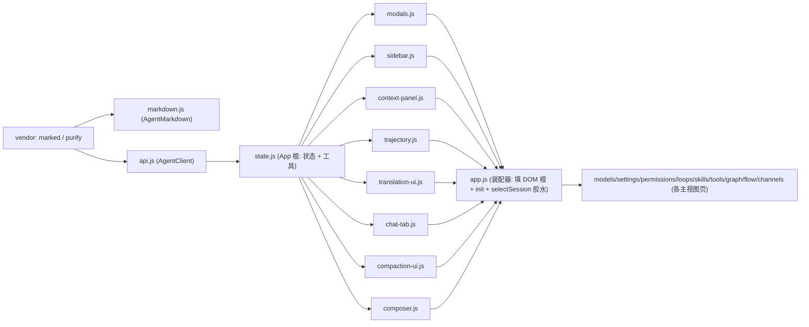
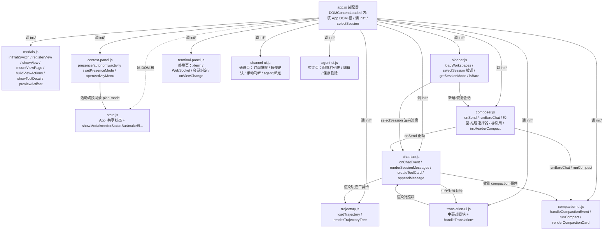

布局树为第一真值：所有页面的 DOM 层级以下文 §2 为准，横切组件（弹层、抽屉、菜单）作为布局树节点的子节点出现，锚点必须使用布局树节点名。命名统一为全单词小写并以 `-` 连接。

---

# ui.md

描述 Agent 的客户端 UI。  
名称一般采用全单词小写，并通过 `-` 连接。  
名称后紧跟 `*` 表示布局中可能包含 n 个对应节点的列表。  
名称后紧跟 `+` 表示布局中可能不固定顺序包含 n 个对应节点。  
名称后紧跟 `?` 表示布局中该界面元素可能存在或不存在。
**布局树为第一真值；其它部分与布局树冲突时，以布局树为准。**

---

## 目录

- [1. 界面要素 Name 与 Desc](#1-界面要素-name-与-desc)
  - [1.1 布局要素（含运行期动态节点）](#布局要素)
- [2. 包含关系](#2-包含关系)
  - [2.1 布局树（第一真值）](#布局树第一真值)
- [3. 事件回调](#3-事件回调)
  - [3.1 会话栏（shell 外）](#31-会话栏shell-外)
  - [3.2 models-page](#32-models-page)
  - [3.3 permissions-page](#33-permissions-page)
  - [3.4 user-job（运行期交互）](#34-user-job运行期交互)
  - [3.5 loops-page](#35-loops-page)
  - [3.6 meta-page](#36-meta-page)
  - [3.7 快捷键](#37-快捷键)
  - [3.8 terminal-page（运行期交互）](#38-terminal-page运行期交互)
  - [3.9 channels-page（运行期交互）](#39-channels-page运行期交互)
  - [3.10 agents-page（运行期交互）](#310-agents-page运行期交互)
- [4. 布局关系](#4-布局关系)
- [5. 元素样式](#5-元素样式)
- [6. 前端文件构成与调用关系（M0 拆分）](#6-前端文件构成与调用关系m0-拆分)

---

## 1. 界面要素 Name 与 Desc

陈列有哪些界面要素以及简要说明各界面要素。

| Name | Desc |
|---|---|
| **shell** | 整体界面外壳 |
| **toast-host** | 轻量提示条容器（右上角，操作失败 / 已删除等非阻断反馈） |
| **toast*** | 单条提示（kind：info / warn / error；自动消失，点击可关） |
| **thread-sidebar** | 左侧会话栏 |
| **sidebar-header** | 会话栏头部 |
| **agent-badge** | 当前 Agent 标识 |
| **left-collapse-button** | 左侧会话栏折叠按钮 |
| **new-session-button** | 新建会话按钮 |
| **workspace-bar** | 工作区工具条（搜索/视图/新增/回收站 + 搜索输入框） |
| **search-btn** | 工作区搜索按钮：切换搜索输入框，按会话名过滤 `session-item` |
| **search-input** | 过滤输入框（hidden 默认，点击 search-btn 显示）：按会话名与工作区名过滤；无匹配时在树底部显示空态 |
| **trash-btn** | 回收站按钮：切换 `deleted-sessions-list` 已软删会话视图 |
| **deleted-sessions-list** | 回收站：列出 `deleted_at` 非空的会话，提供 恢复 / 彻底删除 |
| **add-workspace-btn** | 新增工作区按钮 → folder-selector |
| **workspace-session-tree-list** | 工作区/会话树列表（仅未软删会话） |
| **workspace** | 工作区节点，可重复 |
| **workspace-header** | 工作区头部 |
| **workspace-name-label** | 工作区名称 |
| **workspace-menu-btn** | 工作区行内「⋯」菜单开关（次要操作收纳） |
| **row-menu** | 行内下拉菜单（workspace-header / session-item 内），点菜单外关闭 |
| **row-menu-item*** | 单个菜单项（danger 修饰用于删除类操作） |
| **add-session-btn** | 新增会话按钮 → name-prompt |
| **session** | 会话节点，可重复 |
| **session-name-label** | 会话名称标签 |
| **session-menu-btn** | 会话行内「⋯」菜单开关；菜单含「重命名…」与「删除会话…」（软删除：标记 deleted_at，保留历史，可从回收站恢复） |
| **restore-session-btn** | 回收站内：恢复已软删会话（清除 deleted_at） |
| **purge-session-btn** | 回收站内：彻底删除（hard 删，不可恢复） |
| **sidebar-nav** | 左栏导航容器（分三组：会话 / 编排 / 配置，组间分隔线 + 组标题，最后一组贴底） |
| **sidebar-nav-group*** | 导航分组 |
| **sidebar-nav-title** | 分组标题（编排 / 配置；会话组无标题） |
| **chat-view-btn** | 主视图入口：聊天（chat-view） |
| **trajectory-view-btn** | 主视图入口：轨迹（trajectory-tab） |
| **models-btn** | 主视图入口：模型（models-page） |
| **tools-btn** | 主视图入口：工具（tools-page） |
| **skills-btn** | 主视图入口：技能（skills-page） |
| **permissions-btn** | 主视图入口：权限（permissions-page） |
| **loops-btn** | 主视图入口：循环（loops-page） |
| **meta-btn** | 主视图入口：本体（meta-page，项目本体的内省窗口） |
| **settings-btn** | 主视图入口：设置（settings-page），位于「配置」分组，该组以 margin-top:auto 贴底 |
| **chat-viewport** | 中间聊天主视口 |
| **chat-header** | 顶部表头；两段式布局：左组贴左（left-collapse-button + session-name / view-title），右组 `header-controls-group` 由 `margin-left:auto` 靠右；中间为弹性空白。结构恒定，内容随主视图变化 |
| **session-name** | 当前会话名（左组；仅会话类视图 chat / trajectory 显示）：最大宽度 220px，超出省略号；`title` 属性保留全名供悬停查看 |
| **view-title** | 当前主视图页名（左组；非会话类视图显示，与 session-name 互斥） |
| **view-dirty-badge** | 当前页「未保存」标记（左组，仅该页有未保存改动时显示）；切页前有未保存改动会弹确认，选「确定」后放弃改动 |
| **header-controls-group** | 右侧控件组（chat-header：靠右合并容器，含 view-header-slot / session-header-controls / right-collapse-button；由 margin-left:auto 推到右侧；空间不足时切紧凑样式，见 composer.js 的 ResizeObserver） |
| **view-header-slot** | 表头右槽：由当前主视图声明内容（聊天/轨迹放会话控制组，各页放自己的指示器与页级入口，见 §3.7） |
| **session-header-controls** | 会话控制组（view-header-slot 内，仅 chat / trajectory 显示）：session-mode-indicator / activity-indicator / presence-mode-switch / autonomy-mode-switch |
| **right-collapse-button** | 右侧上下文面板折叠按钮 |
| **main-view** | 主视图容器（main-view 内同一时刻只显示一页；data-view 标记当前页） |
| **chat-view** | 聊天页容器：tab-body + composer + chat-footer（chat / trajectory 视图共用） |
| **tab-body** | 聊天页内容区（chat-tab 与 trajectory-tab 由 viewport[data-view] 切换显隐） |
| **chat-tab** | 聊天标签页 |
| **request-prompt** | 用户请求/提示词 |
| **response-message** | Agent 响应消息 |
| **approval-request** | 审批请求 |
| **ask-user-question** | 向用户提问 |
| **thought** | 思考过程 |
| **tool-call** | 工具调用 |
| **answer** | 最终回答 |
| **ask-user-prompt** | 向用户展示的追问/提示 |
| **tool-call-card** | 工具调用卡片（嵌入 `model-response`）；含 tool-call-desc / approval-request / ask-user-question? / user-job-request? / action-bar? / tool-result |
| **tool-call-desc** | 工具调用描述（名称 + 入参摘要） |
| **tool-result** | 工具执行结果展示（read 默认折叠） |
| **text-file** | 文本文件工具：read / write / edit / search |
| **bash** | Bash 工具：grep / list / file / run |
| **sql** | SQL 工具：add / delete / query / insert |
| **script** | 脚本工具：run |
| **web** | Web 工具：search |
| **action-bar** | 消息/任务操作栏；附着于 `response-message` 或 `tool-call` |
| **branch-picker** | 对话分支选择器；附着于 `response-message` |
| **user-job-request** | 请求用户手动完成任务并回报结果的交互卡片（嵌入 `tool-call-card`） |
| **sub-agent-tree** | 子 Agent 执行树；在 `trajectory-tab` 内展示 |
| **agent-trace-node** | 执行树节点追踪；在 `trajectory-tab` 内展示 |
| **trajectory-tab** | 轨迹标签页：按 turns → steps → (messages + calls) 渲染会话轨迹时间线（思考可展开、工具调用点击联动 context-panel）；详见 `docs/dsh/plan-trajectory.md` |
| **composer** | 输入区 |
| **input-textarea** | 文本输入框 |
| **composer-footer** | 输入区底部工具栏（DSH 风格：思考/搜索/权限预设/model-effort/@/发送） |
| **think-switch** | 思考模式开关；由设置 `reasoningControl` 决定是否在 composer 显示（与 `effort-selector` 二选一）。开启=默认推理（不发送 effort 参数），关闭→透传 core `effort:"off"`（thinking disabled） |
| **search-switch** | 联网搜索开关 |
| **permission-selector** | 权限预设选择器（composer-footer）：`read-only`(只读工具 allow，其余 deny) / `workspace-write`(只读+工作区写 allow，其余 deny) / `full-access`(全 allow) / `fine-grained`(沿用 user/* 配置，点击打开权限 modal) |
| **model-effort-selector** | 模型+推理等级组合选择器，含两个子选择器 `model-selector` 与 `effort-selector`；`effort-selector` 的可见性由 `reasoningControl` 设置控制 |
| **model-selector** | 模型选择器（composer-footer，按 provider 标题用 `<optgroup>` 分组；选中与主档 provider 一起写回 agent/config.json，不再写 settings.json；选中跨 provider 的模型时同步切换主档 provider） |
| **effort-selector** | 推理等级选择器（仅当 `reasoningControl==="effort-selector"` 时显示）；选项由 `modelCapabilities` RPC 获取——优先读 `user/providers.json` 缓存的 `effort.supported_levels`，缺失时回退网络（`effort.supported_levels` / `model_spec.capabilities.reasoningEffortOptions`），再兜底 `low/medium/high`；列表首位固定为 `off`（关闭推理）。选中写回主档 agent/config.json 并透传 core：`off`→`{"thinking":{"type":"disabled"}}`，其余→`{"reasoning_effort":"<level>"}` |
| **reasoningControl 设置** | settings-page 中的「推理参数控件」下拉：`effort-selector` / `think-switch` 二值，持久化到 `settings.reasoningControl`（默认 `think-switch`）。决定 composer 渲染哪个推理控件——二者语义冲突（都向模型注入推理参数），只能显示一个 |
| **ref-btn** | `@` 引用按钮：打开引用菜单（历史会话 / 本地文件），选中的引用以 chip 展示于 `ref-chips` |
| **ref-chips** | 引用 chip 容器（hidden 默认，有引用时显示），每个 chip 可单独移除 |
| **ref-chip** | 单个引用 chip（`ref-file` / `ref-session` 修饰），含移除按钮 |
| **presence-mode-switch** | 在场状态开关（**session-header-controls**：in / out，运行时自动态，可手动切换） |
| **autonomy-mode-switch** | 自主度开关（**session-header-controls**：supervised / autonomous，用户显式提权/降权） |
| **activity-indicator** | 当前活动指示器（session-header-controls：点击打开切换菜单；显示 `活动: <当前活动>` 与完成态 `✓`；建会话时选定初始活动，运行后可自然流转或强制切换（未完成强制切需二次确认））。取值（9）：plan-mode / intent-recog / goal-mode / build-code / discuss-doc / research / review-proj / human-learn / diagnose，默认 `research`。其中 plan-mode 驱动内置计划态（POLICY + exit_plan_mode），其余为占位枚举由模型自判。注：`bare-chat` 不是 activity 取值，而是会话模式（session mode：bare = 未选会话 / persisted = 选中会话），由 `currentSessionId` 派生，见 `docs/agent-mode.md` 会话模式层 |
| **session-mode-indicator** | 会话模式指示器（session-header-controls，只读；显示 `模式: bare-chat` / `模式: turn-step`，附 `data-mode` 着色与 title 说明；由 `currentSessionId` 派生 `getSessionMode()`，不提供切换，进入方式仍为「不选/选会话」） |
| **send-or-stop-btn** | 发送/停止按钮 |
| **shortcut-handler** | 全局快捷键处理器（shortcuts.js，document 级 keydown） |
| **chat-footer** | 聊天底部状态栏（DSH 风格三段；活动/权限/自主度由各自控件承载，不重复） |
| **session-statistics** | 左段：`⟳ N turns M steps · K tok/s`（图标 + 会话累计 turns/steps + 最近一轮 TPS，turns/steps 间空格） |
| **token-usage** | 中段：`▤ X.XM tok · Cache hit NN%`（图标 + total tokens 人类可读 + 缓存命中率） |
| **context-used** | 右段：SVG donut（track + 动态 fill 弧）+ `NN%` 文本，按占上下文窗口估算占比实时更新。窗口经 `contextWindow` RPC 解析：providers.json 每模型 `context_window` > settings.contextWindow > 128000（与自动压缩阈值同源） |
| **terminal-view-btn** | 左栏会话组的主视图入口（💻 终端）：打开 terminal-page |
| **terminal-page** | 终端主视图页（main-view 内一页，铺满内容区）：按当前会话显示终端，页面隐藏时 WebSocket 保持连接 |
| **terminal-panel-head** | 终端页顶部工具条：标题 + terminal-new-btn |
| **terminal-panel-title** | 终端页标题 |
| **terminal-new-btn** | 新建用户终端（createdBy=user），需先选中会话 |
| **terminal-tab-close** | 关闭当前终端标签（确认后结束进程树） |
| **terminal-host** | xterm 挂载点，填满 terminal-slot |
| **terminal-tabs** | 终端标签条（terminal-tab*） |
| **terminal-tab** | 单个终端标签：名称 + 归属标记 + 关闭按钮 |
| **terminal-stage** | 终端显示区（terminal-slot*） |
| **terminal-slot** | 单个终端的 xterm 宿主，active 时显示 |
| **terminal-empty** | 无终端空态（terminal-empty-text + terminal-empty-new） |
| **terminal-empty-text** | 空态文案：有会话显示「暂无终端」并附新建按钮，无会话显示「选择会话后可新建终端」 |
| **terminal-statusbar** | 终端状态行：终端 id / 工作目录 / 进程状态 / 归属 |
| **channels-view-btn** | 左栏配置组的通道入口（🔌 通道）：打开 channels-page |
| **channels-page** | 通道主视图页：左实例列表 + 右详情；状态由流式快照推送，不读写通道配置 |
| **channels-banner** | 推送断开时常驻提示条，附 channels-refresh |
| **channels-refresh** | 手动刷新按钮，走 channel.list |
| **channels-list** | 左侧实例列表（channels-list-item*）与无实例空态 |
| **channels-list-item** | 一个通道实例行：instanceId / 驱动类型 / 状态 / 错误标记；点击选中 |
| **channels-empty** | 无实例空态：提示在 user/channels.json 配置并给出模板路径 |
| **channels-detail** | 右侧详情区：标题、错误条、快照全字段只读、背后 agent 信息区、启停按钮 |
| **channels-agent-info** | 背后 agent 信息区：模型 / provider / 工作区 / 权限默认 / ask 工具数 / 活动 / 来源标记 / 会话映射说明 |
| **channels-agent-title** | 背后 agent 信息区标题 |
| **channels-error** | 启停失败错误条，保留后端原文（字段名与环境变量名） |
| **channels-action-btn** | 启停按钮，只在详情区；按状态切换启动/停止，操作前二次确认 |
| **channels-agent-select** | 通道详情里的 agent 下拉：主智能（默认）或 agents/ 里的某个代理 |
| **agents-view-btn** | 编排组的智能入口（🧠 智能）：打开 agents-page |
| **agents-page** | 智能配置档页：左列表 + 右编辑表单，读写走 agent.* RPC |
| **agents-list** | 左侧配置档列表（agents-list-item*）与新建按钮 |
| **agents-list-item** | 一个配置档：显示名 + id；点击选中 |
| **agents-new-btn** | 新建配置档，清空右侧表单并把 id 置为可编辑 |
| **agents-editor** | 右侧编辑表单：id / 名称 / persona / 模型 / 推理等级 / 工具白名单 |
| **agents-save-btn** | 保存配置档（agent.upsert） |
| **agents-delete-btn** | 删除配置档（agent.delete）；被通道绑定时被后端拒绝 |
| **compaction-card** | 聊天区 checkpoint 卡：按最新 `compaction/summary` 事件的 `boundaryMessageId` 插在**边界消息之后**（切点可能落在 turn 内部；找不到消息时退回 `boundaryTurnSeq` 的 turn 末尾）；标题显示压缩 turn 数 / `~tokensBefore → ~tokensAfter` / 边界 message / 模型 / 时间，正文为模型写的 8 段 summary（默认展开；preamble 与 `<compacted-summary>` 标签只给模型看，卡片不显示）。原始 turns/steps 仍然全部展示（DSH transcript 语义），卡片只标出模型视角被替换的位置 |
| **compaction-notice** | 压缩状态提示行（`compaction` 事件驱动）：start / prune / overflow / done / failed 的短文案，压缩完成后由重建的会话视图与 checkpoint 卡取代 |
| **/compact 斜杠命令** | composer 输入以 `/` 开头时在发送前拦截：`/compact`（无参数）触发手动压缩；bare-chat 提示不可用；未知命令提示可用命令。不进入对话历史 |
| **auto-compact 设置** | settings-page 的「自动压缩」开关（`settings.autoCompact`，默认开）：开启后每个 step 请求前按窗口 80% 检查压力，先裁剪超长 tool result，仍超限则写 checkpoint；关闭后只剩手动 `/compact` |
| **traj-compactions / traj-compaction** | 轨迹面板顶部的压缩标记列表（summary 事件的 trigger / 边界 turn / turns / token 变化）；原始 turns/steps 仍完整保留 |
| **context-panel** | 右侧上下文面板：**产物预览**（`#artifactPreview`，写文件类工具「预览」按钮触发，按扩展名渲染 md/html/图片/代码 + 在编辑器打开）+ 工具检视器（`#contextDetail`，点击 tool-call 看参数/结果） |
| **flow-page** | 流程图编辑页（主视图一页）：左流程图列表 + 中间画布 + 右属性面板，底部操作条 |
| **flow-list** | 流程图列表（flow-list-item*，当前项 active） |
| **flow-toolbar** | 画布顶部工具条（添加节点按钮组） |
| **flow-canvas** | 节点画布（自绘 div 节点 + SVG 边；滚轮缩放、中键/空白处拖平移） |
| **flow-status** | 运行/校验状态行 |
| **flow-panel** | 选中节点或连线的属性面板 |
| **flow-foot** | 表尾操作条：返回聊天 / 保存 / 运行 |
| **permissions-page** | 权限配置页（主视图一页；工具档位 + bash 命令策略 + 文件写精细策略） |
| **permissions-sidebar** | 权限弹窗左侧栏（配置文件切换 + 概要） |
| **config-file-tabs** | 配置文件切换标签组 |
| **tool-permissions-tab-btn** | 工具权限标签按钮 → tool-permissions-tab（对应 permissions.json） |
| **bash-policy-tab-btn** | Bash 命令策略标签按钮 → bash-policy-tab（对应 bash-policy.json） |
| **fs-policy-tab-btn** | 文件写策略标签按钮 → fs-policy-tab（对应 fs-policy.json） |
| **permission-summary** | 权限概要区 |
| **default-tier-label** | 当前 default 档位展示（permissions.json default：allow/ask/deny） |
| **bash-rule-count-label** | bash-policy 规则条数 |
| **rule-count-label** | fs-policy 规则条数 |
| **permissions-viewport** | 权限弹窗中间内容区（随标签切换） |
| **tool-permissions-tab** | 工具权限标签页（permissions.json） |
| **tab-header** | 标签头部 |
| **tab-title** | 标签标题 |
| **default-tier-row** | default 档位行 |
| **default-tier-select** | default 档位选择（ask / allow / deny；缺省 ask） |
| **tool-permissions-table** | 工具档位表格 |
| **tool-permission-row** | 单个工具档位行（每个已声明工具一行） |
| **tool-name-label** | 工具名（registry 工具名，只读） |
| **tier-select** | 该工具档位选择（inherit / allow / ask / deny） |
| **clear-tier-btn** | 清除显式档位，回退 inherit |
| **add-tool-permission-btn** | 新增工具档位行 |
| **config-footer** | 标签页底部保存/重置栏 |
| **reset-btn** | 重置按钮（放弃未保存修改） |
| **save-btn** | 保存按钮（写回对应配置文件，经 permissions op *.upsert） |
| **bash-policy-tab** | Bash 命令策略标签页（bash-policy.json） |
| **bash-default-row** | default 档位行 |
| **bash-default-label** | default 标签 |
| **bash-default-select** | default 档位选择（固定 ask；无匹配默认 ask，fail-closed） |
| **bash-global-env** | 顶层 env：约束未在具体规则声明的 dynamic 变量（key=value* 多行） |
| **bash-rules-table** | bash 命令规则表格 |
| **bash-rule-row** | 单条命令规则行 |
| **program-input** | IR 程序名（字面；dynamic 程序为 null 不在此列） |
| **args-input** | argv 前缀精确匹配（省略表示只按程序名） |
| **decision-select** | 决策选择（allow / ask / deny） |
| **reason-input** | 可解释决策理由（回传审批 UI/日志） |
| **env-input** | dynamic 变量具体化（如 URL 白名单 / 脚本路径白名单，key=value* 多行） |
| **remove-rule-btn** | 删除规则行 |
| **add-bash-rule-btn** | 新增 bash 规则行 |
| **fs-policy-tab** | 文件写策略标签页（fs-policy.json） |
| **fs-scope-note** | 作用域说明（仅作用于 write / edit） |
| **fs-rules-table** | 文件写规则表格 |
| **fs-rule-row** | 单条 path 规则行 |
| **path-input** | 路径 glob（** 跨层 / * 单段 / ? 单字符；支持绝对或相对 workspace） |
| **permission-select** | 路径权限选择（allow / deny；先扫 deny 命中即拒） |
| **add-fs-rule-btn** | 新增 fs 规则行 |
| **reset-defaults-btn** | 恢复默认按钮（default=ask，清空所有显式档位与规则）；在 view-header-slot 的「更多」菜单内 |
| **loops-page** | 循环编排页（主视图一页）：节点拓扑 + hooks 覆写编辑 |
| **engine-indicator** | 当前引擎指示器（view-header-slot；只读，显示 `AGENT_LOOP_ENGINE` 值；点击弹出提示：引擎来源（重启生效）、节点数（含 builtin）、循环边数） |
| **loops-viewport** | 循环页视口 |
| **loop-topology** | 左侧只读拓扑：静态 `next` 链 + `decide-next→pre-step` 回环 + 实时 hooks 虚线指向 target 节点 |
| **loop-nodes-table** | 右侧可编辑节点表 |
| **loop-node-row*** | 单个节点行（core + builtin 均展示） |
| **loop-node-id-label** | 节点 id（只读） |
| **loop-node-type-label** | 节点类型（只读） |
| **loop-next-label** | `next` 指向（只读；`next` 不可编辑） |
| **loop-hooks-editor** | hooks 编辑器（唯一可编辑区域） |
| **hook-slot*** | 单条 hook（on/slot/target 三元组） |
| **hook-add-btn** | 新增 hook 行 |
| **hook-target-select** | hook target 下拉（列出所有节点 id：core + builtin） |
| **hook-remove-btn** | 删除 hook 行 |

| **meta-page** | 本体页（主视图一页，项目本体内省窗口；左侧页导航 + 中间视口，节点详情为浮层抽屉） |
| **meta-sidebar** | 本体页左侧页导航栏 |
| **meta-codegraph-btn** | 代码图页入口（→ meta-codegraph-tab） |
| **meta-viewport** | 本体弹窗中间视口，承载各内省页 |
| **meta-codegraph-tab** | 代码图页：文件级依赖图谱 |
| **meta-codegraph-opbar** | 代码图状态行（仅 meta-status） |
| **meta-graph-search** | 文件路径过滤输入框（view-header-slot；不匹配的节点淡出） |
| **meta-graph-fit-btn** | 适应窗口按钮（view-header-slot 的「更多」菜单；缩放到全图可见） |
| **meta-graph-reload-btn** | 重新加载按钮（view-header-slot 的「更多」菜单；重新读取 graph-data.json） |
| **meta-status** | 数据状态（文件数 / 边数 / 生成时间；失败时显示原因） |
| **meta-codegraph-view** | 代码图视图区（画布 + 图例 + 架构规则面板） |
| **meta-arch-panel** | 架构规则检查面板：按规则分组列出违规边（from → to、依赖类型、是否为候选公共设施），项可点击跳转到图上节点；含静态依赖环 |
| **meta-arch-item*** | 单条违规边（或环成员链） |
| **meta-arch-file*** | 违规边端点文件按钮（点击选中并居中对应节点） |
| **meta-codegraph-canvas** | 依赖图画布（Cytoscape，dagre 左→右分层；节点按层级着色，运行时规则边为虚线） |
| **meta-codegraph-legend** | 图例（层级颜色、虚线语义、入边/出边颜色） |
| **meta-detail-drawer** | 节点详情抽屉：浮在代码图右下角，选中节点时展开、点 × 或空白处收起 |
| **meta-detail-drawer-head** | 抽屉头部（标题 + 收起按钮） |
| **meta-detail-drawer-close** | 收起详情抽屉按钮 |
| **meta-codegraph-detail** | 选中节点的明细（路径、层级、行数；入边列表「谁依赖我」与出边列表「我依赖谁」，可点击跳转）；选中边时显示类型与命中的运行时规则 |
| **meta-side-item*** | 明细中的文件项按钮（点击选中并居中对应节点） |
| **settings-page** | 设置页（主视图一页；运行时设置：流式开关 + 供应者/模型选择） |
| **skills-page** | 技能浏览页（主视图一页；只读） |
| **tools-page** | 工具浏览页（主视图一页；只读浏览当前可用工具：按 group 分组，展示 name / description / parameters / prompt / 读写特性；对应 `AgentClient.call("tools.list")` 返回的工具清单） |
| **view-actions** | 页级「更多」菜单容器（view-header-slot 内，排列在指示器/输入框之后） |
| **view-actions-toggle** | 「更多」菜单开关按钮 |
| **view-actions-menu** | 展开的菜单（view-actions-item*；点菜单外自动收起） |
| **view-actions-item*** | 单个低频/危险操作项（可带 danger 修饰，用于恢复默认、清空配置等） |
| **tool-tab** | 工具详情标签页（tab-header + tool-meta + tool-content） |
| **tool-meta** | 工具元信息（读写特性 mode / 分组 group / 名称 / 描述 / parameters，均只读） |
| **tool-content** | 工具 prompt 片段（AgentMarkdown 渲染；无 prompt 时显示空态提示） |
| **tool-type-tree-list** | 工具按分组列出的树（tool-type*，组内 tool*） |
| **tool-type-header** | 分组头部（折叠开关 + 组名） |
| **tool-type-collapse-toggle** | 展开/折叠该分组 |
| **tool-type-label** | 分组名（`data-group` 为 group 键；显示单字组名：文件 / 命令 / 网络 / 浏览器 / 任务 / agent / 团队 / 定时 / 目标 / 交互 / 渠道 / 技能 / mcp / 通用） |
| **tool-name-label** | 工具名（MCP 工具显示去掉 `mcp__<server>__` 前缀的短名） |
| **settings-sidebar** | 设置页左侧栏 |
| **provider-model-tree-list** | 供应者/模型树列表 |
| **tree-search-input** | 树过滤输入框（按名称过滤） |
| **add-provider-btn** | 新增供应者按钮 → provider-add-tab |
| **provider** | 供应者节点，可重复 |
| **provider-header** | 供应者头部（选中/展开态） |
| **provider-collapse-toggle** | 展开/折叠模型列表 |
| **provider-name-label** | 供应者名称（providers.name） |
| **provider-rename-btn** | 快捷重命名供应者 |
| **provider-delete-btn** | 删除供应者（级联删 models） |
| **add-model-btn** | 新增模型按钮 → model-add-tab |
| **model** | 模型节点，可重复（展开时渲染） |
| **model-name-label** | 模型名称（存储于 providers.json 的 provider.models[].name） |
| **model-fee-badge** | 模型费用徽标（providers.json 模型 fee，缺省 "unknown"） |
| **model-rename-btn** | 快捷重命名模型 |
| **model-delete-btn** | 删除模型 |
| **settings-viewport** | 设置弹窗中间视口 |
| **provider-add-tab** | 新增供应者标签页 |
| **tab-header** | 标签头部 |
| **tab-title** | 标签标题 |
| **provider-form** | 供应者表单 |
| **name-input** | 名称输入框（必填） |
| **description-input** | 描述输入框（多行，选填） |
| **baseurl-input** | Base URL 输入框（URL 校验） |
| **apikey-input** | API Key 输入框（password + 显示/隐藏） |
| **form-footer** | 表单底部工具栏 |
| **cancel-btn** | 取消按钮 |
| **save-btn** | 保存按钮（整体写回 user/providers.json，经 providers op upsert） |
| **provider-edit-tab** | 编辑供应者标签页 |
| **fetch-row** | 功能行：拉取远端模型按钮 + 拉取状态 |
| **fetch-models-btn** | 拉取远端模型按钮（后端代理 /models，兼连通性测试） |
| **remote-status** | 拉取状态 / 错误提示 |
| **remote-models-section** | 远端模型列表区（拉取后展示）；含 `remote-model-response`（展示远端原始响应：HTTP 状态 + 报文，成功/失败均写入，便于排查） |
| **remote-toolbar** | 远端模型列表工具条（全部添加） |
| **add-all-btn** | 全部添加远端模型 |
| **remote-model-item** | 单个远端模型行 |
| **remote-model-id** | 远端模型 id |
| **fee-select** | 远端模型费用选择器（free / paid） |
| **remote-add-btn** | 将远端模型添加到本地（已添加则禁用并显示「已添加」） |
| **model-list-section** | 该供应者本地模型概览区 |
| **section-header** | 区块头部（模型 N + add-model-btn） |
| **model-item** | 单个本地模型行 |
| **model-edit-btn** | 打开模型编辑标签 |
| **reset-btn** | 重置按钮（恢复未保存修改） |
| **model-add-tab** | 新增模型标签页（需 provider_id） |
| **model-form** | 模型表单 |
| **provider-display** | 所属供应者展示（只读） |
| **fee-selector** | 费用选择器（free / paid / 自定义，默认 free；存储为 providers.json 模型 fee，缺省 "unknown"） |
| **model-edit-tab** | 编辑模型标签页 |
| **settings-panel** | 设置弹窗右侧常驻操作栏 |
| **import-config-btn** | 导入配置按钮 |
| **export-config-btn** | 导出配置按钮 |
| **danger-zone** | 危险区（可选：清空配置） |
| **settings-card** | 设置页内容卡（流式 / 翻译 / 自动压缩 开关 + provider / 模型 / 推理参数控件选择） |
| **models-page** | 模型配置页（主视图一页） |
| **models-sidebar** | 模型页左侧栏（供应者/模型树） |
| **models-viewport** | 模型页右侧编辑区（按选中项切换 provider/model 的增改标签页） |
| **tree-search-wrap** | 模型页树列表的搜索框容器（sticky，随列表滚动固定） |
| **tools-sidebar** | 工具页左侧栏（来源标签 + 分组树） |
| **tools-viewport** | 工具页右侧详情区 |
| **flow-body** | 流程页主体（flow-list | flow-main | flow-panel 三列） |
| **flow-main** | 流程页中间列（工具条 + 画布 + 状态行） |
| **flow-list-item*** | 单个流程图条目（名称 + 描述，当前编辑项 active） |
| **flow-header-name** | 当前流程图名（view-header-slot，只读） |
| **flow-return-btn** | 返回聊天按钮（flow-foot） |
| **flow-save-btn** | 保存当前流程图（flow-foot） |
| **flow-run-btn** | 运行当前流程图（flow-foot；需先保存） |
| **loops-viewport-split** | 循环页左右分栏容器（拓扑 / 节点表） |
| **mode-display** | 工具读写特性行（tool-meta，只读） |
| **tool-source-tabs** | 工具目录来源子标签组（内置工具 / MCP 工具） |
| **tool-source-tab*** | 单个来源标签（`data-source`＝builtin / mcp） |
| **tool-type*** | 工具目录中的单个分组 |
| **tool*** | 分组内的工具条目 |
| **tool-visibility** | 工具的默认可见性徽标（默认可见 / 默认隐藏） |
| **parameters-view** | 工具参数 JSON（只读） |
| **mode-badge** | 工具读写特性徽标（read=只读 / write=可写 / both=视情况可写，按 mode 着色） |
| **group-display** | 工具所属 group（只读展示） |
| **skills-sidebar** | 技能页左侧栏（按来源分组的技能树） |
| **skills-viewport** | 技能页右侧详情区 |
| **skill-tab** | 技能详情标签页 |
| **skill-meta** | 技能元信息（来源 / 名称 / 描述，只读） |
| **skill-content** | 技能正文（Markdown 渲染） |
| **skill-name-label** | 技能名 |
| **provider-skill-tree-list** | 按来源（provider/source）分组的技能树 |
| **skill-ref-selector** | 技能引用选择器（弹层）：搜索 + 技能列表 |
| **skill-search-input** | 技能引用选择器的搜索框 |
| **skill-list** | 技能引用选择器的结果列表 |
| **skill-element*** | 技能列表中的单行 |
| **agent-provider-input** | 智能页主档的 provider 下拉：自动选择或 providers.json 中的某个 provider |
| **stream-switch** | 设置页流式输出开关 |
| **translate-switch** | 设置页自动翻译开关 |
| **auto-compact-switch** | 设置页自动压缩开关 |

> 运行期动态节点（thought / tool-call 及其子类型 / approval-request / ask-user-question / user-job-request / action-bar / branch-picker / sub-agent-tree / agent-trace-node 等）不再单列「过程要素 / 人控要素」分块，已并入上表并作为布局树的子节点呈现（见 §2 包含关系）。布局树为第一真值。

---

## 2. 包含关系 布局树（第一真值）

```text
shell
├─ thread-sidebar
│  ├─ sidebar-header
│  │  └─ agent-badge
│  ├─ new-session-button
│  ├─ workspace-bar
│  │  ├─ search-btn
│  │  ├─ search-input
│  │  ├─ add-workspace-btn
│  │  └─ trash-btn
│  ├─ workspace-session-tree-list
│  ├─ deleted-sessions-list
│  │  └─ workspace*
│  │      ├─ workspace-header
│  │      │  ├─ workspace-name-label
│  │      │  ├─ add-session-btn
│  │      │  └─ workspace-menu-btn
│  │      │     └─ row-menu?
│  │      │        └─ row-menu-item*
│  │      └─ session*
│  │          ├─ session-name-label
│  │          └─ session-menu-btn
│  │             └─ row-menu?
│  │                └─ row-menu-item*
│  └─ sidebar-nav
│     ├─ sidebar-nav-group（会话）
│     │  ├─ chat-view-btn
│     │  ├─ trajectory-view-btn
│     │  └─ terminal-view-btn
│     ├─ sidebar-nav-group（编排）
│     │  ├─ sidebar-nav-title
│     │  ├─ models-btn
│     │  ├─ tools-btn
│     │  ├─ skills-btn
│     │  ├─ agents-btn
│     │  ├─ flow-btn-sidebar
│     │  ├─ loops-btn
│     │  └─ meta-btn
│     └─ sidebar-nav-group（配置，贴底）
│        ├─ sidebar-nav-title
│        ├─ channels-view-btn
│        ├─ permissions-btn
│        └─ settings-btn
├─ chat-viewport
│  ├─ chat-header
│  │  ├─ left-collapse-button
│  │  ├─ session-name?
│  │  ├─ view-title?
│  │  ├─ view-dirty-badge?
│  │  └─ header-controls-group
│  │     ├─ view-header-slot
│  │     │  ├─ session-header-controls?          （chat / trajectory）
│  │     │  │  ├─ session-mode-indicator
│  │     │  │  ├─ activity-indicator
│  │     │  │  ├─ presence-mode-switch
│  │     │  │  └─ autonomy-mode-switch
│  │     │  ├─ flow-header-name?                 （flow）
│  │     │  ├─ tree-search-input?                （models / tools / skills）
│  │     │  ├─ meta-graph-search + view-actions? （meta）
│  │     │  ├─ engine-indicator? + view-actions? （loops）
│  │     │  └─ view-actions?                     （models / permissions）
│  │     │     ├─ view-actions-toggle
│  │     │     └─ view-actions-menu?
│  │     │        └─ view-actions-item*
│  │     └─ right-collapse-button
│  └─ main-view
│     ├─ chat-view                          （chat / trajectory）
│     │  ├─ tab-body
│     │  │  ├─ chat-tab
│     │  │  │  └─ turn*
│     │  │  │     └─ step*
│     │  │  │         ├─ agent-request?
│     │  │  │         │  ├─ system-prompt?
│     │  │  │         │  └─ user-input
│     │  │  │         │      ├─ chinese-primary-user-input
│     │  │  │         │      └─ english-translate-user-input
│     │  │  │         └─ model-response
│     │  │  │             ├─ thought?
│     │  │  │             │  ├─ english-primary-thought
│     │  │  │             │  └─ chinese-translate-thought
│     │  │  │             ├─ answer?
│     │  │  │             │  ├─ english-primary-answer
│     │  │  │             │  └─ chinese-translate-answer
│     │  │  │             ├─ ask-user-prompt?
│     │  │  │             ├─ branch-picker?
│     │  │  │             └─ tool-call-card*
│     │  │  │                 ├─ tool-call-desc
│     │  │  │                 ├─ approval-request
│     │  │  │                 ├─ ask-user-question?
│     │  │  │                 ├─ user-job-request?
│     │  │  │                 ├─ action-bar?
│     │  │  │                 └─ tool-result
│     │  │  │                 （工具类型：text-file / bash / sql / script / web）
│     │  │  └─ trajectory-tab
│     │  │     ├─ sub-agent-tree
│     │  │     └─ agent-trace-node
│     │  ├─ composer
│     │  │  ├─ model-http-status(on-wait|on-post|on-get)
│     │  │  ├─ ref-chips
│     │  │  ├─ input-textarea
│     │  │  └─ composer-footer
│     │  │     ├─ think-switch?
│     │  │     ├─ search-switch
│     │  │     ├─ permission-selector
│     │  │     ├─ model-effort-selector
│     │  │     │   ├─ model-selector
│     │  │     │   └─ effort-selector?
│     │  │     ├─ ref-btn
│     │  │     └─ send-or-stop-btn
│     │  └─ chat-footer
│     │     ├─ session-statistics
│     │     ├─ token-usage
│     │     └─ context-used
│     ├─ terminal-page                        （terminal）
│     │  ├─ terminal-panel-head
│     │  │  ├─ terminal-panel-title
│     │  │  └─ terminal-new-btn
│     │  ├─ terminal-tabs
│     │  │  └─ terminal-tab*
│     │  ├─ terminal-stage
│     │  │  ├─ terminal-slot*
│     │  │  │  └─ terminal-host
│     │  │  └─ terminal-empty
│     │  │     ├─ terminal-empty-text
│     │  │     └─ terminal-empty-new
│     │  └─ terminal-statusbar
│     ├─ channels-page                        （channels）
│     │  ├─ channels-banner
│     │  │  └─ channels-refresh
│     │  └─ channels-body
│     │     ├─ channels-list
│     │     │  ├─ channels-list-item*
│     │     │  └─ channels-empty?
│     │     └─ channels-detail
│     │        ├─ channels-detail-head
│     │        ├─ channels-error?
│     │        ├─ channels-fields
│     │        │  └─ channels-field*
│     │        ├─ channels-agent-info
│     │        │  ├─ channels-agent-title
│     │        │  └─ channels-agent-field*
│     │        └─ channels-actions
│     │           └─ channels-action-btn
│     ├─ agents-page                          （agents）
│     │  └─ agents-body
│     │     ├─ agents-list
│     │     │  ├─ agents-list-item*
│     │     │  └─ agents-new-btn
│     │     └─ agents-editor
│     │        ├─ agents-field*
│     │        └─ agents-actions
│     │           ├─ agents-save-btn
│     │           └─ agents-delete-btn?
│     ├─ flow-page                            （flow）
│     │  ├─ flow-body
│     │  │  ├─ flow-list
│     │  │  │  └─ flow-list-item*
│     │  │  ├─ flow-main
│     │  │  │  ├─ flow-toolbar
│     │  │  │  ├─ flow-canvas
│     │  │  │  └─ flow-status
│     │  │  └─ flow-panel
│     │  └─ flow-foot
│     │     ├─ flow-return-btn（返回聊天）
│     │     ├─ flow-save-btn
│     │     └─ flow-run-btn
│     ├─ models-page
│     │  ├─ models-sidebar
│     │  │  └─ provider-model-tree-list
│     │  │      ├─ tree-search-wrap
│     │  │      │  └─ tree-search-input
│     │  │      ├─ add-provider-btn
│     │  │      └─ provider*
│     │  │          ├─ provider-header
│     │  │          │  ├─ provider-collapse-toggle
│     │  │          │  ├─ provider-name-label
│     │  │          │  ├─ provider-rename-btn
│     │  │          │  ├─ provider-delete-btn
│     │  │          │  └─ add-model-btn
│     │  │          └─ model*
│     │  │              ├─ model-name-label
│     │  │              ├─ model-fee-badge
│     │  │              ├─ model-rename-btn
│     │  │              └─ model-delete-btn
│     │  └─ models-viewport
│     │     ├─ provider-add-tab
│     │     │  ├─ tab-header
│     │     │  │  └─ tab-title
│     │     │  ├─ provider-form
│     │     │  │  ├─ name-input
│     │     │  │  ├─ description-input
│     │     │  │  ├─ baseurl-input
│     │     │  │  └─ apikey-input
│     │     │  └─ form-footer
│     │     │     ├─ cancel-btn
│     │     │     └─ save-btn
│     │     ├─ provider-edit-tab
│     │     │  ├─ tab-header
│     │     │  │  └─ tab-title
│     │     │  ├─ provider-form
│     │     │  │  ├─ name-input
│     │     │  │  ├─ description-input
│     │     │  │  ├─ baseurl-input
│     │     │  │  ├─ apikey-input
│     │     │  │  ├─ fetch-row
│     │     │  │  │  ├─ fetch-models-btn
│     │     │  │  │  └─ remote-status
│     │     │  │  └─ remote-models-section
│     │     │  │     ├─ remote-toolbar
│     │     │  │     │  └─ add-all-btn
│     │     │  │     ├─ remote-model-item*
│     │     │  │     │  ├─ remote-model-id
│     │     │  │     │  ├─ fee-select
│     │     │  │     │  └─ remote-add-btn
│     │     │  │     └─ remote-model-response
│     │     │  ├─ model-list-section
│     │     │  │  ├─ section-header
│     │     │  │  └─ model-item*
│     │     │  │     ├─ model-name-label
│     │     │  │     ├─ model-fee-badge
│     │     │  │     └─ model-edit-btn
│     │     │  └─ form-footer
│     │     │     ├─ reset-btn
│     │     │     └─ save-btn
│     │     ├─ model-add-tab
│     │     │  ├─ tab-header
│     │     │  │  └─ tab-title
│     │     │  ├─ model-form
│     │     │  │  ├─ provider-display
│     │     │  │  ├─ name-input
│     │     │  │  ├─ description-input
│     │     │  │  └─ fee-selector
│     │     │  └─ form-footer
│     │     │     ├─ cancel-btn
│     │     │     └─ save-btn
│     │     └─ model-edit-tab
│     │        ├─ tab-header
│     │        │  └─ tab-title
│     │        ├─ model-form
│     │        │  ├─ provider-display
│     │        │  ├─ name-input
│     │        │  ├─ description-input
│     │        │  └─ fee-selector
│     │        └─ form-footer
│     │           ├─ reset-btn
│     │           └─ save-btn
│     ├─ tools-page
│     │  ├─ tools-sidebar
│     │  │  ├─ tab-header
│     │  │  │  └─ tab-title
│     │  │  ├─ tool-source-tabs
│     │  │  │  └─ tool-source-tab*（builtin | mcp）
│     │  │  └─ tool-type-tree-list
│     │  │     └─ tool-type*
│     │  │        ├─ tool-type-header
│     │  │        │  ├─ tool-type-collapse-toggle
│     │  │        │  └─ tool-type-label
│     │  │        └─ tool*
│     │  │           └─ tool-name-label
│     │  └─ tools-viewport
│     │     └─ tool-tab
│     │        ├─ tab-header
│     │        │  └─ tab-title
│     │        ├─ tool-meta
│     │        │  ├─ mode-display
│     │        │  │  └─ mode-badge
│     │        │  ├─ group-display
│     │        │  ├─ name-input
│     │        │  ├─ description-input
│     │        │  ├─ parameters-view
│     │        │  └─ tool-visibility
│     │        └─ tool-content
│     ├─ skills-page
│     │  ├─ skills-sidebar
│     │  │  ├─ tab-header
│     │  │  │  └─ tab-title
│     │  │  └─ provider-skill-tree-list
│     │  │     └─ provider*
│     │  │        ├─ provider-header
│     │  │        │  ├─ provider-collapse-toggle
│     │  │        │  └─ provider-name-label
│     │  │        └─ skill*
│     │  │           └─ skill-name-label
│     │  └─ skills-viewport
│     │     └─ skill-tab
│     │        ├─ tab-header
│     │        │  └─ tab-title
│     │        ├─ skill-meta
│     │        │  ├─ provider-display
│     │        │  ├─ name-input
│     │        │  └─ description-input
│     │        └─ skill-content
│     ├─ permissions-page
│     │  ├─ permissions-sidebar
│     │  │  ├─ config-file-tabs
│     │  │  │  ├─ tool-permissions-tab-btn
│     │  │  │  ├─ bash-policy-tab-btn
│     │  │  │  └─ fs-policy-tab-btn
│     │  │  └─ permission-summary
│     │  │     ├─ default-tier-label
│     │  │     ├─ bash-rule-count-label
│     │  │     └─ rule-count-label
│     │  └─ permissions-viewport
│     │     ├─ tool-permissions-tab
│     │     │  ├─ tab-header
│     │     │  │  └─ tab-title
│     │     │  ├─ default-tier-row
│     │     │  │  ├─ default-tier-label
│     │     │  │  └─ default-tier-select
│     │     │  ├─ tool-permissions-table
│     │     │  │  ├─ tool-permission-row*
│     │     │  │  │  ├─ tool-name-label
│     │     │  │  │  ├─ tier-select
│     │     │  │  │  └─ clear-tier-btn?
│     │     │  │  └─ add-tool-permission-btn
│     │     │  └─ config-footer
│     │     │     ├─ reset-btn
│     │     │     └─ save-btn
│     │     ├─ bash-policy-tab
│     │     │  ├─ tab-header
│     │     │  │  └─ tab-title
│     │     │  ├─ bash-default-row
│     │     │  │  ├─ bash-default-label
│     │     │  │  └─ bash-default-select
│     │     │  ├─ bash-global-env?
│     │     │  ├─ bash-rules-table
│     │     │  │  ├─ bash-rule-row*
│     │     │  │  │  ├─ program-input
│     │     │  │  │  ├─ args-input?
│     │     │  │  │  ├─ decision-select
│     │     │  │  │  ├─ reason-input?
│     │     │  │  │  ├─ env-input?
│     │     │  │  │  └─ remove-rule-btn
│     │     │  │  └─ add-bash-rule-btn
│     │     │  └─ config-footer
│     │     │     ├─ reset-btn
│     │     │     └─ save-btn
│     │     └─ fs-policy-tab
│     │        ├─ tab-header
│     │        │  └─ tab-title
│     │        ├─ fs-scope-note
│     │        ├─ fs-rules-table
│     │        │  ├─ fs-rule-row*
│     │        │  │  ├─ path-input
│     │        │  │  ├─ permission-select
│     │        │  │  └─ remove-rule-btn
│     │        │  └─ add-fs-rule-btn
│     │        └─ config-footer
│     │           ├─ reset-btn
│     │           └─ save-btn
│     ├─ loops-page
│     │  └─ loops-viewport
│     │     ├─ loops-viewport-split
│     │     │  ├─ loop-topology
│     │     │  └─ loop-nodes-table
│     │     │     └─ loop-node-row*
│     │     │        ├─ loop-node-id-label
│     │     │        ├─ loop-node-type-label
│     │     │        ├─ loop-next-label
│     │     │        └─ loop-hooks-editor
│     │     │           └─ hook-slot*
│     │     │              ├─ hook-target-select
│     │     │              ├─ hook-remove-btn
│     │     │              └─ hook-add-btn
│     │     └─ config-footer
│     │        ├─ reset-btn（撤销修改）
│     │        └─ save-btn
│     ├─ meta-page
│     │  ├─ meta-sidebar
│     │  │  └─ meta-codegraph-btn
│     │  └─ meta-viewport
│     │     └─ meta-codegraph-tab
│     │        ├─ meta-codegraph-opbar
│     │        │  └─ meta-status
│     │        └─ meta-codegraph-view
│     │           ├─ meta-codegraph-canvas
│     │           ├─ meta-codegraph-legend
│     │           ├─ meta-arch-panel?
│     │           │  └─ meta-arch-item*
│     │           │     └─ meta-arch-file*
│     │           └─ meta-detail-drawer?
│     │              ├─ meta-detail-drawer-head
│     │              │  ├─ 标题
│     │              │  └─ meta-detail-drawer-close
│     │              └─ meta-codegraph-detail
│     │                 └─ meta-side-item*
│     └─ settings-page
│        └─ settings-card
│           ├─ stream-switch
│           ├─ translate-switch
│           ├─ auto-compact-switch
│           └─ reasoningControl-selector
└─ context-panel                             （仅 chat / trajectory 显示）
   ├─ context-default?
   ├─ artifact-preview
   │  ├─ artifact-preview-head
   │  │  ├─ artifact-preview-title
   │  │  └─ artifact-preview-open
   │  └─ artifact-preview-body
   └─ context-detail?

skill-ref-selector
├─ skill-search-input
└─ skill-list
   └─ skill-element*
```

---

## 3. 事件回调

### 3.1 会话栏（shell 外）

左栏是唯一导航：点击任一带 `data-view` 的按钮 → `App.showView(name)`，右侧「表头内容 + 内容区」整体切页。

add-workspace-btn -> folder-selector -> add-workspace(folder)
add-session-btn -> name-prompt -> add-session(worksapce,name)
chat-view-btn -> chat-view
trajectory-view-btn -> trajectory-tab
terminal-view-btn -> terminal-page
models-btn -> models-page
skills-btn -> skills-page
tools-btn -> tools-page
permissions-btn -> permissions-page
loops-btn -> loops-page
meta-btn -> meta-page
settings-btn -> settings-page
channels-view-btn -> channels-page
agents-btn -> agents-page
选择会话 / 新建会话 -> 自动切回 chat-view

### 3.2 models-page

add-provider-btn -> provider-add-tab（打开新增供应者标签页）
add-model-btn(provider_id) -> model-add-tab（打开新增模型标签页，携带 provider_id）
model-edit-btn(model.id) -> model-edit-tab（打开模型编辑标签页）
save-btn(providers) -> AgentClient.call("providers", {op:"upsert", payload:<整体 providers 数组>}) -> 整体写回 user/providers.json
fetch-models-btn -> AgentClient.call("fetchModels", {baseurl, apikey}) -> remote-models-section（渲染 remote-model-item*，并写入 remote-model-response 原始响应）
remote-add-btn -> AgentClient.call("providers", {op:"upsert", payload:<整体 providers 数组>}) -> model-list-section
add-all-btn -> 对每条未添加 remote-model-item 触发 providers upsert

### 3.3 permissions-page

save-btn(tool-permissions) -> AgentClient.call("permissions", {op:"permissions.upsert", payload:{default, tools}}) -> 写 user/permissions.json
save-btn(bash-policy) -> AgentClient.call("permissions", {op:"bashpolicy.upsert", payload:{default:"ask", rules}}) -> 写 user/bash-policy.json
save-btn(fs-policy) -> AgentClient.call("permissions", {op:"fspolicy.upsert", payload:{rules}}) -> 写 user/fs-policy.json

### 3.4 user-job（运行期交互）

user-job-request(event) -> renderUserJob(card) -> 展示任务描述 + 结果文本框 + 提交/取消按钮
  提交按钮 -> AgentClient.call("answerUserJob", {id, result}) -> 工具结果为用户回报文本
  取消按钮 -> AgentClient.call("answerUserJob", {id, cancel:true}) -> 工具结果标记为已取消
  user-job-update(event:{id,status}) -> 将对应 user-job 卡片置为已结束/已取消

### 3.5 loops-page

loops-btn -> loops-page（首次进入时 loops.get 拉取 engines / nodes / builtins / hooks 覆写）
engine-indicator(click) -> uiAlert 提示：当前引擎（AGENT_LOOP_ENGINE，重启生效）、节点数（含 builtin）、循环边数
save-btn(hooks) -> AgentClient.call("loops", {op:"upsert", payload:{hooks}}) -> 整体写回 agent/loops.json（数组顺序即执行顺序，校验 slot / on / target 且禁止重复三元组）；无未保存改动时禁用
reset-btn(撤销修改) -> 放弃未保存编辑，重新 loops.get 拉取；无未保存改动时禁用
reset-defaults-btn -> AgentClient.call("loops", {op:"upsert", payload:{hooks:<仓库默认两条 translate hook: builtin.translate-input / builtin.translate-output>}}) -> 恢复出厂（需 uiConfirm）；位于「更多」菜单

### 3.6 meta-page

meta-btn -> meta-page（打开；首次打开时 fetch "graph-data.json" 渲染依赖图）
meta-codegraph-btn -> meta-codegraph-tab（页切换；当前仅代码图一页）
meta-graph-search(input) -> 按文件路径过滤，不匹配节点淡出
meta-graph-fit-btn -> 缩放到全图可见；位于「更多」菜单
meta-graph-reload-btn -> 重新 fetch "graph-data.json" 并重建图；位于「更多」菜单
架构规则 -> 展开/收起 meta-arch-panel（展示 scan 求值结果 graph-data.json 的 arch 段）；位于「更多」菜单，菜单项文字显示检查结果（通过 / N 警告 / N 违规）
meta-arch-file(click) -> 选中并居中对应节点
点击 meta-codegraph-canvas 节点 -> 高亮入边（谁依赖我）/ 出边（我依赖谁），其余淡出；选中节点缩放到可读级别并居中；meta-codegraph-detail 列出入边与出边清单
点击 meta-codegraph-canvas 边 -> meta-codegraph-detail 显示 from / to / 类型（require | import | dynamic）与命中的运行时规则
meta-side-item(click) -> 选中并居中对应节点
meta-detail-drawer-close -> 收起详情抽屉
数据来源：node scripts/graph/scan.js 生成 ui/web/graph-data.json（静态 require/import + runtime-edges.json 规则表）

---

### 3.7 快捷键

Ctrl/⌘ + N -> 新建会话（同 new-session-button）
Ctrl/⌘ + K -> 聚焦会话过滤框（自动展开 search-input）
Esc        -> 关闭最上层弹层：modal-overlay（走取消路径）/ row-menu / view-actions-menu
?          -> 弹出快捷键说明（焦点在输入框内时不触发）

规则：有弹层打开时 Esc 优先且只关最上层；弹层打开期间其余快捷键不生效；焦点在输入控件内时不抢单键快捷键，Ctrl/⌘ 组合键仍生效。

### 3.8 terminal-page（运行期交互）

terminal-view-btn -> terminal-page（主视图页，左栏会话组入口）
terminal-new-btn / terminal-empty-new -> terminal.panel.open({session_id}) -> 刷新 terminal-tabs 并选中新终端
terminal-tab(click) -> 切换活动终端（fit + 聚焦仅在页面可见时执行）
terminal-tab-close -> 确认后 terminal.panel.close({session_id, id}) -> 结束进程树
agent 新建终端 -> toast 提示，不自动切页
切换主视图 -> onViewChange：隐藏时保持 WebSocket 连接与 xterm 写入，可见时重新 fit 与聚焦
选择会话 -> setSession 按 session_id 重建终端列表，随后回到 chat-view

### 3.9 channels-page（运行期交互）

channels-view-btn -> channels-page（配置组入口，普通主视图页）
首次进入 -> channel.subscribe（streaming）：订阅建立即推全量实例快照，此后每次状态变化推全量快照
首次进入 -> config.get / config.permissions.get / workspace.list / agent.list -> 详情区背后 agent 信息模型/provider/工作区/权限默认/ask 工具数与配置档列表；活动固定 chat；会话映射见 data/channels/sessions.json
channels-list-item(click) -> 选中实例；默认选第一个，切页后保留选中
channels-agent-select(change) -> channel.setAgent({id, agent}) -> 写回 channels.json agent 字段并推送新快照；绑定只影响新平台会话
channels-action-btn(click) -> uiConfirm -> channel.start / channel.stop({id}) -> 用返回快照更新详情；失败时详情顶部错误条 + toast
推送断开/失败 -> channels-banner 常驻提示 + channels-refresh -> channel.list 刷新快照；不自动重连、不轮询
离开页面 -> 订阅不取消；页面卸载时客户端取消订阅
无实例 -> channels-empty 提示配置 user/channels.json 与模板路径 channels/channels.example.json

### 3.10 agents-page（运行期交互）

agents-btn -> agents-page（编排组入口，普通主视图页）
首次进入 -> agent.list -> { main, agents }：左列表置顶「主智能（默认）」，下面列 agents/<id>；默认选主档
agents-save-btn(click) -> agent.upsert({payload})：主档不传 id 写 agent/config.json，其它档带 id 写 agents/<id>/config.json
主档字段含 identity/persona/provider/model/effort/tools；provider 下拉来自 providers.json，留空表示自动选择
composer 的 model-selector / effort-selector 变更 -> agent.get({}) + agent.upsert 写回主档（不写 settings.json）
agents-delete-btn(click) -> uiConfirm -> agent.delete({id}) -> 只针对其它档；被通道绑定时后端拒绝
配置档只在新的平台会话生效；已有会话继续使用 session.prompt 中已存的 system prompt

## 4. 布局关系

shell
   children: thread-sidebar | chat-viewport | context-panel
   arrange: horizontal

thread-sidebar
   children: sidebar-header, new-session-button, workspace-bar, workspace-session-tree-list, deleted-sessions-list, sidebar-nav
   arrange: vertical
   nav-groups: 会话（chat-view-btn / trajectory-view-btn / terminal-view-btn）| 编排（sidebar-nav-title + models / tools / skills / agents / flow / loops / meta）| 配置（sidebar-nav-title + channels / permissions / settings，贴底）
   row-actions: 工作区头部常显「+ 会话」，会话行常显名称；重命名 / 删除收进行内「⋯」菜单（点击「⋯」不触发选中会话，点菜单外关闭）
   note: 导航按钮组在会话树之下，settings-btn 以 margin-top:auto 固定在最底部；当前页按钮带 active 高亮

sidebar-header
   contains: agent-badge, left-collapse-button

workspace-session-tree-list
   children: workspace*
   workspace*
      children: session*

chat-viewport
   children: chat-header, main-view
   arrange: vertical

main-view
   children: chat-view, terminal-page, channels-page, agents-page, flow-page, models-page, tools-page, skills-page, permissions-page, loops-page, meta-page, settings-page
   arrange: 单页显示（同一时刻只显示 data-view 与当前视图名相同的一页；各页首次进入时懒建）
   note: chat-view 承载 chat / trajectory 两个视图（内容由 tab-body 内的 data-view 切换）

terminal-page
   children: terminal-panel-head, terminal-tabs, terminal-stage, terminal-statusbar
   arrange: vertical
   note: 按当前 session_id 过滤终端；无会话时空态文案为「选择会话后可新建终端」。切换主视图只隐藏页面，WebSocket 与终端进程保持，xterm 继续写入；fit 与聚焦只在可见时执行，隐藏终端不抢焦点。agent 新建终端只 toast 提示

channels-page
   children: channels-banner, channels-body
   arrange: vertical（body 横向：channels-list 固定 240px + channels-detail 自适应）
   note: 只展示 manager.list() 快照（附 channels.json 的 agent 绑定字段），enabled:false 实例不出现。订阅全量快照驱动状态，断连后不重连、不轮询，靠 channels-refresh 手动刷新。启停只在详情区、需二次确认且不受权限预设约束；agent 下拉写回 channels.json，绑定只影响新平台会话。channel turn 在入口层强制 autonomous（ask 自动 deny），trust 未接线

agents-page
   children: agents-body
   arrange: body 横向（agents-list 固定 240px + agents-editor 自适应）
   note: 主档存 agent/config.json（无 id），其它代理存 agents/<id>/config.json（目录名即 id）；字段为 name/identity/persona/provider/model/effort/tools。主档为空时从 assets/agent/config.json 物化一次；identity/persona/provider/model/effort 已全局提取进主档，settings.json 只留 stream/reasoningControl/translate/web/autoCompact。工具白名单按配置档裁剪请求工具清单（前缀缓存随之失效）。未绑定实例用主档；绑定只影响新会话，被绑定的档拒绝删除

chat-header
   contains: left-collapse-button, session-name? / view-title?, header-controls-group
   header-controls-group: view-header-slot, right-collapse-button
   note: 两段式，左组贴左（left-collapse-button + session-name / view-title）、右组 header-controls-group margin-left:auto 靠右，中间为弹性空白；空间不足时右组切紧凑（收间距 + 文案缩写，见 composer.js 的 ResizeObserver）；session-name 最大宽 220px，超出省略号，title 保留全名
   note: 表头结构恒定，内容随主视图变化——聊天/轨迹显示 session-name + session-header-controls；其余页显示 view-title + 该页在 view-header-slot 里声明的内容

view-header-slot
   规则: 表头放指示器与输入；常用操作放表尾；低频/危险操作收进「更多」菜单
   按视图:
     chat            → session-header-controls（模式 / 活动 / 在场 / 自主）
     trajectory      → session-header-controls
     flow            → flow-header-name（当前流程图名，只读）
     models          → tree-search-input + view-actions（导入配置 / 导出配置 / 清空所有配置）
     tools           → tree-search-input
     skills          → tree-search-input
     permissions     → view-actions（恢复默认）
     loops           → engine-indicator + view-actions（恢复默认 hooks）
     meta            → meta-graph-search + view-actions（适应窗口 / 重新加载 / 架构规则）
     settings        → 无

未保存状态
   来源: 各页自己的 dirty 状态，经 App.setViewDirty(name, dirty) 写入 view-dirty-badge
   flow-page: 加载后干净；新增/删除节点、连线、拖动节点、改属性、改名称均置为未保存；保存成功清除
   loops-page: 编辑 hook 后未保存；保存 / 撤销修改 / 恢复默认 hooks 后清除
   models-page / permissions-page: 表单级脏检查（App.watchFormDirty）；控件值与进入表单时的基线不同即未保存，
     改回原值自动清除；保存成功后基线刷新；增删规则行 / 切换 tab 也会重新判定
   规则: 切换主视图时，若当前页有未保存改动，弹确认（确定 = 离开并放弃，取消 = 留在当前页）

页尾操作
   flow-page.flow-foot: flow-return-btn, flow-save-btn, flow-run-btn
   loops-page.config-footer: reset-btn（撤销修改）, save-btn
   models-page 各表单的 form-footer: save-btn / reset-btn（随编辑对象）
   permissions-page 各标签页的 config-footer: reset-btn, save-btn

tab-body
   toggle: chat-tab | trajectory-tab（按 viewport[data-view] 决定，chat 显示 chat-tab，trajectory 显示 trajectory-tab）

chat-tab
   children: request-prompt (top), model-response (bottom)
   model-response
      dynamic, order-free: thought? / answer? / ask-user-prompt? / branch-picker? / tool-call-card*

tool-call-card*
   children: tool-call-desc, approval-request, ask-user-question?, user-job-request?, action-bar?, tool-result
   user-job-request?
      trigger: request_user_job；展示任务描述 + 结果输入框，提交/取消后继续本轮
   type: text-file / bash / sql / script / web

trajectory-tab
   children: sub-agent-tree, agent-trace-node

composer
   children: ref-chips (above input-textarea), input-textarea, composer-footer
   composer-footer: think-switch, search-switch, permission-selector, model-effort-selector(model-selector + effort-selector), ref-btn, send-or-stop-btn
   note: presence-mode-switch / autonomy-mode-switch 在 chat-header 的 session-header-controls 内（见上）；权限预设与模型/推理等级在 composer-footer 提供 DSH 风格快捷选择，左栏 permissions-btn / models-btn 页仍作深度配置

chat-footer
   shows: session-statistics, token-usage, context-used
   note: 活动/权限/自主度由各自控件(activity-indicator / permissions-btn / autonomy-switch)承载，不在状态栏重复
   format:
     session-statistics: "⟳ N turns M steps · K tok/s"
     token-usage:        "▤ X.XM tok · Cache hit NN%"
     context-used:       "[SVG donut] NN%"

context-panel
   position: right
   default: hidden
   visible: 仅 chat / trajectory 视图（切到其它页自动收起）
   shows:
     artifact-preview: 写文件类工具「预览」按钮触发，按扩展名渲染产物（md/html/图片/代码）
     context-detail: 点击普通 tool-call 触发，展示参数/结果/引用来源

collapse
   left-collapse-button  → thread-sidebar
   right-collapse-button → context-panel

attachment
   no AttachmentDropzone node; 文件引用由 ref-btn 的「引用本地文件」承接

loops-page
   children: loops-viewport
   loops-viewport: loops-viewport-split (loop-topology 左，只读; loop-nodes-table 右，可编辑) + config-footer
   note: engine-indicator 只读（表头展示 AGENT_LOOP_ENGINE，点击弹出引擎来源 + 节点数 + 循环边数，不提供引擎切换）；loop-next-label 只读（next 链不可编辑）；id/type/entry 只读，仅 loop-hooks-editor 可编辑 hooks；loop-topology 含静态 next 链 + decide-next→pre-step 回环 + 实时 hooks 虚线；保存/撤销修改仅在无未保存改动以外时才可点

meta-page
   children: meta-sidebar | meta-viewport
   meta-sidebar: meta-codegraph-btn（页导航，可扩展为多页）
   meta-viewport: meta-codegraph-tab
      meta-codegraph-opbar: meta-status
      meta-codegraph-view: meta-codegraph-canvas, meta-codegraph-legend, meta-arch-panel（可选，默认收起）, meta-detail-drawer（可选，浮于右下角，选中节点时展开）
   note: 图数据来自 graph-data.json（scripts/graph/scan.js 生成）；节点按层级着色，运行时规则边画虚线；点击节点同时高亮入边与出边

tools-page
   children: tools-sidebar | tools-viewport
   tools-sidebar: tab-header, tool-source-tabs（内置工具 / MCP 工具）, tool-type-tree-list
   tool-source-tabs 规则:
     builtin → 非 mcp__<server>__ 前缀的工具，按 group 分组（文件 / 命令 / 网络 / 浏览器 / 任务 / agent / 团队 / 定时 / 目标 / 交互 / 渠道 / 技能 / mcp / 通用）；共享注册的 MCP 资源工具（list_mcp_resources / list_mcp_resource_templates / read_mcp_resource）属内置工具的「mcp」组
     mcp     → mcp__<server>__<tool> 形式的服务器工具，按服务器名分组，条目显示去掉前缀的短名
   切换来源标签只影响左栏目录，右侧详情随之选中该来源的第一个工具；tree-search-input 作用于当前标签

---

## 6. 前端文件构成与调用关系（M0 拆分）

`ui/web` 在 M0 把单文件 `app.js`（2597 行 `DOMContentLoaded` 闭包）拆为多个独立 `<script>`，由 `app.js` 装配器在 `DOMContentLoaded` 内串起。所有跨文件引用统一走全局 `window.App` 伪闭包：`state.js` 集中持有共享状态与工具，各域文件向 `App` 挂载函数，装配器在 DOM 就绪后填 `App` 的 DOM 根引用并调用各 `init*`。

`index.html` 脚本加载顺序（决定 `App.*` 在运行前的可用性，运行期调用不受顺序约束）：



通道页的后端契约由 `channels/manager.js` 的全量快照订阅与 `core/rpc/handlers/channels.js` 的 `channel.list/start/stop/setAgent/subscribe` 提供。智能页的契约由 `core/rpc/handlers/agents.js` 的 `agent.list/get/upsert/delete` 提供；配置档经 `lib/agent-profile/index.js` 在 channel sink 中生效。

各域文件职责与相互调用（`App.*`）：



主视图链路：左栏 `[data-view]` 按钮 → `App.showView(name)` → 左栏高亮 + 表头左槽（session-name / view-title）与右槽（该页声明的 header）+ `main-view` 内对应页显隐；各页在 `registerView` 时声明 `title` / `header` / `mount`，页面 DOM 首次进入时懒建并挂进 `main-view`。

运行期主链路：`composer.onSend` → `AgentClient.call("chat", …, onChatEvent)` → `chat-tab.onChatEvent` 按事件类型分发（token / tool_call / approval-request / plan-review / translation / compaction / usage / turn-end），其中 `compaction` 转 `compaction-ui.handleCompactionEvent`、`translation` 按 `isBare()` 分流到 `translation-ui`、`tool-call-card` 点击触发 `modals.showToolDetail`。

---

## 5. 元素样式
textcard
   line-number column
   markdown render

thought inherit textcard
answer inherit textcard

approval-request
   single-line

tool-result
   if read default collapse

user-job-request
   .user-job 卡片（复用 ask-user-question 的标题/正文/按钮样式）
   .user-job-result 多行文本框（用户填写结果报告）
   提交/取消按钮分别对应 btn-approve / btn-deny